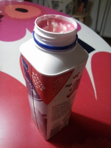
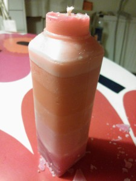

Tykkään näistä uusista puolen litran maitopurkeista, mukavampia käsitellä kuin vanhat neliskanttiset. Hyvä korkki, purkin saa oikeasti kiinni.

Maitopurkkia ihastellessani muistui mieleen kun joskus lapsena tehtiin kynttilöitä vanhoista steariinin jämistä valaen ne maitopurkkiin. Rumia niistä tuli, mutta toimivia. Tämä uusi purkki on enemmän oikean kynttilän muotoinen, joten kokeilinpa palata lapsuuden temppuihin. Kotoa ja pihalta löytyikin kynttilänpätkiä ja tuikkujen jämiä, siispä sulattamaan.

Tässä lopputulos.

\[caption id="attachment\_1922" align="alignnone" width="225"\] Maitopurkki kynttilän valumuottina\[/caption\]

Valumuotin purkaminen kannattaa alkaa pohjasta, ettei pilaa kynttilän pintaa. Aika psykedeelinen lopputulos ;)

\[caption id="attachment\_1923" align="alignnone" width="225"\] Valmis kynttilä\[/caption\]
