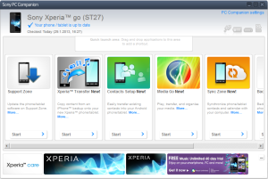
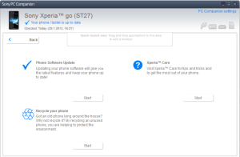

Kakkospuhelimenani on ollut jonkin aikaa Sony Xperia Go, pieni, siisti, halpa mutta vesitiivis Android kapula. Siinä ei käyttöjärjestelmän päivitys onnistukaan suoraan verkosta (FOTA eli Firmware Over The Air). Käyttöjärjestelmän päivitys uudempaan Androidiin tarvitsee avukseen tietokoneen, USB-johdon ja Sony PC Companion ohjelman. Päivitys uusimpaan Sonyn laitteeseen saatavilla olevaan Androidiin käy kutakuinkin näin:

1. Lataa ohjelma Sony PC Companion ja asenna se tietokoneellesi. [http://www.sonymobile.com/global-en/tools/pc-companion/](http://www.sonymobile.com/global-en/tools/pc-companion/)
2. Ohjelman asennuksen jälkeen käynnistä se, minulla ainakin se päivittyi vielä uudempaan versioon.
3. Laita puhelimeesi USB-johto ja liitä se tietokoneeseen. Tarvittavat ajurit asentuvat automaattisesti.
4. Ohjelmisto kertoo sinulle onko uudempaa Android -versiota tarjolla ja voit aloittaa asennuksen samantien.

Tätä kirjoitettaessa uusin Android Sony Xperia Go -laitteeseen on versio 4.0.4

Muutama ruutukaappaus Sony PC Companion -ohjelmasta:

\[caption id="attachment\_1913" align="alignnone" width="300"\] Sony Xperia Go PC Companion\[/caption\]

\[caption id="attachment\_1914" align="alignnone" width="300"\] Sony Xperia Go Update Firmware\[/caption\]

Voihan Sony PC Companion -ohjelmalla tietty tehdä muutakin kuin päivittää Androidin. Voit varmuuskopioida ja synkronoida puhelimesi tiedostoja.
