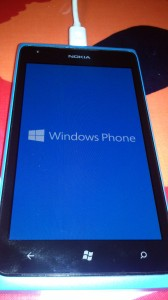
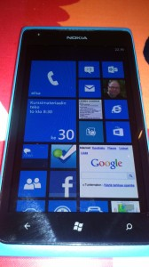

Tänään 30.1.2013 klo 20:00 saapui vihdoin päivitys työpuhelimen käyttöjärjestelmään. Päivitys hoitui Zune -ohjelmalla ja USB-piuhalla, kesto reilut parisenkymmentä minuuttia muutamalla boottauksella.

Uusi Windows Phone 7.8 mahdollistaa nyt mm. "tiilien" koon muuttamisen. Samalla oikeasta sivusta katosi turha käyttämätön musta tila, eli informaatiota mahtuu ruudulle enemmän kuin ennen. Nämä oli isoja muutoksia ainakin käytettävyyden kannalta. Internet Explorerin hakukoneeksi saa nyt vaihtaa Googlen, tärkeä parannus sekin.

Siinä kai ne olennaisimmat parannukset päivityksessä, ei mitään järisyttävää, mutta mukavia uudistuksia.

\[caption id="attachment\_1934" align="alignleft" width="168"\] Windows Phone 7.8 boottaa\[/caption\]

\[caption id="attachment\_1936" align="alignleft" width="168"\] Windows Phone 7.8 kotinäkymä\[/caption\]
