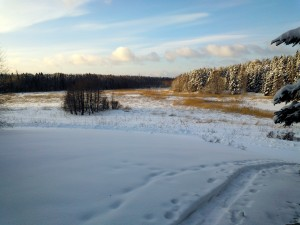

Ilmatieteen laitos kertoi äskettäin, että menossa on pilvisin talvi 25:een vuoteen. Tänään kuitenkin taivas repesi auringonpaisteeseen.

\[caption id="attachment\_1955" align="alignleft" width="300"\] Aurinko paistaa - viikko-7-2013\[/caption\]

Lumikenkäreitilleni on alkanut jo muodostua kunnon polku. Tänään tuli vastaan pariskunta lumikengillä.
