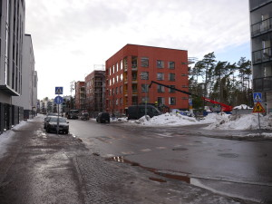
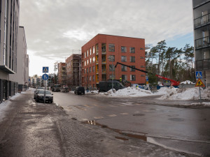
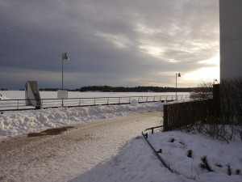
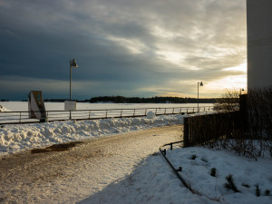

Tähän asti olen digikuvia käsitellyt pääosin Picasalla, sen helppouden ja nopeuden takia. Se on pitkälti riittänyt pokkarikuvien kanssa hääräilyyn. Photoshoppiakin aina välillä käytän, jos jotain erityisempää viilausta on tarvittu. Nyt uuden kameran myötä pääsin vihdoin opettelemaan myös Lightroom -ohjelmaa, kamerahan tallentaa jpg:n lisäksi RAW-muotoon, jos niin haluaa.

Olen aivan aloittelija Lightroomin kanssa, mutta jotain kivaa on tullut jo kokeiltua. Kyllähän siitä säätöjä löytyy. Valkotasapainot saa helposti kuntoon ja valoisyyden säädettyä melko helposti.

\[caption id="attachment\_1971" align="alignleft" width="300"\] Muokkaamaton kuva 1\[/caption\]

 

 

\[caption id="attachment\_1972" align="alignleft" width="300"\] Muokattu kuva 1\[/caption\]

Ennen muokkausta taivas on palanut puhki.

 

 

 

 

Muokkauksen jälkeen tuli taivas ja pilvet paremmin näkyviin.

 

 

 

 

 

\[caption id="attachment\_1979" align="alignleft" width="300"\] Muokkaamaton kuva 2\[/caption\]

 

Vastavalo on hankalaa mutta kiehtovaa.

 

 

 

 

\[caption id="attachment\_1980" align="alignleft" width="300"\] Muokattu kuva 2\[/caption\]

 

Hieman lisää dramatiikkaa.

 

 

 

 

Tästä on hyvä jatkaa Lightroomin oppimista, varmasti on 99% ominaisuuksista käymättä läpi ;)
