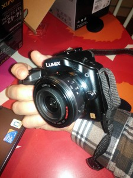
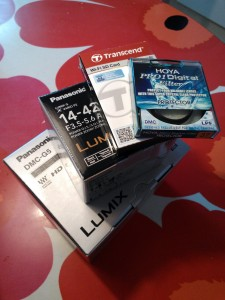

Monen monen vuoden tauon jälkeen (sitten filmiajan) hankin itselleni järjestelmäkameran. Päädyin Panasonic Lumix G5:een hinnan, koon ja käytettävyyden pohjalta. Harkinnassa oli kyllä Olympus OM-D, mutta ajattelin lopulta että tulen toimeen ilman sääsuojaustakin.

\[caption id="attachment\_1959" align="alignleft" width="225"\] Panasonic Lumix G5\[/caption\]

\[caption id="attachment\_1960" align="alignleft" width="225"\] Varustepaketti\[/caption\]

Seuraavana päivänä hankin vielä samantien pikkutelen Lumix G X 45-175mm

Näillä pärjään, aluksi ;)
