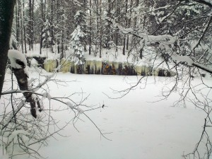

Vuosaaressa, täyttömäen ja Mustavuoren välissä on louhittu monttu, jossa on kallioseinässä mystisiä mittaviivoja. Vedenkorkeusmittareita?

\[caption id="attachment\_1951" align="alignleft" width="300"\] Kalliomaalaus - viikko-6-2013\[/caption\]
