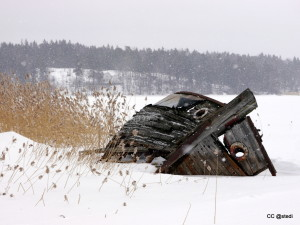

Vanha hylky Ribbingön edustalla. Talvisin pääsee lumikengillä hylyn viereen, kesäisin kun joutuu veneellä vain katselemaan kauempaa ohi ajaessaan. Koskahan tämä on uponnut? Muistan tämän 70 luvulta asti.

\[caption id="attachment\_2032" align="alignleft" width="300"\] Hylky Ribbingössä - viikon 11 kuva\[/caption\]
