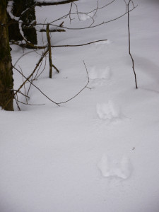
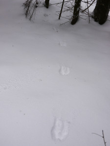
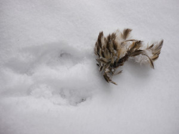

Tänä talvena on tullut tehtyä paljonkin jälkiä lumeen kun on liikkunut lumikengillä pitkin metsiä. Lumisateen jälkeen pääsee näkemään myös muiden eläinten tekemiä jälkiä tuoreessa lumessa.

Tänään löytyi paljon tasatahtiin hypelleen eläimen jälkiä, liekä kärppä ollut?

\[caption id="attachment\_1994" align="alignleft" width="225"\] Kärppä loikkinut?\[/caption\]

\[caption id="attachment\_1995" align="alignleft" width="225"\] Kärppä?\[/caption\]

\[caption id="attachment\_1995" align="alignnone" width="300"\] Pyy lounaaksi?\[/caption\]

Olisipa päässyt näkemään loikat ;)
