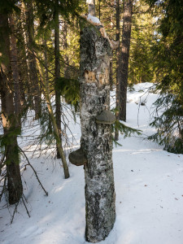
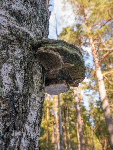
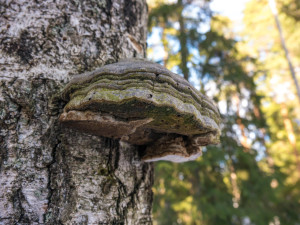
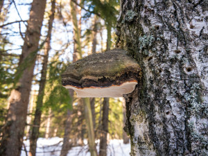

Tuulisena päivänä on mukava lumikenkäillä metsän siimeksessä. Lintumaailmassa on vielä hiljaista, joten voi tutkia vaikkapa kääpiä.

\[caption id="attachment\_2012" align="alignleft" width="225"\] Ruokapuu\[/caption\]

\[caption id="attachment\_2015" align="alignleft" width="225"\] Kääpä\[/caption\]

 

\[caption id="attachment\_2013" align="alignleft" width="300"\] Kääpä\[/caption\]

\[caption id="attachment\_2014" align="alignleft" width="300"\] Kääpä\[/caption\]

 

Mukava että joissain Helsingin metsissä löytyy vielä lahopuita pystyssä. Tätäkin tikka oli kaivellut herkkujen toivossa. Maistuu se lahopuu käävällekin.
