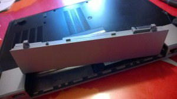
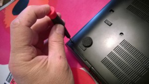
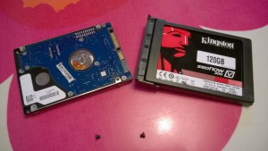

Vanha läppäri, jossa on **Windows 7** käynnistyy hitaasti ja kone käy melko lämpöisenä, jotain on tehtävä. Uusi läppäri on toki yksi vaihtoehto, mutta päätin kokeilla toista reittiä. SSD -levy tuo käynnistykseen ja käyttöön nopeutta, joten sellaisen hankintaan siis. Ylimääräistä Windowsia ei hyllyssäni ole, joten päätin samalla kokeilla kuinka tulisin toimeen Linuxin kanssa. Olen kyllä erilaisia linuxeja kokeillut vuosien saatossa ns. kakkoskoneissani, hyvinhän ne pelittävät, mutta pärjäänkö sen kanssa ykköskoneessa, siinäpä kokeilun ydin. Käytössäni on myös tabletteja sekä älypuhelimia ja nykyisessä multi-device -maailmassa palvelujen ja tiedostojen synkronointi on olennainen asia.<!--more-->

Ensin kuitenkin rauta-asiat kuntoon. Päätin hankkia kokeeksi SSD -levyn halvimmasta päästä, enkä alkaa hifistelemään luku- ja kirjoitusnopeuksien kanssa,  ajattelin, että kyllä tuolla perustasollakin saa huomattavia parannuksia aikaan. Niinpä kaupasta tarttui mukaan 120 Gt **Kingston SSDNOW V300**.

Ennen kuin levyä kiinni laittamaan, latasin verkosta **Linux Mint 17 Qiana**:n ja siitä 64-bittisen Cinnamon -version ISO -kuvan, [http://linuxmint.com/](http://linuxmint.com/ "http://linuxmint.com/"). Poltin sen rompulle valmiiksi, jotta pääsen sitten heti levyn asennuksen jälkeen asentelemaan käyttöjärjestelmää.

## SSD -levyn vaihtaminen

Levyn vaihto oli helppoa kuin kakunpalan syöminen. Ensin akku pois.

\[caption id="attachment\_2105" align="alignnone" width="300"\] Dellin akku irti\[/caption\]

Sitten ruuvimeisselillä vanha kovo irti.

\[caption id="attachment\_2106" align="alignnone" width="300"\] Dellin kovalevy irti\[/caption\]

Uuteen kovalevyyn korotusreunus kiinni mukana tulleilla tarroilla ja vanha päätylevy kiinni.

\[caption id="attachment\_2107" align="alignnone" width="300"\] Vanha 7200 rpm ja uusi SSD kovalevy\[/caption\]

Kiinni koneeseen, ruuvit paikoilleen. Akku takaisin, ja se on siinä.

Sitten Linuxin asennus. Boottaus rompulta, ja Linux Mint asennus alkuun. Helppoa kuin heinän teko, asennusvelho kyselee olennaiset asiat ja homma on valmista n. vartissa. Ensimmäisen käynnistyksen jälkeen on viisasta tietysti päivittää ohjelmisto, siihen meneekin joku tovi, sillä päivityksiä on melko paljon.

## Koneen nopeutuminen

Miten koneen käynnistys nopeutui uudella SSD -levyllä ja Linuxilla?

Vanha Windows 7 ja 7200 rpm kovo

- logon-screenin ilmestyminen 1:42
- kirjautumisen jälkeen työskentely mahdollista vasta reilussa 3 minuutissa (muutama käynnistyvä palvelu hidastaa tätä vaihetta)

Linux Mint ja SSD kovo

- logon-screenin ilmestyminen 0:18
- kirjautumisen jälkeen työskentely mahdollista 0:35 jälkeen, eli ei kerkiä edes kahvia juomaan odotellessa, niin kuin ennen
