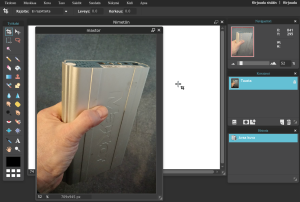

Hankin v. 2015 syksylläToshiba Chromebook 2 tietokoneen. [Kirjoitin silloin lyhyesti Chromebookista](https://teuvovaisanen.fi/2015/09/02/toshiba-chromebook-2-uusi-lappari/) ja pohdin kuinka tämän kanssa tulisin toimeen päivittäisessä työskentelyssä?

Näin aluksi voi suoraan todeta, että Chromebook on pitkälti syrjäyttänyt Windows -koneeni ykköstyökalunani. Syyt ovat yksinkertaisen selkeät.  Chromebook on

- nopea käynnistymään
- kevyt kantaa mukana
- sen ominaisuudet riittävät valtaosaan päivittäisessä käytössä kohtaamistani tietotekniikkatarpeista

Palataanpa listaan, jota pohdiskelin puolisen vuotta sitten.

<!--more-->

## Kuvankäsittely Chromebookissa

Niin, eihän tähän saa Photoshoppia. En ole designer, joten en fotaria tarvitsekaan, ja voi kuvia käsitellä muutenkin. Chromebookissa sovellukset ovat selaimessa ja niitä voi ladata Chrome Web Storesta, jossa kuvien käsittelyyn riittää vaihtoehtoja [https://chrome.google.com/webstore/category/app/28-photos](https://chrome.google.com/webstore/category/app/28-photos)

Itse nappasin sieltä Pixlr -ohjelman, joka on ihan ok, löytyy tasot ja kaikki ;)

Niin ja voihan kuvia muokata selaimessa useammassakin verkkopalvelussa. Muun muassa Google Kuvat sisältää myös oman simppelin editorin. Valtaosa kuvista tulee nykyään otettua kännykällä, siinäkin voi muokata kuvia galleriasovelluksella jne..

## Koulutusmateriaalin valmistaminen ja esittäminen

Olen Web-aihealueen kouluttaja, joka tarvitsee esitysmateriaalia ja Webiä.  Chromebook suoriutuu esityskoneena ihan mainioisti. HDMI-liitin mahdollistaa tykin liittämisen ja sen lisäksi olen käyttänyt Chromecast -tikkua apunani. Chromecast -sovellus Chromessa mahdollistaa välilehden tai koko selainikkunan castaamisen vaikka tykille tai televisioon.

Chromebookissa on sisäänrakennettu screenshot - ruudunkaappaustoiminto, jonka avulla saa näytöltä kuvamateriaalia suoraan esitysohjelmaan. Esitysohjelmana on tietysti Google Slides ja tallennuspaikkana Google Drive. En juurikaan ole Powerpointtia kaivannut, vaikka onhan tuo Slides sitä rajoittuneempi.

Teen nykyään valtaosan koulutusmateriaaleistani pelkästään Chromebookia käyttäen.

## Crouton ja Linux

Monet Web-koodaajat käyttävät Chromebookin rinnalla Linuxia. Crouton -ohjelman avulla Chromebookista voi valjastaa dual-boot tyyppisenkoneen, jossa välillä voi työskennellä Chrome OS ja välillä Linux -ympäristössä. Kokeilin tätä heti alkajaisiksi ja sainkin Linuxin Chrome OSn rinnalle. Itselläni ei kuitenkaan ollut pakottavaa tarvetta Linuxille, joten palasin puhtaan Chrome OSn pariin nopeasti.

Kaiken lisäksi Chromebookiin saa SSHn helposti Chrome -sovelluksella **Secure Shell** jonka voi ladata Crome Web Storesta.

## Frontend koodaus ja työkalut

Tässä osiossa Chromebook on heikoimmilla verrattuna esim. Windows -koneeseen. Chromebookiin ei ole hyvää HTML / CSS -/ JavaScript editoritarjontaa. No on jotain, Caret, Zed ja sitten pilvipalveluita, joissa koodaus tehdään selainikkunassa, mutta en tykkää ;)

Itse jos/kun koodaan jotain, käytän suosiolla Windows -konettani sillä sinne on paremmat editorit ja paikallinen Web-palvelin esim. XAMPPin avulla.

## Pilvipalvelut ja Chromebook

Google Drive on elimellisesti integroitu Chromebookkiin ja sitä tuleekin ensisijaisesti käytettyä nykyään. Chromebookin oma tallennustila on rajallinen, toki itsekin laajensin sitä 32 Gt SD-kortilla.

OneDrive ja muut pilvipalvelut toimivat Chromebookissa selaimessa, ei siis integrointia kovalevyn kanssa niin kuin Google Drive. Eli toimeen tulee riittävän hyvin.

## Yhteenveto

Loppujen lopuksi siirtyminen Chromebookin käyttäjäksi oli mutkatonta, sillä valtaosa asioista tehdään nykyään selaimessa ja siinähän Chromebook loistaa. Chromebook soveltuu mainiosti tavalliselle internetin käyttäjälle, joka hyväksyy ja omaksuu pilvipalveluideologian. Sellainen käyttäjä minäkin ainakin valtaosin olen ;)

Chromebookin käyttöjärjestelmä ChromeOS päivittyy säännöllisesti ja automaattisesti ja kaiken lisäksi se sisältää virustorjunnan.

Vielä kuitenkin on Windows -koneille sijansa  minunkin huushollissa, yksi toimii musiikkistudiona ja toinen sitten koodauskoneena ja kun tarvitsen MS-teknologiaa kuten esim. Lync / Skype -palaverointia yms.
