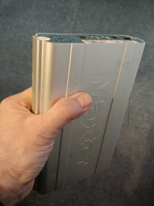
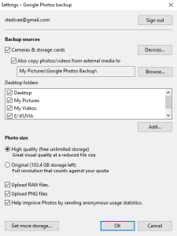
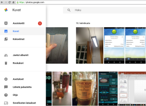

Olen nähtävästi siirtynyt paperikuvista digikuviin joskus 2000-luvun alkupuolella. Se selviää, kun katselee digikuvien varmuuskopiontiin käyttämiäni ulkoisia USB-kovalevyjä. Vanhimpien levyiltä löytyneiden kuvien aikaleimat ovat sieltä 2002 tienoilta, siis reilu 10 vuotta sitten. Vanhin USB-kovalevykin on siis jo melko vanha. Sehän tässä on jo vuosia pelottanut, mitä jos ne levyt hajoavat? Tekisikö varmuuskopion USB-levystä, vai miten kuvien säilymisen varmistaisi? Sain vihdoin aikaiseksi aloittaa varmuuskopioinnin varmuuskopioinnin ;)

\[caption id="attachment\_2520" align="alignnone" width="225"\] wanha maxtor\[/caption\]

<!--more-->

## Google Kuvat

Olin jo päättänyt, etten ala tekemään enää fyysisiä kopioita ja kasvattamaan laitemäärää hyllyssäni. Siispä kuvat verkkoon tai pilveen, niin kuin nykyään sanotaan. Palveluksi valikoitui Google Kuvat, pitkälti siitä syystä että siellä on rajaton tallennustila, kunhan ei täysresoluutiolla tarvitse tallentaa. No täysreso on jo USB:llä, enkä ole reilun 10 vuoden aikana teettänyt kuvistani yhtään edes A-4 kokoista printtiä, niin so what, en varmaan tarvitse täyttä resoa jatkossakaan. Google tallentaa aivan riittävän hyvällä resoluutiolla, jos mielii tavallisia 10x15 kuvia itselleen niistä teettää.  Toinen olennainen syy palvelun valintaan oli se, että tableteistani ja kännyköistäni olin jo pitkään hoitanut varmuuskopioinnin automaattisesti Google Kuviin. Nyt oli enää kyse wanhojen kuvien siirrosta uudempien joukkoon.

Siirto oli helppo operaatio, joskin vei aikaa parisen päivää, sillä kuvia oli 30000+ ja ne olivat ripoteltuna pitkin USB-levyille ja niissä eri kansioihin,. Tarkistin kansiot silmämääräisesti, ennen kuin aloitin backupin. Itse backup oli helppoa.

1. Latasin ja asensin tietokoneelle Google Kuvat synkronointiohjelman [https://photos.google.com/apps](https://photos.google.com/apps)
2. Kytkin kovalevyn tietokoneeseen ja laitoin asetuksissa polut kuvien sijaintiin

\[caption id="attachment\_2522" align="alignnone" width="225"\] Google Kuvat synkronointi\[/caption\]

Tämän jälkeen homma hoituikin automaattisesti ja kuvat valuivat pilveen itsestään.

Jos levyllä on paljon kuvia, kannattaa tietokoneessa laittaa asetukset sellaisiksi, ettei kone mene nukkumaan, silloinhan siirto keskeytyy. Windowsissa ne löytyvät kohdasta **Power & sleep settings**

Kuvien siirtämisen jälkeen kuviin pääsee käsiksi mobiililaitteiden Google Kuvat -sovelluksella (Android ja iOS) sekä tietty selaimella osoitteessa [https://photos.google.com/](https://photos.google.com/) oman Google tilin kirjautumisen avulla.

\[caption id="attachment\_2523" align="alignnone" width="300"\] Google Kuvat verkossa\[/caption\]

Kun kuvaan järjestelmäkameralla, siirrän kuvat SD-kortilta kovalevylle. Jos haluan kaikkien siirrettyjen kuvien valuvan verkkoon automaattisesti, tulee synkronointiohjelman tietysti tietää kansio, jossa kuvat ovat. Toinen vaihtoehto on käyttää Picasa -ohjelmaa ja siirtää sen avulla vain valitut kuvat verkkoon talteen.

Nyt varmuuskopioinnin suoritettuani on helpottunut olo, kuvat ovat paremmassa tallessa kuin omilla levyilläni. Myös kuvien katselu on nyt huomattavasti helpompaa, sen kuin avaa tabletin appin tai tietokoneella selaimen ja alkaa pläräämään.
