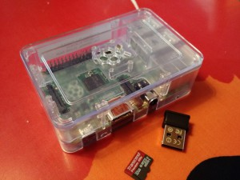
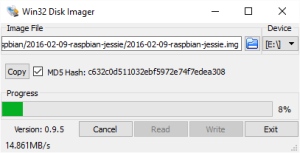
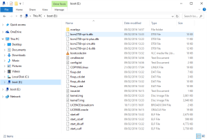
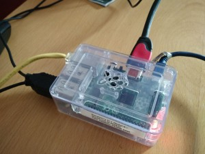
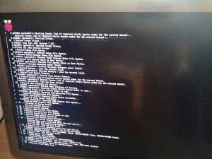
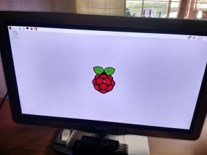

Sain ex-duunikaveriltani käyttämättömänä lojuneen RaspBerryn. Mukana tuli kotelo ja jonkinlainen näyttökin. Muistikortin ja Wi-Fi kävin ostamassa, microUSB -laturi, ethernet-kaapeli sekä HDMI telkkariin on jo ennestään.

\[caption id="attachment\_2550" align="alignnone" width="300"\] Raspberry Pi\[/caption\]

Eiköhän noilla pääse alkuun. Jotain tällä vois kehitellä, kunhan sen ensin saa pystyyn. Yks projekti onkin jo mielessä.<!--more-->

## Käyttöjärjestelmän asennus

Siispä käyttöjärjestelmää lataamaan, siitä onkin verkossa selkeät ohjeet.

[Installing Operating System Images](https://www.raspberrypi.org/documentation/installation/installing-images/)

Pääkohdat ovat karkeasti seuraavat:

1. **Lataa Raspbian käyttöjärjestelmäpaketti** [https://www.raspberrypi.org/downloads/](https://www.raspberrypi.org/downloads/), latausta odotellessa voit tehdä jotain fiksua, kuten lukea asennusohjeita tai purkaa tiskit koneesta tms.
2. **Pura käyttöjärjestelmäpaketti ja siirrä ne kortille**, itse käytin tähän siirtoon  Win32DiskImager -ohjelmaa
    
    \[caption id="attachment\_2558" align="alignnone" width="300"\] Win32DiskImager-Raspbian\[/caption\]
    
    Purettu käyttöjärjestelmä SD-kortilla
    
    \[caption id="attachment\_2559" align="alignnone" width="300"\] Raspbian-microSD\[/caption\]
3. **Laita kortti Raspberry PI muistipaikkaan, piuhat kiinni ja boottaa**

\[caption id="attachment\_2561" align="alignnone" width="300"\] Raspberry-piuhat-kiinni\[/caption\]

\[caption id="attachment\_2562" align="alignnone" width="300"\] Raspberry-boot\[/caption\]

\[caption id="attachment\_2563" align="alignnone" width="300"\] Raspbian-TV\[/caption\]

Laitteen käyttöönotto oli helppoa. Tästä ne vaikeudet alkavat ;) Mihin tätä nyt sitten käyttäisi?
