WordPress -ohjelmiston asennus omalle koneelle on helppoa, kunhan pohjalle tarvittava ympäristö on ensin saatu pystyyn ja toimintakuntoon ([tutustu osa 1 artikkeliin](https://teuvovaisanen.fi/2016/02/04/wordpress-asentaminen-omalle-koneelle/)). WordPressin voi asentaa itse käsipelillä tai sitten käyttää apuna esim. Bitnami installeria.

WordPressin itseasentamisen vaiheet ovat pääpiirteissään seuraavat:

<!--more-->

1. Tehdään tietokanta tietokantapalvelimelle
2. Ladataan WordPress -ohjelmisto ja puretaan tiedostot Web -palvelimen kansioon
3. Muokataan konfiguraatio-tiedosto vastaamaan tietokannan tietoja
4. Ajetaan asennusskripti selaimella

Tämä itse käsipelillä tehtävä asentaminen on kattavasti dokumentoitu WordPressin sivustolla. [https://codex.wordpress.org/Installing\_WordPress](https://codex.wordpress.org/Installing_WordPress)

## WordPress asennus Bitnami installerilla

Me käytämme tässä artikkelissa vielä helpompaa tapaa asentaa WordPress. XAMPPin latauksen yhteydessä on useaan otteeseen mainittu tämä Bitnami installer. Se on kolmannen osapuolen paketoitu kokonaisuus, jolla WP:n asentaminen tapahtuu kädenkäänteessä. Bitnami Installerista on kaksi versiota, toisessa on mukana Web- ja tietokantapalvelimet WordPressin lisäksi (stack) ja toisessa on vain itse WordPress (moduuli). Me käytämme tässä moduulia, sillä XAMPP on jo asennettu, ja siinähän on jo nuo palvelimet.

Pienenä miinuksena on se, että se asentuu palvelimelle /wordpress/ kansioon, ei palvelimen juureen. Bitnami tarjoaa monen muunkin järjestelmän installereita, esim. Drupal, Joomla, Moodle jne. ja ne kukin asentuvat omiin kansioihinsa.

1. Lataa ensin WordPress **\-moduulin** asennustiedosto koneellesi osoitteesta [https://bitnami.com/stack/wamp/modules#wordpress](https://bitnami.com/stack/wamp/modules#wordpress)
2. Tutustu ohjeisiin jos kiinnostaa eikä sinulla ole liika hoppu ;)  
    [https://wiki.bitnami.com/Infrastructure\_Stacks/Bitnami\_for\_XAMPP](https://wiki.bitnami.com/Infrastructure_Stacks/Bitnami_for_XAMPP)  
    Kun olen lukenut ohjeet, on sinulla suunnilleen käsitys mitä seuraavaksi tapahtuu. Nyt käynnistetään itse asennus.
3. Käynnistä ensin XAMPP Control Panelista Apache ja MySQL -palvelut käyntiin Start -painikkeella.  
    [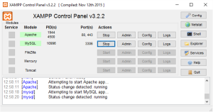](https://teuvovaisanen.fi/wp-content/uploads/2016/02/XAMPP-on.png)
    
4. Kun palvelimet ovat päällä, käynnistä WordPress -asennus lataamastasi asennustiedostosta ja seuraa näytön ohjeita.  
    
    
5. Valitse asennuskieli ja siitä se asennus lähtee  
     [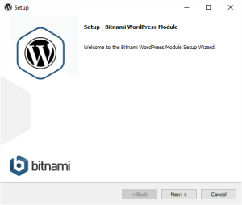](https://teuvovaisanen.fi/wp-content/uploads/2016/02/Bitnami-step1.png)
6. Valitse asennuskansio, sama kuin mihin olit XAMPPin asentanut aiemmin.  
     [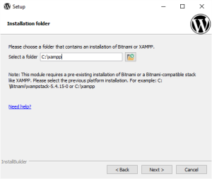](https://teuvovaisanen.fi/wp-content/uploads/2016/02/Bitnami-step2.png)
7. Anna käyttäjätunnus WordPress -järjestelmään.  
    Merkitse nämä muistiin, tarvitset niitä kirjautuessasi WordPressiin sisään.  
     [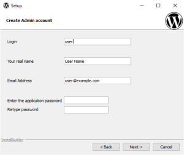](https://teuvovaisanen.fi/wp-content/uploads/2016/02/Bitnami-step3.png)
8. Anna sivustolle nimi, voit muuttaa tämän myöhemmin jos haluat.  
     [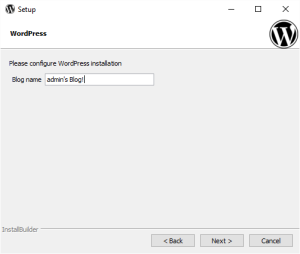](https://teuvovaisanen.fi/wp-content/uploads/2016/02/Bitnami-step4.png)
9. Määritä sähköposti, mikäli haluat testiympäristösi pystyvän lähettämään sähköpostia esim. lomakkeista. Älä käytä omaa sähköpostia, vaan tee tälle toiminnolle oma tili Googleen. Voit myös olla käyttämättä ominaisuutta.  
     [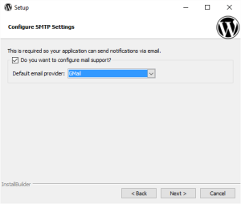](https://teuvovaisanen.fi/wp-content/uploads/2016/02/Bitnami-step5.png)
10. Jatka sähköpostin määrityksellä, mikäli rastitit ominaisuuden.  
      [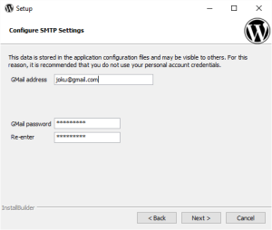](https://teuvovaisanen.fi/wp-content/uploads/2016/02/Bitnami-step6.png)
11. Mainos, jonka voit ohittaa.  
      [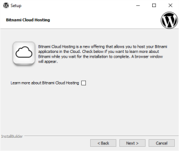](https://teuvovaisanen.fi/wp-content/uploads/2016/02/Bitnami-step7.png)
12. Asetusten määrittämisen jälkeen on aika alkaa asennus.  
      [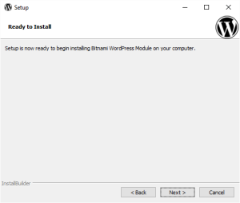](https://teuvovaisanen.fi/wp-content/uploads/2016/02/Bitnami-step8.png)
13. Asennus etenee  
      [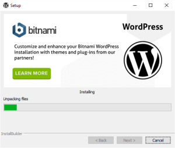](https://teuvovaisanen.fi/wp-content/uploads/2016/02/Bitnami-step9.png)
14. Lopuksi paina Finish.  
      [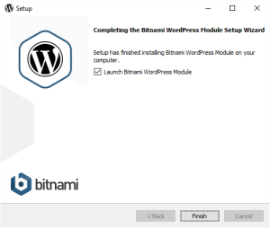](https://teuvovaisanen.fi/wp-content/uploads/2016/02/Bitnami-step11.png)
15. Selain avaa valmiin WordPress -sivuston.  
     [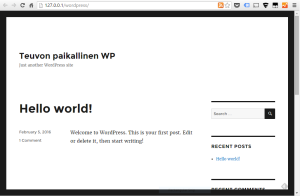](https://teuvovaisanen.fi/wp-content/uploads/2016/02/Bitnami-step12.png)
     

Näin helppoa se oli :)  
Pääset WordPress -järjestelmän hallintapuolelle Meta -otsikon alta **Log in** -linkistä.  
Käytä tunnuksia jotka äsken asennuksessa annoit.  Toinen vaihtoehto sisäänkirjautumiseen on ottaa selaimeen osoitteeksi asennuskansion alta wp-admin -kansio. Tässä esimerkissä siis http://localhost/wordpress/wp-admin

Localhost on sama kuin 127.0.0.1

Bitnami installer asentaa WordPressin hieman poikkeavaan kansioon, eli varsinaiset tiedostot löytyvät Windows-koneissa polusta `C:\xampp\apps\wordpress\htdocs`

No niin, siinä se on, valmis WordPress odottaen kaikkea sitä mitä haluatkin, mars konfaamaan ja opettelemaan! ;) Oman koneen ja oman toimintakuntoisen WordPressin kanssa voi tulla vaikka [WordPress kurssillenikin opettelemaan](https://teuvovaisanen.fi/kurssit/kotisivut-helposti-wordpress-jarjestelmalla/) ;)

p.s. WordPress kun taitaa olla maailman yleisin CMS, niin crackerit kehittävät murtautumiskeinoja siihen tietenkin tosi paljon. Ensisijaisen tärkeää on aina pitää ohjelmistot uusimmissa testatuissa versioissa. Tämä on onneksi helppoa WordPressissä, sillä siinä on mahdollista ottaa automaattinen päivitys käyttöön.

Happy WordPressing!
