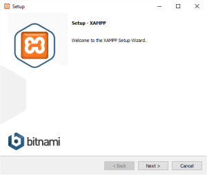
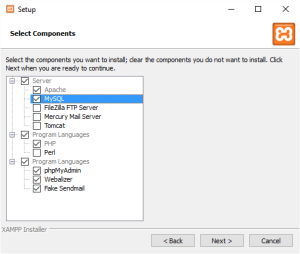
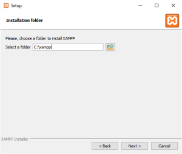
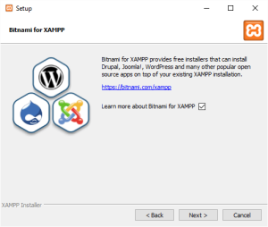
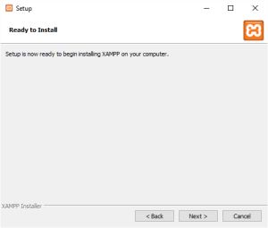
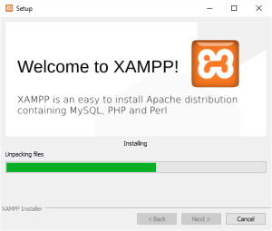
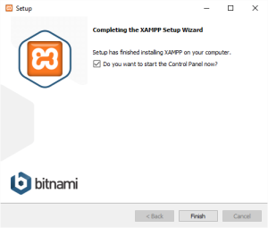
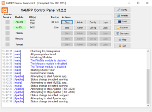
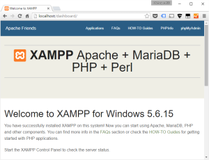
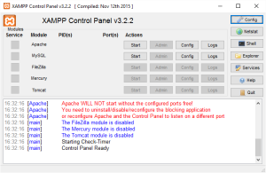

## Yleistä WordPress -asiaa

WordPress on eräs maailman yleisimmistä CMS -järjestelmistä. Eikä syyttä, ohjelmisto on erinomainen esimerkki Open Source -ohjelmistojen laadusta. WordPress on helppo ottaa käyttöön hyvässä Web-hotellissa, sivuston saa aikaiseksi alta aikayksikön ja sisällöntuotantotyökalut on helppo oppia. Moni WordPressiä käyttöön ottava haluaisi kuitenkin hieman harjoitella ensin, ennen kuin tekee sen oikean sivuston sinne Web-hotellin serverille. Opetteluun on kaksi helpohkoa tapaa:

- **kokeillaan ohjelmaa ilmaiseksi [WordPress.com](http://wordpress.com) -palvelussa,**  
    tee vain tunnukset ja perusta sivusto verkossa olevaan palveluun  
    tai
- **asennetaan WordPress omalle koneelle,**   
    hieman monimutkaisempi, mutta aina mukana omalla koneella oli nettiä tai ei

Tässä artikkelissa ja sitä seuraavassa jatkoartikkelissa tutustutaan tuohon jälkimmäiseen tapaan. Käydään läpi se, miten WordPress asennetaan omalle tietokoneelle.

<!--more-->

Vaiheet ovat pääpiirteissään seuraavat:

1. Ladataan ja asennetaan XAMPP, tietokanta- ja Web-palvelinohjelmistot omalle koneelle (tämä artikkeli)
2. Ladataan ja asennetaan WordPress -ohjelmisto XAMPPiin

Omalle koneelle itse asennetussa WordPressissä on se mukava piirre, että se on täysverinen WordPress ja se näkyy vain sinulle, eli voit tehdä sen kanssa turvallisesti kokeiluja ilman että muut Internetin käyttäjät näkevät sivustoasi. Tätä "piilossa" -ominaisuutta kysytään lähes jokaisella [WordPress kurssillani](https://teuvovaisanen.fi/kurssit/kotisivut-helposti-wordpress-jarjestelmalla/).

WordPress tarvitsee toimiakseen tietokannan ja Web-palvelimen sekä PHP-ympäristön. Web -hotelleissa nämä yleensä on toteutettu Linux -palvelimella olevalla MySQL -tietokannalla sekä PHP -ohjelmointikielen avulla. Tälläistä kokonaisuutta kutsutaan yleisesti LAMPiksi. (Linux, Apache, MySQL, PHP = LAMP). Tässä artikkelisarjassa käytetään kuitenkin Windows -konetta ja vastaavan ympäristön saa pystyyn erilaisilla paketoiduilla ohjelmistoilla kuten, WAMPP ja /tai XAMPP. Jos käytät Macciä on sille tarjolla XAMPPin lisäksi myös MAMP. Tässä artikkelissa kuvakaappaukset ovat Windows 10 -koneesta, mutta periaate asennukseen on sama Maceissa. Näissä XAMPP, WAMP, MAMP -paketeissa on se kiva puoli, että niiden kanssa voi tehdä ja kokeilla WordPressin lisäksi kaikkea muutakin Web-sivujen kanssa. Mikäli tiedät, ettet tarvitse XAMPPia sekalaiseen Web-kehitykseen, voit ladata ja asentaa [Bitnami WordPress Stack](https://teuvovaisanen.fi/2018/06/23/bitnami-wordpress-stack/)in ja pääset WP -asennuksessa vieläkin helpommalla, seuraa ed. linkkiä ko. artikkeliin.

Uusimmissa XAMPP -paketeissa MySQL -tietokanta on kovattu MariaDB -tietokannalla, mutta sen ei pitäisi aiheuttaa ongelmia. MariaDB on kehitetty MySQLn pohjalta.

## XAMPP -ohjelmistopaketin lataus ja asentaminen

Lataa verkosta XAMPP -ohjelmisto osoitteesta [https://www.apachefriends.org/](https://www.apachefriends.org/) , ohjelmisto on Open Source, eli maksuton. Voit toki tukea kehittäjiä rahallisesti jos niin haluat ;)

Asenna ohjelmisto käynnistämällä ladattu tiedosto kaksoisnapsauttamalla.

Seuraa normaali ohjelmistonasennusrutiini, voit periaatteessa hyväksyä kaikki asennuksen ehdottamat vaiheet.

Voit valita eri ohjelmistoja asennukseen mukaan, ao. kuvassa poistettu ruksit ohjelmista, joita ei WordPressissä tarvita.  

Valitse asennuspaikaksi jokin muu kuin tyypillinen Program Files, tee esim. niin kuin alla:  
 

Voit valita helpon tien WPn asentamiseen, se onnistuu Bitnami for XAMPP installereiden avulla. Voit tutustua aiheeseen myöhemmin, jatketaan tässä kohtaa vain XAMPP -perusohjelmiston asennusta.  
 

 

Asennus etenee  

Loppu häämöttää, paina Finish.  
 

Web -palvelin, tietokantaohjelmisto ja PHP ympäristö on asennettu.

Nyt on testattava että kaikki toimii. Avaa XAMPP Control Panel (oranssi kuvake) ja käynnistä Apache sekä MySQL **Start** -painikkeista.  

Mikäli Apache ja MySQL tekstit ovat ja pysyvät vihreinä, eikä tekstikentässä näy virheilmoituksia, olet onnistunut asennuksessa. Avaa vielä selain ja siirry osoitteeseen http://localhost , näkymän pitäisi olla jotain tälläistä:

Nyt sinulla on täysiverinen PHP -kehitysympäristö koneellasi. Voit aina tarvittaessa käynnistää Web-palvelimen ja käytön jälkeen sulkea sen. Voit vaikka tehdä tavallisia staattisia Web-sivuja ja laittaa ne **httpdocs** -kansioon joka on palvelimen juurihakemisto. Sinne otetaan sitten selaimella yhteys http://localhost/tiedoston-nimi.htm

## Virhetilanteet

Aina ei asennus mene kuitenkaan niin kuin Strömsössä, vaan jotain menee pieleen. Todennäköisin virhe on se, ettei Web-palvelin suostu käynnistymään. Syy siihen on yleensä se, että tietokoneellasi on jokin muu ohjelma, joka käyttää samaa tietoliikenneporttia 80, jota Apachekin käyttää HTTP -liikenteeseen.

Syy on siis jokin toinen ohjelma, mikä se on, se sinun täytyy itse tutkia. Itselläni se usein on ollut Skype, jonka sammuttaminen tai poistaminen koneelta ratkaisee ongelman bootin jälkeen. Joskus koneella on toinen Web-palvelin, esim. IIS ja se käyttää myös 80 -porttia.

Toinen korjauskeino blokkaavan ohjelmiston poistamisen sijasta on konfiguroida XAMPPin Apache käyttämään vaihtoehtoista porttia 80 sijasta, esim. porttia 8080, se tehdään Apachen konfiguraatiotiedostoon **httpd.conf**  joka löytyy asennuskansiosta, esim. C:\\xampp\\apache\\conf  
Lue lisää aiheesta Apachen dokumentaatiosta: [https://httpd.apache.org/](https://httpd.apache.org/)

Tämän jälkeen on siis vuorossa itse [WordPressin asennus, josta voit lukea osassa 2](https://teuvovaisanen.fi/2016/02/05/wordpress-asennus-omalle-koneelle/).
