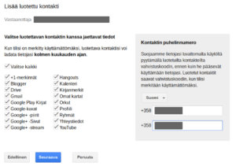

Kukaan meistä ei hillu täällä ikuisesti. Jossain vaiheessa tulee koiranputken puskenta eteen, väistämättä. Mitä sitten tapahtuu GMail -posteillesi, Google Kuvat -valokuvillesi ja muille Google -tilin takana oleville digitaalisille sisällöillesi? Digitaalinen testamentti on tehtävä, jos haluat turvata valokuvien ja kenties muun tärkeän sisällön säilymisen ja jakamisen perinnöksi haluamillesi edunvalvojille.

<!--more-->

## Google tilipalvelu

Voit hallita oman Google -tilisi asetuksia osoitteessa [https://myaccount.google.com](https://myaccount.google.com)

Suosittelen lämpimästi vierailemaan osoitteessa, mikäli et koskaan ole tarkastellut oman Google -tilisi asetuksia. Googlen tilipalvelussa voit keskitetysti hallinnoida oman tilisi asetuksia, tietoturvaa, tilin poistoon liittyviä asetuksia jne.

## Digitaalinen testamentti - edunvalvojan valinta

Tilipalvelussa voit myös valita edunvalvojan(t) omalle Google -palveluissa olevalle datallesi tilanteeseen, jossa et ole käyttänyt tiliäsi pitkään aikaan (sairaus, menehtyminen tms.). Ominaisuus on Google tilipalvelussa nimellä: **tilin käyttämättömyyden hallinta**. Voit määrittää maksimissaan 10 henkilöä, joille Google erikseen ilmoittaa tilisi käyttämättömyydestä. Voit itse päättää mitä ilmoitusteksti läheisillesi/edunvalvojillesi on ja määrittää mitä kukin saa tiedoillasi tehdä, vai saako mitään. Google ei ilmoita valitsemillesi henkilöille mitään, ennen kuin tilisi käyttämättömyyden ehdot täyttyvät. Itse valitsemani edunsaajat eivät ole ainakaan vielä Googlelta postia saaneet, olen siis ehkä elossa :)

\[caption id="attachment\_2759" align="alignnone" width="300"\] Google sisällöt\[/caption\]

Voit tietysti myös olla valitsematta edunvalvojaa ja päättää että Google yksinkertaisesti poistaa tilisi ja siihen liittyvän datan, kun tili on käyttämättä riittävän pitkään. Valinta on sinun.

## Muut palvelut

Google tilipalvelu tietysti hallinnoi dataa, joka on vain Googlen palveluissa. Samankaltainen testamentti on siis tehtävä eri palveluissa kussakin erikseen.  kuten esimerkiksi Facebook, Twitter jne. mikäli haluaa että palvelun sisällölle tapahtuu se mitä omistaja haluaa, siis sinä itse.

## Ei digitaalista testamenttia

Mikäli et ole huolehtinut oman digitaalisen sisällön jälkihoidosta, eivät  omaiset / edunsaajat pääse välttämättä sisältöihin käsiksi.  Pääsääntöisesti eri palveluntarjoajat eivät luovuta sisältöjä kenellekään, kun datan omistaja ei ole siitä mitään ohjeistusta antanut.

Lisätietoja aiheesta Wikipediassa: [https://en.wikipedia.org/wiki/Death\_and\_the\_Internet](https://en.wikipedia.org/wiki/Death_and_the_Internet) sekä eri palveluiden omilla tukisivuilla.

**Tee edunsaajallesi / omaisellesi palvelus: tee etukäteen itse digitaalinen testamentti käyttämissäsi palveluissa nyt, kun siihen vielä kykenet!**
