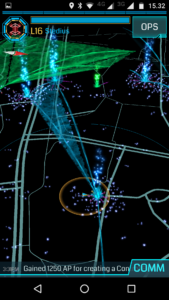
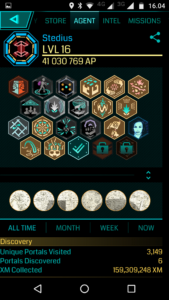
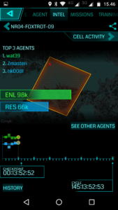

## Mitä Ingress on?

> Ingress on massiivinen monen pelaajan verkkopeli, joka käyttää avuksi lisättyä todellisuutta ja jota pelataan älypuhelimella.

Ingressiä sanotaan usein peliksi, jossa on piirteitä geokätköilystä ja lipunryöstöstä. Ingressissä on kaksi joukkuetta (faction), jotka pelaavat toisiaan vastaan

- siniset (resistance/vastarinta/ "smurffit") ja
- vihreät (enlightened/valaistuneet/ "sammakot")

Peliä voi pelata puhelimellaan (Android tai iOS) ihan yksinäänkin, mutta parasta sosiaalisuutta on kun useat saman joukkueen pelaajat pelaavat yhdessä saman tavoitteen eteen.

<!--more-->

Ingress -pelaaja (agent) valtaa portaaleja, jotka ovat oikeita paikkoja maailmassa, kuten patsaita, grillikatoksia, majakoita, puiston kylttejä jne. Valtaamiaan portaaleita voi linkittää toisiinsa, tehden kenttiä, joiden alla vastapuoli ei voi tehdä omia linkkejään eikä kenttiään. Peliä pelataan puhelimella käyttäen maksutonta Ingress -karttasovellusta, joka näyttää paikannuksen avulla skannerin näytössä lähellä olevat portaalit, linkit ja kentät.

\[caption id="attachment\_2743" align="alignnone" width="169"\] Ingress skanneri puhelimessa\[/caption\]

Pelissä on lapsellinen taustatarina, mutta sen voi jättää omaan arvoonsa ja ottaa pelistä hyötyjä esim. liikkumiseen ja vaikka matkustukseen. Pelatakseen on lähdettävä ulos, eli fyysisesti mennä portaalien luokse, ennen kuin voi tehdä mitään. Tämä on siis oiva peli liikkuvalle ihmiselle ja/tai saada ihminen liikkumaan. Pelin myötä tulee helposti käveltyä pari tuntia ympäriinsä portaalilta toiselle ja kilometrejä kertyy niin, että 10000 askelta päivässä -tyyppiset tavoitteet toteutuvat helposti. Itse laihduin pelin aloittamisen jälkeen 8 kiloa helposti, vain liikkumalla. Olen myös tutustunut kymmeniin pelikavereihin, aika mukavia ihmisiä tämän pelin parissa on, aikuisia valtaosa. Peliä voi pelata kävellen, pyörällä, autolla, metrolla, raitiovaunullakin, miten itse haluaakin liikkua.

Pelin alussa täytyy valita kumpaan puoleen haluaa kuulua. Itse pelaan sinisessä (resistance) joukkueessa pelinimellä Stedius. Kannattaa harkita tarkkaan kumpaan factioniin liittyy, sillä puolta voi vaihtaa vain kerran, jos niin haluaa. Tervetuloa siniseen leiriin! ;)

Peliä voi pelata kukin omalla tavallaan ja omaan tahtiinsa. Pelissä on toki sisäänrakennettu kannustusjärjestelmä, tasot sekä mitalit, jotka voivat toimia mukavana kannustimena liikkua entistä enemmän.

\[caption id="attachment\_2747" align="alignnone" width="169"\] Ingress tasot ja mitalit\[/caption\]

Ingressissä on myös joukkueiden välinen pistelaskujärjestelmä, jossa 7 x 25 tunnin tarkistuspisteiden (checkpoint) kohdalla lasketaan kummalla joukkueella on enemmän alueita hallussaan ja reilun viikon cyclen lopuksi toinen voittaa. Sitten alkaa taas uusi cycle ja uusi kisa puhtaalta pöydältä.

\[caption id="attachment\_2746" align="alignnone" width="169"\] Ingress cycle\[/caption\]

Parhaan käsityksen siitä miten peliä pelataan saa katsomalla englanninkielisen johtantovideon Youtubesta:

https://youtu.be/Y6-JAm3NCAk

## Ingress -linkkejä

- [https://www.ingress.com/](https://www.ingress.com/) Ingress -pelin koti: täältä voit mm. ladata sovellukset puhelimeen / tablettiin
- [https://support.ingress.com/hc/en-us](https://support.ingress.com/hc/en-us) Ingress Help
- [https://www.youtube.com/user/ingress](https://www.youtube.com/user/ingress) Ingress Youtube -kanava
- [http://resistance.fi/index.php/ingress\_sanasto/](http://resistance.fi/index.php/ingress_sanasto/) Ingress Resistance -sivustolla on sanastoa, jota pelissä käytetään
