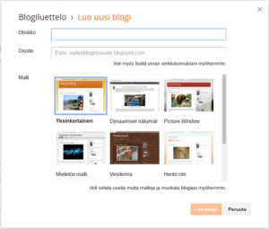
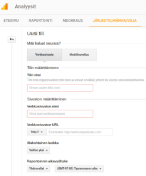

[Google Analytics -kurssillani](https://teuvovaisanen.fi/kurssit/google-analytics-ja-hakukoneoptimointi/) tapaan usein asiakkaita, jotka haluavat oppia Web-analytiikkatyökalun hallinnan ja käytön, mutta heille ei ole annettu täysiä käyttöoikeuksia käytössään olevaan GA -tiliin tai jopa niin, ettei ole laisinkaan sivustoa, jota analysoisi. Olen neuvonut heitä perustamaan yksinkertaisen sivuston Blogger -palveluun ja tekemään Google Analytics -palvelussa uuden tilin, johon liittää tuon Blogger -sivuston. Bloggerissa ylläpidettävään sivustoon on todella helppo liittää Google Analytics ja kun sivusto ja GA -tili on "oma" niin GAssakin voi opetella administrator -tason ylläpitotoimia.<!--more-->

## Sivuston luominen Bloggeriin

Blogger on Googlen palvelu, joten sivuston perustamiseen tarvitaan Google -tili (siis se GMail).

1. Suuntaa selaimella osoitteeseen [https://www.blogger.com/](https://www.blogger.com/)
2. Kirjaudu sisään, ellet ole jo kirjautuneena
3. Luo uusi blogi, voit valita ulkoasuteeman heti alussa.

\[caption id="attachment\_2869" align="alignnone" width="300"\] Luo uusi Blogger sivusto\[/caption\]

Tee edes yksi sisältösivu uuteen sivustoosi, jotta siinä voisi vierailla selaimella. Paina mieleen sivustosi osoite, sehän on muotoa https://jokukeksimasinimi.blogspot.fi

## Uuden tilin luominen Analytics -palveluun

Seuraavaksi tehdään Analytics -palvelussa uusi tili ja määritetään siihen uusi omaisuus eli juuri perustamasi sivusto.

1. Suuntaa selaimella osoitteeseen [https://www.google.fi/analytics/](https://www.google.fi/analytics/)
2. Kirjaudu sisään Google-tunnuksillasi, ellet jo ole kirjautuneena
3. Valitse valikosta **Järjestelmänvalvoja** ja saat näkyviin tili, omaisuus ja raporttinäkymän.
4. Valitse tilin alta **Luo uusi tili** ja täytä eri kenttien tiedot, tarvitset tässä mm. luomasi sivuston osoitetta
    
    \[caption id="attachment\_2872" align="alignnone" width="249"\] GA luo uusi tili\[/caption\]
5. Paina sivun alaosasta **Hanki seurantatunnus** -painiketta ja hyväksy käyttöehdot
6. Seuraavalla sivulla sinulle näytetään seurantaskripti sekä seurantatunnus. Bloggerissa sinun ei tarvitse kopioida seurantaskriptiä, vaan riittää että kopioit seurantatunnuksen, joka on muotoa: **UA-XXXXXXX-X**
7. Siirry seuraavaksi Blogger -palveluun ja liitä kopioimasi seurantatunnus sivustosi asetuksissa. Kenttä löytyy Bloggerista **Asetukset - Muu - Google Analytics** -kohdasta
8. Muista tallentaa asetukset

Nyt sinulla on Blogger -palvelussa oleva sivusto ja Google Analytics -palvelu kytketty toisiinsa ja seuraavana päivänä näet jo ensimmäiset raportit GA -palvelusta. Voit toki heti testata toimiiko seurantaskripti menemällä selaimella sivutoosi (siihen blogspot.fi -loppuiseen osoitteeseen) ja katsomalla selaimen toisella välilehdellä reaaliaikasesta raporttiryhmästä kuinka monta vierailijaa juuri nyt on sivustollasi. Näin aluksi ehkä vain yksi, sinä ;)

## Google Sites ja Google Analytics

Jos päädyt tekemään sivuston Google Sites -palvelulla, saat sinnekin helposti Analyticsin asennettua ohjeiden mukaan. [Lue ohjeet englanniksi.](https://support.google.com/sites/answer/7055030)
