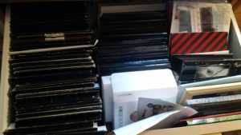

Lähes joka perheessä on paperisia valokuvia albumeissa, laatikoissa, kuorissa ja säilöttynä kaappeihin, kellareissa ja ullakoilla. Paperikuvia on kiva katsella kahvipöydän ääressä, kunhan ne hakee sieltä laatikoista ensin.

\[caption id="attachment\_3017" align="alignright" width="300"\] Vanhoja paperikuvia\[/caption\]

Jos haluat katsella kuvia isolta TV -ruudulta, tabletista tai puhelimesta tai jakaa verkossa katseltavaksi, täytyy ne ensin digitoida. Perinteinen skanneri on hidas ja harvalla sellaista kotoa löytyykään ja pelkkä valokuvan ottaminen kännykällä ei tuota hyvää lopputulosta.

## PhotoScan by Google Photos

Google julkaisi helppokäyttöisen ohjelman puhelimeen / tablettiin, jolla kuvan digitoiminen käy käden käänteessä. Digitointi tapahtuu pääpiirteissään seuraavasti:

1. aseta valokuva pöydälle
2. avaa puhelimesta PhotoScan ohjelma
3. ota pöydällä olevasta kuvasta kuva ja siirrä kameraa näytöllä olevan ohjeen mukaisesti neljään eri kulmaan
4. ohjelma koostaa eri kulmista ottamistaan kuvista yhden kuvan ilman heijastuksia

<!--more-->

Jos vielä käytät puhelimessasi kuvien tallentamiseen Google Kuvat -palvelua, siirretään kuvat sinne talteen.

Todella nopeaa ja helppoa, alle minuutissa kuva on digitoitu.  Laatu ei toki ole aivan samalla tasolla, kuin perinteisellä tasoskannerilla digitoitu kuva, mutta katselukuviksi taso riittää aivan mainiosti.

Ohjelma on maksuton.

- Androidille Play Kauppa: [PhotoScan Google Kuvilta](https://play.google.com/store/apps/details?id=com.google.android.apps.photos.scanner)
- iOS -laitteilla, suuntaa laitteellasi AppStoreen

Katso video aiheesta:

https://youtu.be/MEyDt0DNjWU
