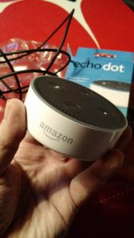
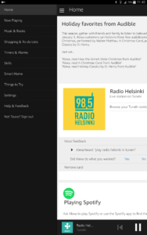

Puheohjattavat laitteet ja palvelut kuten Amazon Echo Dot, Google Home, Siri jne. ovat olleet jo pitkään kiinnostuksen kohteena. iOSsin Siriä demoilen aina [iPad-kursseillani](https://teuvovaisanen.fi/kurssit/ipad-tabletti-haltuun/) ja Google Now -palvelua [Android-tablettikursseillani](https://teuvovaisanen.fi/kurssit/android-tabletti-haltuun/). Amazon Echo ja Echo Dot ovat ehkä pisimpään olleet tuotteena / palveluna markkinoilla, mutta niitä ei Amazon myy Suomeen, ainakaan vielä.

PÄIVITYS: [Nyt marraskuussa 2017 on Saksan Amazon alkanut postittaa myös Suomeen](https://teuvovaisanen.fi/2017/12/11/amazon-echo-virallisesti-suomessa/).

Amazon toi vast'ikään Suomeen [Amazon Prime Video](https://www.primevideo.com/) -palvelunsa, joten voisi olettaa että Echo -laitteetkin jossain vaiheessa tulevat tarjolle.<!--more-->

Halusin kuitenkin Amazon Echo Dot'in "heti" ja tilasin laitteen suoraan jenkeistä [B H Photo](https://www.bhphotovideo.com/) -liikkestä. Amazon Echo Dot -laite maksoi 39,99 $ plus postikulut 8,91 $ ja sen lisäksi tullaus tuli maksamaan reilut 11 €.  Laite tuli postin kuljettamana, tullauksen tein itse tullin sivuilla ja verkkopankissa, helppoa.

## Amazon Echo Dot asennus ja temput sen onnistumiseksi

\[caption id="attachment\_3167" align="alignleft" width="169"\] Amazon Echo Dot\[/caption\]

Ei muuta kuin paketti auki ja asentelemaan. Laite tuli micro usb -johdolla ja amerikkalaisella pistokkeella, noh onneksi noita latureita on ennestään. Ei muuta kuin töpseli seinään ja laitteeseen kiinni. Viehko englantia puhuva naisääni ohjaa asennusta ja neuvoo jatkamaan asennusta puhelimen Alexa -sovelluksen kanssa. Siispä puhelimella Google Play -kauppaan sovellusta lataamaan, vaan ilmaantui pieni ongelma, **sovellus ei ole saatavilla maassasi.** Niin, Amazon ei tosiaan ko. palvelua ole lanseerannut Suomeen, tämä oli riski jonka tiedostin kun tilasin sen, en ehkä saa laitetta toimimaan. Lähin maa, jossa palvelu on käytössä on Saksa.

Eipäs kuitenkaan luovuteta :) Kokeilin ensin F-Securen Freedome VPN-palvelulla huijata Play Kauppaa, jotta saisin yhdysvaltojen Play Storen käyttööni, ei onnistunut, ei vaikka GPSkin oli pois päältä. Noh, tein uuden Google -tilin ja sinne osoitetietoihin  New York. Uudella tunnuksella Play Kauppaan ja nyt oli Alexa -sovellus ladattavissa. (Edit: Jälkikäteen on selvinnyt, ettei sovellus kaikilla onnistu puhelimeen asentumaan, itsellänikin se on Samsung Tab S -tabletissa.)

Asennus oli kohtuuhelppoa, Alexa -sovellus ja Echo Dot -laite löysivät toisensa ja sain kytkettyä laitteen kodin Wi-Fi -verkkoon. Ei muuta kuin kokeilemaan, toimi! Tabletissani on Amazon -sovellus, jolla olen suomalaisena kirjautuneena sisään ja jotenkin uusi Alexa -sovellus oli kaivanut tiedot sieltä ja olin Alexassakin omalla Amazon -tilillä kirjautuneena.

\[caption id="attachment\_3176" align="alignnone" width="188"\] Alexa sovellus\[/caption\]

## Echo Dot lyhyesti

Echo Dot on kodin Wi-Fi -verkossa toimiva laite, jota voi ohjata puheen avulla (englanti). Laitteen avulla voi mm. ohjata älykodin laitteita kuten valoja ja muita sähkölaitteita sekä tietenkin kuunnella musiikkia eri palveluista, kysellä säätietoja jne. Echo Dotissa on mikrofoneja, joilla se kuuntelee käskyjä sekä kaiutin, jolla se vastaa sekä soittaa musiikkia. Parempi äänenlaatu onnistuu ulkoisella kaiuttimella.

Tule varmasti kirjoittamaan aiheesta lisää, kunhan hieman käyttökokemusta karttuu lisää.

Lue myös kokemuksiani [Google Home -laitteista](https://teuvovaisanen.fi/2017/11/21/google-home-ja-google-home-mini-toimivat-suomessa/).
