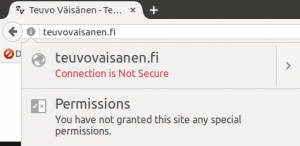
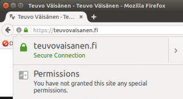
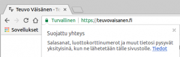

HTTPS -suojaus on nyt ollut sivustollani jonkin aikaa käytössä, sillä hankin sivustolle SSL/TLS -sertifikaatin. Nyt kaikki liikenne tällä sivustolla tapahtuu HTTPS -protokollalla (HyperText Transfer Protocol Secure). Käyttäjänä huomaat sivuston suojauksen selaimen osoitepalkissa. Suojaamaton sivusto on yleensä varustettu huutomerkillä (Firefox ja Chrome) ja suojattu sivusto **lukkokuvakkeella** (Firefox, Chrome, Edge, Safari) ja tekstillä **turvallinen** (Chrome). Saat lisätietoja sivuston suojauksesta napsauttamalla hiirellä huutomerkkiä/lukkokuvaketta.<!--more-->

 

\[caption id="attachment\_3229" align="alignnone" width="300"\] Firefox - suojaamaton, pelkkä HTTP\[/caption\]

 

\[caption id="attachment\_3228" align="alignnone" width="300"\] Firefox - HTTPS-suojaus päällä\[/caption\]

 

\[caption id="attachment\_3227" align="alignnone" width="300"\] Chrome - HTTPS -suojaus päällä\[/caption\]

## Miten SSL/TLS -sertifikaatin saa sivustolleen?

Web-hotellit tarjoavat suojausta joko maksusta tai sitten se kuuluu hosting-pakettiin. Suojaus on kuitenkin erikseen aktivoitava/tilattava. Itse hankin sivustolleni maksullisen sertifikaatin, sen ollessa Web-hotellillani kohtuuhintaan tarjolla. Sertifikaatin asennus käyttöön tehtiin Web-hotellin tuen toimesta.

SSL/TLS -sertifikaatteja voi toki myös tehdä ja asentaa itse, jos on tietotaitoa olla nörtti ;)   Itse tehtyjen sertifikaattien ongelmana on kuitenkin ns. "luottamuspula", eli se ei ole riippumattoman ja luotetun organisaation myöntämä. Sen sivuston käyttäjä huomaa selaimessaan herjana.

Luotettavia sertifikaatteja on myös tarjolla maksutta, yksi sellainen on **Lets Encrypt**. Moni Web-hotelli tarjoaa sen asentamisen maksutta tai itsepalveluna. Toivon hartaasti, että nykyinen Web-hotellini alkaa tarjota tätä maksutonta sertifikaattia myös palveluna vuoden sisällä, jolloin nykyinen sertifikaattini vanhenee, muuten harkitsen vakavasti palveluntarjoajan vaihtoa, sillä minusta suojaus kuuluisi ilman muuta olla maksutta tarjolla.

> Let’s Encrypt is a free, automated, and open certificate authority (CA), run for the public’s benefit. It is a service provided by the Internet Security Research Group (ISRG).

[Lue lisää Lets Encrypt -sertifikaatista](https://letsencrypt.org/).

## Mitä tietosuojaa HTTPS -suojaus tarjoaa?

Googlen tukisivuston dokumentin mukaan HTTPS tuo kolme tietosuojatasoa liikenteeseen:

> **Salaus** – välitettyjen tietojen salaaminen niiden suojaamiseksi luvattomilta käyttäjiltä. Tämä tarkoittaa, että käyttäjän selatessa verkkosivustoa kukaan ei voi "kuunnella" keskusteluja, seurata toimintoja useilla sivuilla tai varastaa tietoja.
> 
> **Tiedon eheys** – tietoja ei voi huomaamatta muokata tai vahingoittaa siirron aikana tahallisesti tai tahattomasti.
> 
> **Todennus** – todistaa, että käyttäjä viestii tarkoitetun verkkosivuston kanssa. Tämä estää välistävetohyökkäyksiä ja lisää käyttäjän luottamusta, mikä hyödyttää yritystä.

Tämän lisäksi Google arvostaa nykyään hakutuloksissa HTTPS -protokollaa käyttäviä sivustoja ja niiden sisältöjä korkeammalle kuin vastaavia ilman suojausta olevia sisältöjä. Tämä on siis taas yksi komponentti lisää hakukoneoptimoinnissa (SEO).

[Lue lisää sivuston suojaamisesta HTTPS -protokollan avulla](https://support.google.com/webmasters/answer/6073543?hl=fi) (Google tukiartikkeli)

Sivustollani ei kerätä lomakkeiden avulla luottokorttitietoja tms. mutta lisätietoturva on aina hyvä asia ja yhteydenottolomakkeenkin kautta lähetettävät tiedot on nyt salattu.

Turvallista matkaa!
