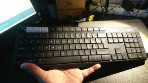
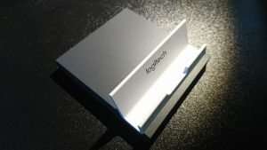
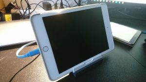
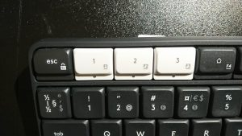

Itselläni on työhuoneessa käytössä useampia laitteita rinnakkain. Linux desktop, Windows läppäri, Chromebook läppäri, tabletteja ja puhelimia. Olen jo pitkään haaveillut yhtä "master-keyboardia", jolla kirjoittaminen sujuisi eri laitteille. Nyt sellaisen vihdoin hankin.

<!--more-->

## Logitech K375s Multi-Device Wireless Keyboard

UPSn auto kurvasi tänään pihaan ja toi paketin, jonka olin tilannut viikkoa aiemmin Logitechin verkkokaupasta. Paketti auki ja kokeilemaan. Paketti sisälsi itse näppäimistön, 2 kpl AAA paristoa, USB-liittimen (Unifying)  sekä pienen telineen mobiililaitteita varten.

Näppäimistö on kompaktin kokoinen ja kirjoitustuntuma mukava, ei taustavalaistusta tähän € 44,99 hintaan, joka muuten sisälsi toimituksen.

<figure>

<figcaption>

Logitech K375s

</figcaption>

</figure>

Paketissa mukana tuli siis myös teline tabletteja / puhelimia varten.

<figure>

<figcaption>

Teline mobiililaitteille

</figcaption>

</figure>

<figure>

<figcaption>

iPad telineessä

</figcaption>

</figure>

Positiivista telineessä on se, että siihen mahtuu tabletti suojakuorineen. Ainakin iPad Mini sekä Samsung Tab S sujahtivat kuorineen paikoilleen, ei tarvitse siis riisua suojakuorta kun istuttaa telineeseen.

Asennus tai siis oikeastaan parittaminen eri laitteisiin toimi suoraan tai ainakin melkein. Kytkennän voi tehdä Bluetoothilla tai [Logitechin omalla Unifying -tekniikalla](https://www.logitech.com/fi-fi/promotions/6072), kolmelle laitteelle.

- iPad paritti näppäimistön suoraan Bluetoothilla
- Chromebookissa Logitechin Unifying -sovelluksella kytkentä onnistui samoin heti, minulla olikin ennestään Chromebookissa Logitechin M705 hiiri ja Unifying USB-liitin.
- Windows 10 -kone parittui samoin Logitechin sovelluksella ja Unifying -tekniikalla

En kuitenkaan jättänyt Windows -koneeseen kytkentää, vaan halusin Ubuntu desktoppiini myös langattoman näppisen. Logitech ei tue virallisesti tällä näppäimistöllä Linuxia, mutta kyllä se lähti toimimaan normaalilla Bluetooth -liittymällä, toisella yrittämällä.

Nyt järjestelmän vaihto sujuu kätevästi nappia painalla :), Ykkösellä Ubuntu, kakkosella Chromebook ja kolmosella iPad.

<figure>

<figcaption>

Vaihtonapit

</figcaption>

</figure>

Ehkä positiivisin yllätys oli se, että iPadin käyttö sujuu hauskasti erilaisilla näppäinkomennoilla, iOS peruskomennoille on omat näppäinkomentonsa ja sovelluksissa samoin, hieman joutuu tietty niitä opettelemaan. Tekstin kirjoittaminen on melkoisen paljon helpompaa oikealla näppäimistöllä kuin tabletin virtuaalinäppäimistöllä.

Näppäimistö toimii Windows®, Mac, Chrome™, Android™ ja iOS® -järjestelmissä sekä epävirallisesti myös Linuxissa.  
[https://www.logitech.com/fi-fi/product/k375s-multidevice-keyboard](https://www.logitech.com/fi-fi/product/k375s-multidevice-keyboard)
