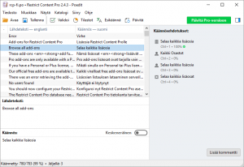

WordPress on pohjaltaan englanninkielinen. Samoin valtaosa teemoista ja lisäosista on tehty englanniksi. Kaikki on kuitenkin käännettävissä suomenkielelle, se vaatii vain hieman viitseliäisyyttä.

## GlotPress

WP ohjelmiston perusosasta (core) ja osa teemoista sekä lisäosista on verkossa käännettävissä yhteisön jäsenien yhteisvoimin. Voit liittyä kääntäjien yhteisöön, tarvitset vain tunnukset WordPress.org -palveluun. Suuntaa selaimella **GlotPress** -osoitteeseen [https://translate.wordpress.org/](https://translate.wordpress.org/)

Siellä voit valita kielen(t), jonka käännökseen haluat ottaa osaa. Yleensä kielellä ja lisäosalla on yksi tai useampi "päällekatsoja", joka hylkää/hyväksyy ehdotetun käännöslauseen. Tässä palvelussa tehdyt käännökset valuvat automaattisesti WP:n coren / lisäosien käännösten päivityksiin muutaman tunnin viiveellä.

Kaikki käännökset eivät kuitenkaan ole GlotPressissä.

## PoEdit

WordPressin perusosan (core) käyttöliittymän tekstien mallitiedoston sekä eri lisäosien mallitekstitiedostot voi ladata verkosta itselleen ja kääntää ne jollain gettext -yhteensopivalla ohjelmalla. Itse olen käyttänyt **PoEdit** -ohjelmaa, jonka saa verkosta maksutta.

[https://poedit.net/](https://poedit.net/)

PoEditiin ladataan mallitiedosto .pot ja sitten vain käydään yksinkertaisesti kaikki tekstistringit läpi.

\[caption id="attachment\_3537" align="alignnone" width="300"\] poedit\[/caption\]

Käännöksen lopputuotoksena syntyvät .po ja .mo -tiedostot. Käännöstiedosto siirretään sitten omaan WP asennukseen asiaankuuluvaan paikkaan, tyypillisesti esim. lisäosan / teeman asennuskansioon. Näin sinulla on käytössäsi ikioma käännös. Varaudu kuitenkin siihen, että esim. teeman / lisäosan päivitykset ajavat käännöstiedostot yli, mikäli ne tulevat lisäosan päivitysten mukana.
