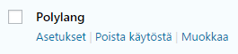
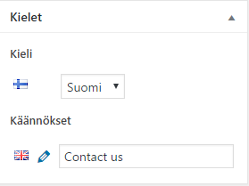
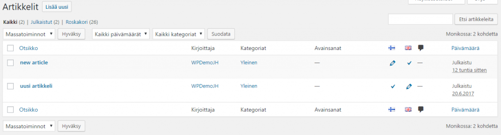
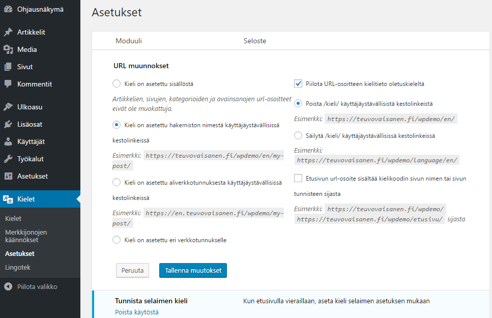
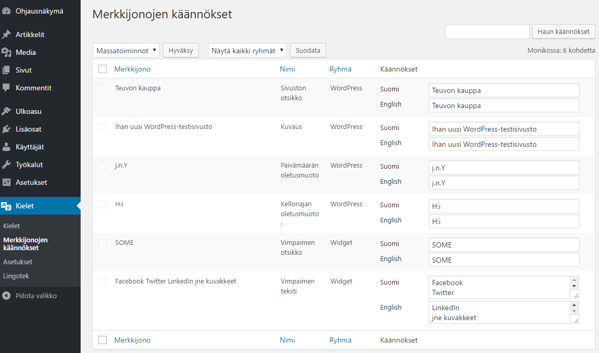
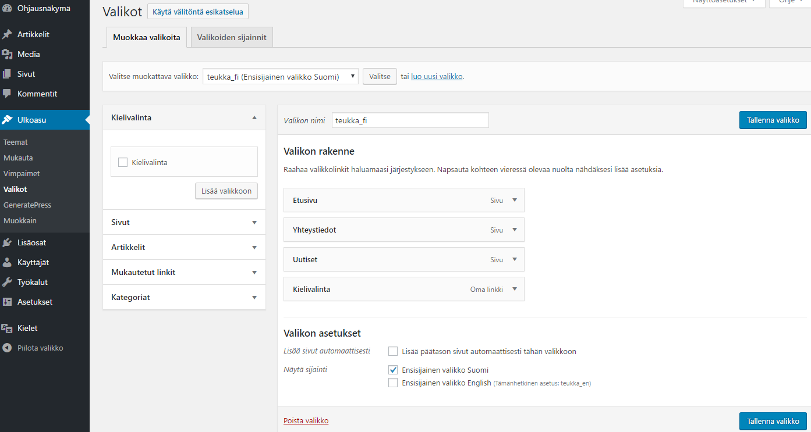
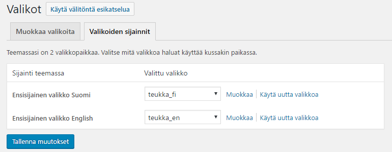
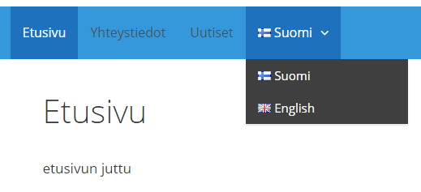

Ajattelin kokeilla sivustoni muuttamista kaksikieliseksi käyttäen Polylang -lisäosaa. Mitään pakottavaa tarvetta kaksikielisyyteen ei itselläni ole, sivustoni sisältö kun on valtaosin tarkoitettu suomalaisille. En todellakaan aio kääntää kaikkea vanhaa tai uutta sisältöä toiselle kielelle, vaan WordPressin oppimisen kannalta tämäkin kokeilu tulee tehtyä. Niin, ja se toinen kieli on englanti.

Olen vuosien saatossa työskennellyt muutaman asiakkaan kanssa, joilla on monikielinen WordPress, heillä on ollut aina käytössään laadukas maksullinen lisäosa WPML. Minä en kuitenkaan nyt aio sitä käyttää, vaan toista yleisesti käännöksiin käytettyä lisäosaa Polylangia, josta on olemassa maksullisen version rinnalla myös maksuton kevytversio. On taas opiskelun ja oppimisen aika :)

<!--more-->

## Polylang -lisäosan asennus ja tärkeimmät asetukset

Ensikokeilut lisäosalla tein tietysti WordPress -testisivustolle, jotta en rikkoisi oikeaa sivustoa ;)

Polylangin koti löytyy täältä: [https://polylang.pro/](https://polylang.pro/) ja tämä maksuton versiokin on ladattavissa sieltä, sieltä löytyy myös dokumentaatio. Maksuton Polylang löytyy myös WP:n plugins repositorysta, eli sen voi asentaa "suoraan WP:n sisältä" eli /wp-admin/ -näkymässä:

- **Lisäosat - Lisää uusi**  ja tee haku lisäosan nimellä "Polylang" ja lisäosan löydyttyä valitse **Asenna nyt**
- Asennuksen jälkeen **Ota käyttöön**

Käyttöönotettaessa Polylang lisää WP hallinnointinäkymään oman valikkonsa **Kielet**

Sitten Polylang asetuksia kuntoon. Asetuksia löytyy hieman sekavasti kahdesta paikkaa, itse lisäosien listaussivulta sekä Kielet -valikon alta. Aloitetaan lisäosat -sivun asetuksista:

\[caption id="attachment\_3600" align="alignnone" width="265"\] Polylang asetukset\[/caption\]

Lisätään kielet, ensin **suomi** ja merkitään olemassa oleva sisältö suomenkieliseksi. Sitten jatkoksi muut kielet, minun tapauksessani **englanti**. Tämä asetus tuo sivun ja artikkelin muokkausnäkymään vimpaimen, josta pääsee tekemään haluttuun sivuun / artikkeliin sisällön (käännöksen) toisella kielellä.

\[caption id="attachment\_3604" align="alignnone" width="279"\] Polylang vimpain\[/caption\]

Polylang näkyy myös sivujen ja artikkelien hallinnointinäkymässä.

\[caption id="attachment\_3601" align="alignnone" width="1024"\] Polylang sivujen ja artikkelien ylläpidossa\[/caption\]

Seuraavaksi pitää ottaa kantaa siihen, millaisessa URLissa eri kielet näkyvät. Itse haluan jatkossa helposti seurata Google Analyticsissä erikseen englanninkielistä sisältöä, joten valitsin kakkosvaihtoehdon. En myöskään halunnut rikkoa olemassa olevan suomenkielisen sisällön jo olemassa olevaa hakukonenäkyvyyttä, joten suomenkieliset sisällöt näkyvät kuten ennenkin, ilman kielitietoa URLissa. Lisätietoa URLeista Polylangissa [https://polylang.pro/doc/url-modifications/](https://polylang.pro/doc/url-modifications/)

\[caption id="attachment\_3606" align="alignnone" width="967"\] Polylang URL asetukset\[/caption\]

Vielä on muutama asetus jäljellä, sivuston nimi ja muita merkkijonoja, nämäkin olisi käännettävä. Merkkijonoja voi olla paljonkin, riippuen muista asennetuista lisäosista, esim. Yoast SEO tuo niitä toistakymmentä lisää käännettäväksi.

\[caption id="attachment\_3609" align="alignnone" width="1144"\] Polylang merkkijonot\[/caption\]

## Kielivalinta navigointivalikkoon

Käyttäjälle kielen vaihtamiseksi Polylang tarjoaa eri vaihtoehtoja, joista itse valitsin valikon. Omassa sivustossani pitää siis olla sekä suomenkielinen että englanninkielinen valikko. On tehtävä kummallekin kielelle oma valikko, niiden ei tarvitse onneksi olla identtisiä, vaan voi rakentaa eri sisällön vieraille kielille. Valikko kannattaa nimetä siten, että siitä ilmenee kieli.

Valitse  **Ulkoasu - Valikot** ja tee kullekin kielelle oma valikko. Kielen vaihtaja näkyy työkalussa.

\[caption id="attachment\_3611" align="alignnone" width="1393"\] Polylang valikko\[/caption\]

Jokainen kieli ansaitsee oman valikon ;)

\[caption id="attachment\_3613" align="alignnone" width="770"\] Polylang valikkoasetus\[/caption\]

Sen jälkeen se näkyy sivustolla.

\[caption id="attachment\_3614" align="alignnone" width="519"\] Polylang valikossa\[/caption\]

## Sisällön kääntäminen

Sisällön valmistaminen eri kielille on jokaisella sivustolla varmaan oma juttunsa. Toiset sivustot ovat yksi yhteen eri kielillä, toiset taas saattavat tarjota vain osan sivuista vieraille kielille, tai jopa aivan eri sisältöä. Itselläni on tämä jälkimmäinen tilanne. Mikäli on isoja tekstimääriä käännettävissä, voi Polylangin valjastaa jopa tekemään automaattisia käännöksiä tai sitten ostaa käännös palveluna. Polylang käyttää **Lingotek** -käännöspalvelua.

Sivun tai artikkelin kääntäminen on helppoa. Kun alkuperäiskielinen sisältö on valmis, voi rinnakkaissivun sisältöä alkaa tuottamaan ylläpitotilassa napsauttamalla Kielet vimpaimessa ko. kielen kynäpainiketta.

\[caption id="attachment\_3604" align="alignnone" width="279"\] Polylang vimpain\[/caption\]

Myös avainsanat ja kategoriat ovat käännettävissä, samoin mukautetut sisältötyypit (custom posts).

Sitten vaan kokeilemaan ;)
