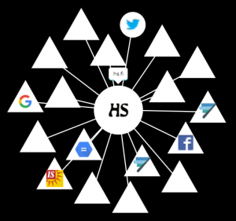

 

Onko muita selaimia kuin Chrome? ;) No on tietysti, mutta Googlen Chromen markkinaosuus on melko murskaava ympäri maailman, Suomessakin reilu puolet käyttäjistä on Chromen käyttäjiä. Chrome, Firefox ja Safari muodostavat selkeähkön kärkikolmikon, Microsoftin IE ja Edge ovat jo jääneet kauas kärjestä. Näitä kaikkia yleisimmin käytettyjä selaimia vaivaa perusasetuksissa löyhähkö tai lähes olematon yksityisyyden suoja.

<!--more-->

## Yksityisyyden suojeleminen on haasteellista

Käytitpä mitä tahansa em. selainta desktopissa, tabletissa tai puhelimessa, niin olet ehkä kokenut verkkoa selatessasi jotain tämän kaltaista:

_Käyt verkkokaupan sivuilla tutkimassa tuotteita. Sen jälkeen surffaat verkossa eri sivustoilla ja kas kummaa selaamiesi tuotteiden mainoksia on sivustoilla muun sisällön seassa._

tai

_Epäilet sairastavasi jotain tautia. Teet verkkohakuja aiheesta. Alat sen jölkeen saamaan mainoksia ko. sairauden hoitoon liittyvistä lääkkeistä._

Osa meistä kokee harmillisena tai jopa pelottavana sen, että selaimen käyttö näkyy mainostajille ja muille käyttäytymisestämme kiinnostuneille. Eikö surffailu pysy mitenkään salassa?

Monella kaupallisella / mediasivustolla saattaa olla helposti kymmenkunta eri tahoa, jotka seuraavat surffailuasi. Tässä alla olevassa kuvassa Helsingin Sanomien https://hs.fi -sivuston etusivun kylkiäiset.  Alla olevassa kuvassa seuraajat näyttää Firefoxin Lighbeam -lisäosa.

\[caption id="attachment\_3651" align="alignnone" width="300"\] Lightbeam-Firefox-hs.fi\[/caption\]

Selaimen asetuksia säätämällä ja yksityisyyttä suojaavia lisäohjelmia asentelemalla voi toki seurantaa ja mainoksia estää tai ainakin hillitä.  Sormituntumani kuitenkin on, että valtaosa tavallisista Internetin käyttäjistä ei osaa tai vaivaudu säätämään selaimensa asetuksia. Selainta käytetään sellaisenaan, mainostajat ja muut seurantaa tekevät tahot kiittävät.

## Firefox Focus

Mozilla -organisaation kehittämä uudehko selain [Firefox Focus](https://www.mozilla.org/en-US/firefox/focus/) koettaa ratkaista yksityisyyden suojelemisen sekä seurannan. Siinä on automaattinen mainostajien sekä seurannan esto, eikä käyttäjän tarvitse perehtyä selaimen asetuksiin, oletusarvoiset asetukset hoitavat homman tyylikkäästi. Firefox Focus on tällä hetkellä saatavilla vain mobiililaitteisiin (Android ja iOS), toivottavasti myöhemmin myös desktop-laitteisiin.

- Firefox Focus estää automaattisesti mainostajien ja analytiikkasovellusten seurantayritykset (artikkelin kirjoitushetkellä Focus blokkasi 11 seuraajaa automaattisesti hs.fi -etusivulta)
- Selaussession jälkeen Focus poistaa historian, evästeet, salasanat yhdellä napin painalluksella (Erase iOS -laitteissa ja roskakorikuvake Andoidissa)
- Firefox Focus blokkaa myös sivustoilta mainoksia pois, ja sen vuoksi sivut latautuvat paljon nopeammin ja surffailu tulee käyttäjälle mukavammaksi

 

\[gallery ids="3668,3669,3657,3656,3672"\]

## Firefox Focus ja Safari yhdessä

Focusta voi siis käyttää sellaisenaan selaimena, mutta iOS -laitteissa (iPad ja iPhone) sen voi laittaa toimimaan myös Safarin sisällön estäjänä. Voit siis käyttää halutessasi Safaria ja Focus hoitaa taustalla mainosten eston

- asenna Focus iOS laitteeseen AppStoresta
- laita Focuksen asetuksista Safari -integraatio päälle
- valitse iOS Asetukset - Safari - Yleiset - Sisällön estäjät ja laita Firefox Focus täppä päälle

\[gallery ids="3665,3666"\]

Firefox Focus on saatavilla kirjoitushetkellä

- [Android -laitteisiin Googlen Play Kaupasta](https://www.google.fi/url?sa=t&rct=j&q=&esrc=s&source=web&cd=2&cad=rja&uact=8&ved=0ahUKEwj1i-6u_ufUAhWMLlAKHTrQCA0QFggsMAE&url=https%3A%2F%2Fplay.google.com%2Fstore%2Fapps%2Fdetails%3Fid%3Dorg.mozilla.focus&usg=AFQjCNEDxQN5M1-_UU1KfL4BlhG84UIIKg)
- [iOS -laitteisiin Applen AppStoresta](https://www.google.fi/url?sa=t&rct=j&q=&esrc=s&source=web&cd=1&cad=rja&uact=8&ved=0ahUKEwjom5Gb_ufUAhUMK1AKHaQxBtgQFggkMAA&url=https%3A%2F%2Fitunes.apple.com%2Fus%2Fapp%2Ffirefox-focus-the-privacy-browser%2Fid1055677337%3Fmt%3D8&usg=AFQjCNFLjmCdKxbgpetljtgFQiFBA_U54Q)
