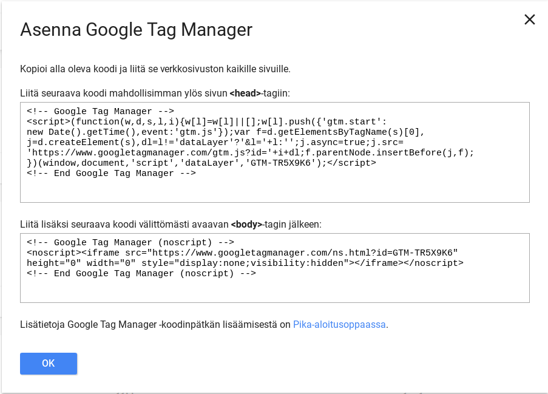
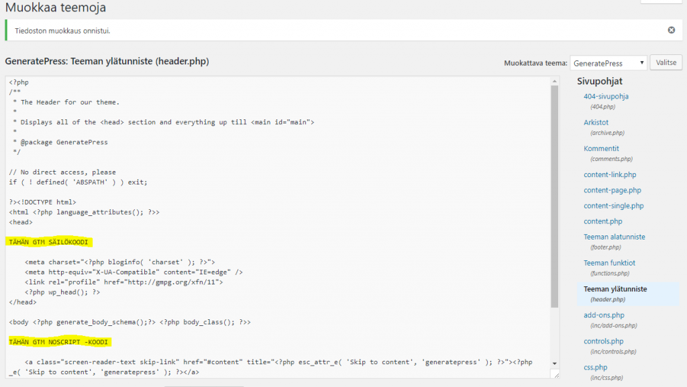
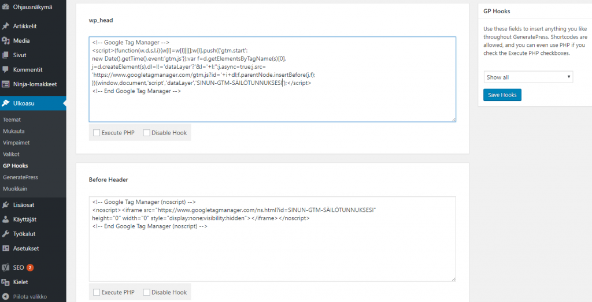
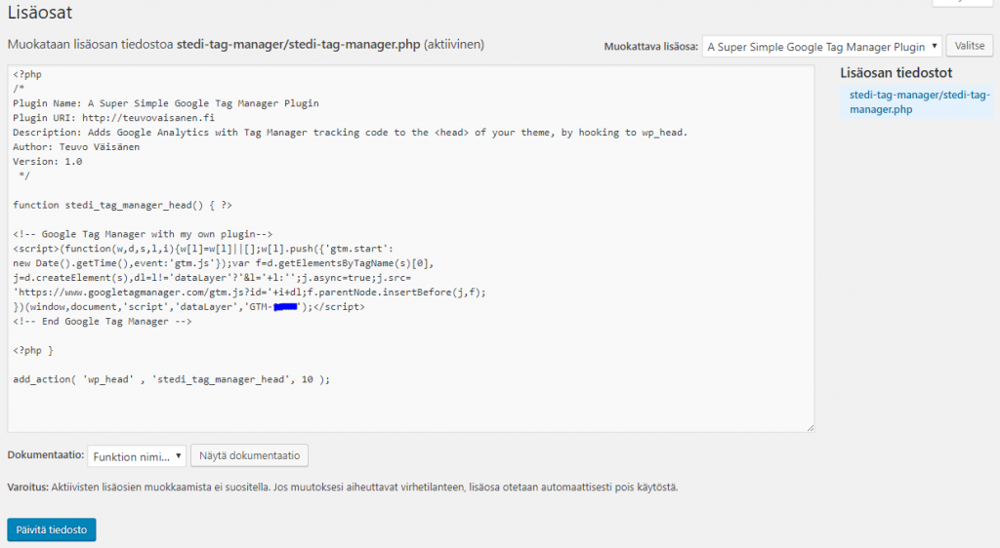

[Google Tag Manager](https://tagmanager.google.com/) (GTM) on palvelu, jonka avulla Web -sivuston haltija voi etäisesti lisätä ja muokata seurantakoodeja sivustolle koskematta itse sivuston lähdekoodiin. Tämä vähentää virheiden määrää ja nopeuttaa työnkulkua. Tag Manager -palvelussa on selkeät ohjeet siitä, miten palvelu otetaan käyttöön. WordPress -järjestelmässä on kuitenkin monia eri tapoja käytännössä toteuttaa käyttöönotto.

<!--more-->

(Mikäli sivusto on WordPress.com -palvelussa, Google Analytics onnistuu vain kalleimmassa hosting-paketissa. Tämä artikkeli käsittelee vain tyypillistä Web-hotelliin asennettavaa WordPressin "täysversiota".)

## Google Tag Manager asennusohje

Tag Manageria käyttöönotettaessa saa palvelun sivustolta selkeät ohjeet siitä, mihin säilökoodi sivuston HTML -koodissa tulee asentaa.

Itse asiassa GTM -palvelussa on kaksi eri koodinpätkää kopioitavaksi sivustolle. Tuo ensimmäinen koodinpätkä on "pakollinen". Se toimittaa säilön kaikille selaimille, joissa on JavaScript päällä, siis ylivoimaiselle enemmistölle selaimia. Toinen (noscript) -koodinpätkä on "vapaaehtoinen". Se toimii iframe -tekniikan avulla selaimille, joissa JavaScript ei ole käytettävissä jostain syystä. Ilman JavaScriptia olevia selaimia on häviävän pieni osa sivuston vierailijoista, joten osa webmastereista ei edes välitä tästä toisesta koodista.

\[caption id="attachment\_3793" align="alignnone" width="903"\] GTM-asennusohje Tag Manager -palvelussa\[/caption\]

Lisää ohjeita saat GTM -tukisivuilta: [https://support.google.com/tagmanager/answer/6103696?hl=fi&ref\_topic=3441530](https://support.google.com/tagmanager/answer/6103696?hl=fi&ref_topic=3441530)

WordPress -sivuston ylläpitäjällä on monta erilaista tapaa em. koodien sijoittamiseen oikeille paikoilleen, esim. :

- käsin copy pastaamalla teemaan
- kolmannen osapuolen lisäosan avulla
- teeman mahdollisesti tarjoaman Action Hookin avulla
- itsetehdyn lisäosan avulla
- koodaamalla hieman PHP:ta

## GTM säilön asennus käsin - copy paste

1. Siirry sivustolla hallinnointinäkymään (wp-admin)
2. Valitse **Ulkoasu - Muokkain**
3. Valitse oikealta puolelta teeman tiedostojen joukosta **header.php**
4. Kopioi GTM -palvelusta säilökoodi ja sijoita se juuri <head> -aloitustagin jälkeen
5. Tallenna
6. Kopioi GTM -palvelusta se toinen <noscript> -koodi ja sijoita se juuri <body> -osion alkuun.
7. Tallenna

Ole tarkkana äläkä muuta mitään muita koodeja header.php:ssä.

\[caption id="attachment\_3814" align="alignnone" width="1024"\] GTM-copy-paste\[/caption\]

Tällä tavalla GTM:n säilöä toteutettaessa on haasteena se, että aina kun teema päivittyy, ajavat teeman uudet tiedostot nämä itse muokatut GTM -säilökoodit ylitse ja joudut copy pastaamaan ne uudestaan paikoilleen. Lapsiteeman käyttö toki auttaa päivitysten haittojen minimoimiseksi.

## Tag Manager ja WordPress Action Hooks

WordPress Action Hookien avulla voi ujuttaa koodia useisiin strategisiin kohtiin HTML -tiedoston rakenteessa.  Hookien joukosta löytyy mm. `wp_head` , jonka avulla voi  PHP:ta käyttäen tulostaa GTM -säilöskriptin HEAD -osioon sijoittamalla oman koodisi teemasta löytyvään **functions.php** -tiedostoon. Tässäkin toteutustavassa täytyy varoa teeman päivitystä, joka yliajaa muokkaukset, siispä lapsiteeman sen funtions.php:n käyttö on suotavaa.

Lisätietoja funtions.php -tiedoston käytöstä: [https://codex.wordpress.org/Functions\_File\_Explained](https://codex.wordpress.org/Functions_File_Explained) Lisätietoja lapsiteemoista: [https://codex.wordpress.org/Child\_Themes](https://codex.wordpress.org/Child_Themes)

### GeneratePress (premium) ja GP Hooks

Jotkin teemat tarjoavat näiden hookien käyttöön myös helpon graafisen käyttöliittymän, vältyt siis koodaamasta PHP:ta :) Näin on mm. käyttämäni GeneratePress -teeman premium -versiossa.

- Siirry ylläpitokäyttöliittymään (wp-admin)
- Valitse **Ulkoasu - GP Hooks**
- Liitä säilökoodi **wp\_head** -laatikkoon
- Liitä noscript -koodi **Before Header** -laatikkoon (se ujuttaa koodit BODYn alkupuolelle)
- Tallenna

\[caption id="attachment\_3818" align="alignnone" width="1024"\] Google Tag Manager - GeneratePress - GP Hooks\[/caption\]

Lisätietoja WordPress Action Hooks -ominaisuuksista

- [https://codex.wordpress.org/Plugin\_API/Action\_Reference](https://codex.wordpress.org/Plugin_API/Action_Reference)
- [GeneratePress - GP Hooks](https://docs.generatepress.com/article/hooks-overview/)

## GTM säilön asennus lisäosan avulla

WordPress plugin on myös helppo tapa GTM:n asennukseen. Käyttämällä pluginia, ei teeman tiedostojen päivitys sotke GTM -koodeja. Yleisesti käytetty kolmannen osapuolen GTM -lisäosa on Duracell Tomi's  Tag Manager for WordPress [https://fi.wordpress.org/plugins/duracelltomi-google-tag-manager/](https://fi.wordpress.org/plugins/duracelltomi-google-tag-manager/) , mutta muitakin toki on. Vain mieleisesi pluginin asennus ja asetukset kuntoon ko. pluginin ohjeiden mukaan, se on siinä.  En aio niitä tässä käydä erikseen läpi, kun niitä lisäosia on useampia, kannattaa tutustua valitsemansa pluginin ohjeisiin. Pluginin käytön etu on se, ettei ole teemasta laisinkaan riippuvainen. Teeman vaihto onnistuu heittämällä ilman että GTM -säilö ja sen avulla julkaistut tagit hajoavat.

GTM -plugineja käytettäessä on toki hyvä tarkistaa, että myös se <noscript> -osa tulee toteutettua (jos se on tärkeää), näin ei kaikkien lisäosien osalta valitettavasti aina tapahtu.

### Oma plugin - lisäosan koodaus

Mikäli olet pikkuisen nörtimpi ja haluat hieman koodailla, voit toki aina tehdä oman pluginin. Alla olevassa yksinkertaisessa pluginissani on hieman PHP -kieltä, jossa wp\_head -metodin avulla lisätään GTM -koodi <head> -osioon. Lisäosa on sijoitettu WordPress -asennuksessa wp-content/plugins -kansion alle ikiomaan kansioonsa.

\[caption id="attachment\_3825" align="alignnone" width="1024"\] GTM-plugin\[/caption\]

Itselläni on käytössä tuo oma tekemäni plugin ja käytän GeneratePress -teeman hookia sen noscript -osan toteuttamiseen. Miksi näin? No huviksi ;)

Lisätietoja oman pluginin koodauksesta: [https://developer.wordpress.org/plugins/intro/](https://developer.wordpress.org/plugins/intro/)

## Mitä GTM säilön toteuttamisen jälkeen?

Säilökoodi ei itsessään siis "tee mitään" sivustolla. Se vain mahdollistaa Tag Manager -sivuston palvelun kautta etäisesti hallinnoida kaikkia mahdollisia seurantaskriptejä, joita haluataan asentaa sivustolle. [Google Analytics seurantakoodi Tag Managerin avulla](https://teuvovaisanen.fi/2017/07/10/google-tag-manager-toinen-tapa-asentaa-google-analytics/) on varmaan ensimmäinen tagi, joka sivustolle toteutetaan, siitä kirjoitinkin juuri [edellisessä artikkelissani](https://teuvovaisanen.fi/2017/07/10/google-tag-manager-toinen-tapa-asentaa-google-analytics/).

Säilön ja sen avulla ujutettujen tagien asennuksen onnistuminen tulee aina testata. Tässä apuna on Googlen [Chrome -selaimeen saatava lisäosa **Tag Assistant**](https://chrome.google.com/webstore/detail/tag-assistant-by-google/kejbdjndbnbjgmefkgdddjlbokphdefk).
