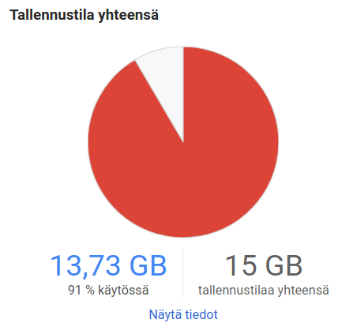
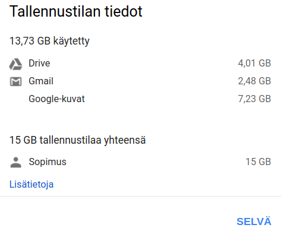
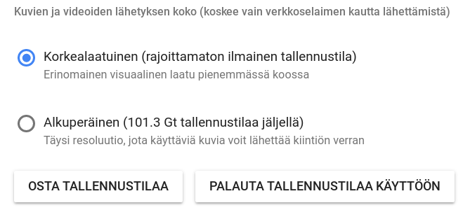
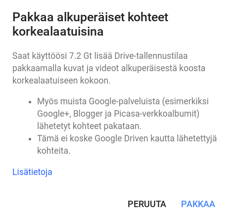
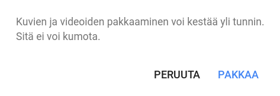
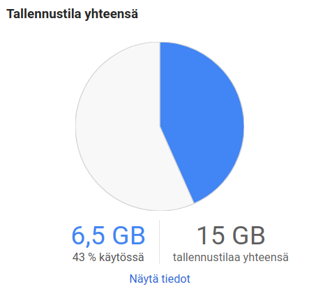

Google tilin haltijat saavat automaattisesti maksutta käyttöönsä 15 gigatavua tallennustilaa. Tallennustila jaetaan GMailin, Driven ja Photos -palvelun kesken (tietyillä kriteereillä). Se riittää hyvin tavalliselle kuluttajalle. Oman tallennustilan käytön saa helposti selville vierailemalla selaimella osoitteessa [https://www.google.com/settings/storage](https://www.google.com/settings/storage).

Chromebook -tietokoneen ostajat saavat tuon lisäksi maksutta 100 gigatavua lisää kahdeksi vuodeksi. Minulla tuli tuo kaksi vuotta juuri täyteen ja sain ilmoituksen siitä. Niinpä tuli eteen tarkistaa oma tilan käyttö.

\[caption id="attachment\_3883" align="alignnone" width="447"\] Google tallennustila\[/caption\]

Siis aika täysi on, vaikka säännöllisesti deletoin turhia sähköposteja GMail -tililtäni. Rahalla toki saisi uudestaan lisää tilaa, mutta enpä sitä nyt halua tehdä. Miten tuo tilan käyttö jakaantuu? Sen saa selville kun napsauttaa Näytä tiedot -linkkiä.

\[caption id="attachment\_3884" align="alignnone" width="473"\] Jakauma\[/caption\]

Suurimman osan tallennustilasta vievät siis kuvat. Kun aikoinaan aloitin kuvien tallentamisen Googlen palveluun, tallensin ne alkuperäisellä tarkkuudella. Google Kuvat -palveluhan tarjoaa rajattoman kuvien tallennustilan edellyttäen että käytät alkuperäisestä hieman pienennettyä versiota. En ole kertaakaan tarvinnut alkuperäisen laatuista kuvaa tässä vuosien saatossa ja valtaosa kuvistani onkin pikkuisen heikennettynä tallessa. Se laatu on minulle riittänyt mainiosta, sillä en teetä niistä mitään isoja julisteita tms. printtinä.

Saako niitä aiemmin tallennettuja kuvia jälkikäteen pienennettyä?

Siirryin oosoitteeseen [https://photos.google.com/settings](https://photos.google.com/settings) ja napsautin PALAUTA TALLENNUSTILAA KÄYTTÖÖN -painiketta.

\[caption id="attachment\_3888" align="alignnone" width="659"\] Palauta tallennustilaa\[/caption\]

Ja sitten

\[caption id="attachment\_3890" align="alignnone" width="467"\] Pakkaa ja sen varoitus\[/caption\]

\[caption id="attachment\_3891" align="alignnone" width="473"\] Varoitus\[/caption\]

Ja sitten jos kuvia on paljon, niin se todella voi kestää yli tunnin. Minulla se kesti alle kaksi tuntia, ja sen jälkeen oli tilaa taas reilusti.

\[caption id="attachment\_3894" align="alignnone" width="453"\] Tilaa on taas\[/caption\]
