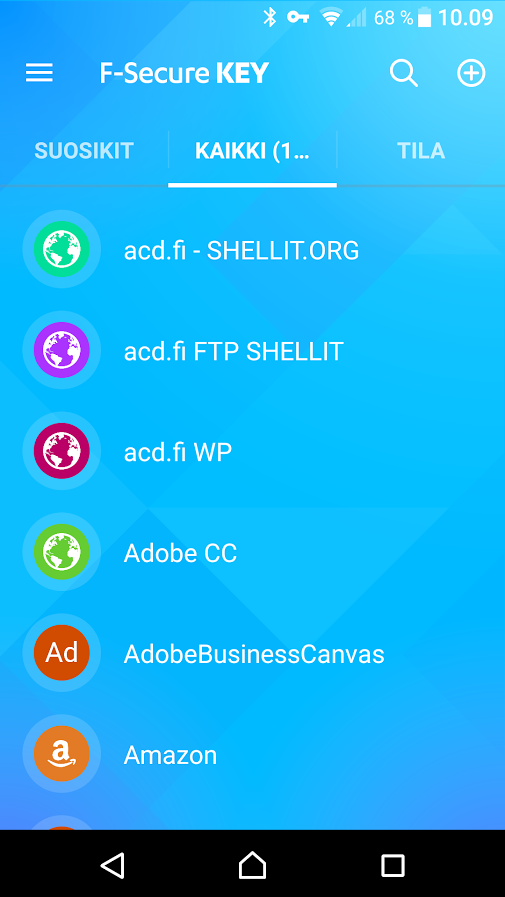
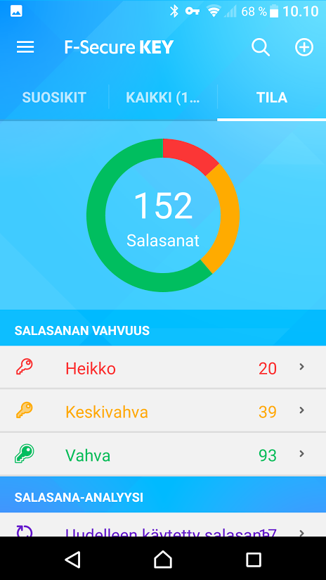

Käyttäjätunnusten ja salasanojen muistaminen on haasteellinen asia kenelle tahansa, ainakin jos teet tietoturvallisesti oikein ja pidät eri salasanan joka palveluun. Onneksi salasanojen hallintaan on olemassa ohjelmia / palveluita kuten F-Secure Key.  [Voit toki myös tehdä muistisäännön](https://teuvovaisanen.fi/2015/05/02/eri-salasana-joka-palveluun-miten-muistan-ne-kaikki/), jonka avulla voit muodostaa päässäsi salasanan kussakin palvelussa, mutta salasanan säännöllinen vaihtaminen on parempaa tietoturvaa ja jotkin palvelut jopa edellyttävät sitä, silloin ei muistisääntö ehkä enää auta.

## F-Secure Key - sovellus salasanojen hallintaan

F-Secure Key on suomalaisen tietoturvayrityksen F-Securen ohjelma salasanojen keskitettyyn hallintaan. Olen käyttänyt ko. sovellusta parisen vuotta ja ollut melko tyytyväinen. Käytettävyys ja ominaisuudet jäävät ehkä hieman jälkeen muutamasta ulkomaisesta kilpailijasta, mutta mieluummin tuen kotimaista ohjelmistuotantoa. :)

Käyttöönotto on helppoa. [Lataa sovellus maksutta verkosta](https://www.f-secure.com/fi_FI/web/home_fi/key), asenna ohjeiden mukaan ja ala syöttää tietoja sisään. Perusidea on se, että eri palveluiden tunnukset ja salasanat on ohjelman pääsalasanan takana. Sinun täytyy siis muistaa vain yksi salasana, loput on F-Secure Keyn hallussa, salakirjoitettuna laitteen levylle.

F-Secure Key on alunperin tarkoitettu käyttäjätunnusten ja salasanojen säilömiseen, mutta voit toki tallentaa siihen mitä haluat, SOTUn, luottokorttien numerot ja PIN-koodit jne. Itse olen tallentanut myös erilaisten laitteiden kuten puhelimien, kameroiden ja soittimien sarjanumeroita sekä Wi-Fi -reitittimien hallintakonsolien pääsykoodit. Kaikki tieto on kätevästi yhdessä paikassa sen sijaan että ne ehkä ovat jossain paperilla, jos ovat tallessa ollenkaan.

Mikäli käytössä on useampia laitteita, kuten puhelin, tabletti ja tietokone, niin parhaimman hyödyn saa F-Secure Keyn Premium -versiosta (maksullinen), jonka avulla ohjelmaan säilötyt tiedot siirtyvät pilven kautta kaikkiin laitteisiin synkronoituna. Salasanasi ovat aina mukanasi, kunhan sinulla on laite jossa on asennettuna F-Secure Key. Itselläni Key on käytössä puhelimessa, kolmessa tabletissa sekä kahdessa tietokoneessa.

Parhaan käytännön hyödyn itselleni saan selaimen käytössä. On todella helppo kirjautua sisään eri verkkopalveluihin, kun Key on käytettävissä suoraan Firefox ja Chrome -selaimissa. Ohjelma täyttää puolestasi tunnuksen ja salasanan, nopeuttaa ja helpottaa huomattavasti, varsinkin kun salasanani ovat tyypillisesti tämän tyylisiä `_hVG2974(XV+U6m7` (ei sitten ole muuten missään käytössä) ;)

Ohjelma näyttää tallennetut tiedot listana (kuva Android -puhelimesta)

\[caption id="attachment\_4010" align="alignnone" width="505"\] F Secure Key lista salasanoista\[/caption\]

Ohjelma myös kertoo salasanojen laadun ja oletko käyttänyt samaa salasanaa useammin kuin kerran

\[caption id="attachment\_4011" align="alignnone" width="464"\] F-Secure-Key salasanojen laatu\[/caption\]

## Loppusanat

En enää tulisi toimeen ilman salasanoja muistavaa ohjelmaa, niitä on itselläni "liikaa", osin johtuen työstäni. F-Secure Key on ollut tähän ongelmaan mainio ratkaisu pienistä käyttöliittymäpuutteistaan huolimatta.

Suosittelen.
