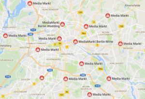

Googlen älykaiuttimet eivät ainakaan toistaiseksi ole saatavissa kaupoista Suomesta. Niinpä Berliinin lomamatkan tuliaisena repussa matkasivat Suomeen **Google Home** ja sen pienempi versio **Google Home Mini**. Saksassa laitteet tulivat myyntiin syksyllä 2017. Esimerkiksi Berliinissä on elektroniikkaa myyviä liikkeitä runsaasti ja em. laitteet ovat perushyllytavaraa. Charlottenburgin kaupunginosassa oli yksi Media Marktin liikkeistä sopivasti kävelyetäisyydellä hotellista.

[Saksalaisen Google Blogin mukaan](https://germany.googleblog.com/2017/07/google-home-kommt-nach-deutschland.html) laitteita myyvät mm.:

- Media Markt (Google Home 129 € ja Mini 58,99 €)
- Saturn
- mobilcom-debitel
- Conrad
- Cyberport
- Tink
- EP
- Medimax
- Otto

em. liikkeet ja sijainti selvisivät helposti [Google Mapsissa tehdyn haun](https://www.google.fi/maps/search/media+markt+berlin/) avulla.

<figure>

<figcaption>

Media Markt Berlin

</figcaption>

</figure>

## Google Home asennus

Sitten paluumatkan jälkeen pääsi kotona kokeilemaan toimivatko Google Home ja Mini Suomessa. Laitteiden asennukseen tarvitaan puhelimeen/tablettiin Google Home -sovellus, joka itselläni olikin jo kolmen Chromecastin omistajana.

1. Virta laitteeseen ja puhelin kodin Wi-FI -verkkoon sekä puhelimen Google Home -sovellus auki
2. Sovellus tunnistaa hetikohta uuden laitteen ilmestyneen ja alkaa asennusvelho, jossa sovellus kysyy tarvittavat asiat
3. Sitten onkin kaikki valmista, todella yksinkertaista

## Google Home testausta

Aluksi tietenkin testaamaan ja saamaan kokemuksia mikä toimii. Tässä tuloksia ensipäivän alustavista kokeiluista. Niin, siis englanniksi on palveluun puhuttava, suomenkielen tukea ei ole, josko koskaan tuleekaan.

Google -palvelut näyttävät toimivan mainiosti, taustalla on tietty oma Google -tili, jonka pohjalta laite tietää kuka olet ja missä olet. Niinpä voi kysyä kellonaikaa, asettaa herätyksiä, kysellä oman kalenterin tapahtumia, lisätä ostoslistaan ostettavaa jne.  
**Paikkatiedon oikeellisuus on iso ero ja parannus** ennestään omistamaani [Amazonin Echo Dot -laitteeseen](https://teuvovaisanen.fi/2016/12/21/amazon-echo-dot-tuli-taloon/), jossa kotipaikaksi oli keksittävä jokin osoite Saksasta, kun ei hyväksy Suomen osoitteita.  
PÄIVITYS: [marraskuusta 2017 lähtien onnistuu sekin](https://teuvovaisanen.fi/2017/12/11/amazon-echo-virallisesti-suomessa/)!

Maksuton **TuneIn** radio toimii heti, joten suosikkiasemani Radio Helsinki -kuuntelu onnistuu.

> Hey Google, Radio Helsinki on TuneIn

**Spotify**, **Netflix** ja **Youtube** toimivat mainiosti televisioihin, kun niissä on **Chromecast**. Premium -tilit on kytkettävä Google Home -sovelluksen avulla.

> Hey Google, play King Crimson on Spotify
> 
> Hey Google, watch Punisher from Netflix on Bedroom TV
> 
> Hey Google, show cat videos from Youtube on Livingroom TV

Omien valokuvien katselu onnistuu **Google Kuvat** -palvelusta myös suoraan Chromecastin avulla televisioissa.

> Hey Google, show my photos from last wednesday on Livingroom TV

**Philips Hue** -valot toimivat harmittavan epäluotettavasti yläkerrassa, välillä komento toimii välillä ei, yleensä ei. Tämä voi johtua Google Home ja Philips Hue reitittimien välisestä etäisyydestä tai sitten kyseessä on jokin softaongelma. Jonkin verran epäluotettavuutta oli välillä Amazon Echo Dotillakin Philipsin valojen kanssa. Alakerran Mini ja Philips Hue Bridge ovat lähekkäin ja tuntuvat toimivan pikkuisen paremmin, joskin epäluotettavasti sielläkin, välillä bootti on auttanut, välillä ei. :(  Google Home kyllä vastaa usein positiivisesti tehneensä pyydetyn toiminnon, mutta mitään ei sitten valoille tapahdukaan oikeasti.

Verkossa on keskustelupalstoille keskustelua samasta aiheesta, en siis ole ainoa joka tappelee Philips Huen toimivuuden kanssa.  
Tarkennuksena vielä, että Philipsin oma appi sekä kaukosäädin toimivat moitteetta.

Lukuisten matkan varrella saapuneiden ohjelmistopäivitysten myötä valojen komentelu onnistuu nykyään ongelmitta.

**TP-Link Smart Plug** \-testaus on vielä vaiheessa toimii myös, kuten videosta voi todeta.

https://www.youtube.com/watch?v=ONLk2Gdlezs

Kaiken kaikkiaan yhden päivän alkukokeilujen perusteella voi sanoa, että hyvät hankinnat, vaikka valojen kanssa olikin aluksi vaikeaa. Google Home -laitteet taustapalveluineen sopivat selkeästi paremmin Suomeen kuin tuo Amazonin vastaava, etenkin kun itselläni on Google -tili ja siihen liitetyt palvelut voimallisesti käytössä. Äänen laatu on isommassa Google Homessa tietysti parempi kuin Google Home Minissä, mutta minikin hakkaa äänenlaadussa selvästi Amazon Echo Dotin, jonka ääni on aika laiha.

[Lue myös kokemuksiani Amazon Echo Dot -laitteesta](https://teuvovaisanen.fi/2016/12/21/amazon-echo-dot-tuli-taloon/).
