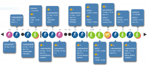
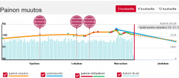

Iän karttuessa huoli omasta kunnosta ja jaksamisesta tulee väistämättä mieleen. Olen liikkunut melko aktiivisesti lintuharrastuksen myötä etenkin nuorempana. Aktiivisin lintuharrastus hiipui kun perhettä tuli ja työkin muuttui enempi nörttihommiksi. Kellot alkoivat soida joskus vuonna 2005 tienoilla, kun ylipainoa oli kertynyt riittävästi. Jotain pitäisi tehdä. Kuntosalit ei kiinnostaneet pätkääkään, eikä juokseminen ole koskaan maittanut, millä siis liikkeelle?<!--more-->

## Sports Tracker potkaisee vauhtiin

Silloin aluksi minulla oli Nokian Symbian puhelin ja siihen sai asennettua suomalaisen Sports Tracker -ohjelman. Nörtti sai teknologiavetoisen kuntoilun alkuun. Polkupyöräillen sekä kävellen tuli taitettua matkaa aika paljon ja Sports Trackerin käytön myötä lähti paljon kiloja ja housujen vyöhön tehtiin uutta reikää :)

Jossain tässä vaiheessa ostin ensimmäisen Polarin sykemittarinkin, se toimi mainiosti Sports Trackerin kanssa, puhelimen ruudulta näki sykkeen, se oli hienoa. Datan alkoi saada tallennettua verkkoon [www.sports-tracker.com](http://www.sports-tracker.com) -palveluun, se innosti minua lisää kuntoilemaan.

## Sauvakävely löytyy

Onneksi löysin sauvakävelyn, sillä pelkkä Sports Tracker ja kävelyinto oli pikkuhiljaa hiipunut. Vuodesta 2010 joulukuusta kevääseen 2011 sauvakävelin todella reippaasti. Reilusti toistakymmentä kiloa tippui, siihen ei enää riittänytkään enää vyön rei'itys vaan oli mentävä housukauppaan :) Siirryin myös näihin aikoihin Windows puhelimeen.

## Heia heia lisää löylyä

Samaan aikaan vuonna 2010 liityin Heia Heia -palveluun. SOME oli silloin kova juttu ja kaikkiin palveluihin piti tehdä tunnus. Aluksi yhteisössä mukana oleminen edelleen lisäsi liikuntaa ja kavereiden kannustus tuntui hyvältä ja se sai liikkumaan entistä enemmän. Liikkuminen oli pääosin kävelyä, sauvakävelyä, pyöräilyä ja satunnaisemmin muita lajeja.

## Lumikengät uutena lajina mukaan

Vuonna 2012 ostin lumikengät. Talvena 2012 - 2013 olikin Helsingissä ihan kunnon lumitalvi ja minä sain paksussa umpilumihangessa tarpoen kasaan 116 km. Se oli todella rankkaa ja erittäin mukavaa.

\[caption id="attachment\_4025" align="alignnone" width="300"\] Lumikengät ja Heia Heia\[/caption\]

Näin jälkikäteen kun olen katsellut heiaheia.com ja www.sports-tracker.com -palveluista kirjaamiani tapahtumia, huomaan että 2013 kesä ja syksy oli nolla kirjausta. Taisi tulla väsähdys. SOME-innostus hiipui, jaksoin kirjata harjoituksia Heia Heia -palveluun aktiivisesti 2010 - 2013 ja enää satunnaisesti 2014 kunnes lopetin.

Kiloja kertyi taas. Jostain piti löytää uutta potkua kun vanhat keinot eivät enää innostaneet liikkumaan.

## Polar Loop ranneke ja Polar Flow

Olin kyllästynyt myös aiemmin sykevyön ja puhelimen virittelyyn kun piti lähteä lenkille. Onneksi keksin vuoden 2014 alussa hankkia aktiivisuusrannekkeen. Polar Loopin hankin varmaan syystä, että minulla oli ennestään jo Polarin sykevyö. Tämä sai taas intoa mieheen ja kilometrejä alkoi kertyä. Jos käytti sykevyötä näki sykkeen suoraan ranteesta, eikä tarvinnut kaivella enää puhelinta. Erinomainen parannus.

Aktiivisuusranneke onkin ollut tammikuusta 2014 lähtien ranteessani käytännöllisesti katsoen 24/7. Tässä vaiheessa siirryinkin sitten tallentamaan liikkumisen dataa Polarin palveluihin. Ranneke kannusti taas liikkumaan, sillä se laski askeleet automaattisesti, enää ei tarvinnut puhelimen apua datan tallentamiseen. Polar Loopin myötä hylkäsin Sports Trackerin (kiitos hyvistä vuosista) ja siirryin käyttämään Polarin verkkopalvelua [https://flow.polar.com/](https://flow.polar.com/) liikkumisen datan tallennukseen ja seurantaan.

## Vaihto Polar M400 ja H7 sykevyöhön

Vaihdoin Polarloopin Polar M400 -laitteeseen kun se tuli markkinoille, sillä kaipasin ranteeseen kelloa, no olihan se toiminto kyllä Polar Loopissakin, mutta M400:ssa paremmin visualisoitu kellotaulu. Olin kyllästynyt kaivamaan puhelinta kellonajan tarkistamiseksi. Polar M400 laitteen kaveriksi hommasin uuden Polar H7 sykevyön ja näillä laitteilla mennään edelleen. Kuntolulajeina edelleen samat, kävely, sauvakävely ja pyöräily (ja jos olisi lunta niin taatusti lumikenkäily).

Mutta kun ei ole mitään uutta, niin into hiipuu ja kilot kasaantuvat. Mistä potkua liikkumiseen?

## Ingress -peli vuodesta 2014

Sitten oli Twitter -kavereiden kanssa perinteiden pikkujoulutapaaminen ja siellä eräs tuttavani esitteli minulle kännykkäpeli Ingressin. [Ingress on paikkatietopeli](https://teuvovaisanen.fi/2016/07/01/ingress-paikkatietopeli-liikkuvalle/), jota siis pelataan oikeassa maailmassa. Se laittaa sinut oikeasti liikkumaan. Innostuin pelistä tosi paljon ja sen myötä liikuttua tulikin reippaasti, kävellen, pyörällä ja kyllä, välillä autollakin sekä veneellä. Pelissä on itsessään liikkumisen rekisteröivä yksinkertainen kilometrilaskuri. Se rekisteröi kuljettuja kilometrejä ainoastaan hitaalla vauhdilla, siis kävelyvauhdilla. Pyöräily ja nopeammat liikkumiset eivät rekisteröidy pelissä, mutta rannekkeessa kylläkin. Minulla on peliin rekisteröityneitä liikkumisia jo hyvän matkaa neljättätuhatta käveltyä kilometriä. Pelin aloituksen jälkeen kiloja tippui 8 melko nopeaan tahtiin. Aika tehokasta, en ollut aavistanutkaan että pelaamalla voi kuntoilla. Olin taas löytänyt uuden liikkumisen kimmokkeen :)

No ei Ingress -peli koko ajan jaksa kiinnostaa, vaikka mielenkiintoinen onkin, ja nyt syksyllä 2017 oli taas kiloja aivan liikaa, kolminumeroinen lukema! Jotain uutta oli taas keksittävä, kun pelaaminen ei koko ajan maita.

## Polar Balance vaaka

Olen ollut sangen tyytyväinen Polarin tuotteisiin tässä nörttiliikunnannassa, ja päädyin sitten hankkinaan vaa'an, joka integroituu Polarin muihin laitteisiin sekä taustalla olevaan dataa säilövään Polar Flow -palveluun. Eli aamuisin käynti vaa'alla ja se rekisteröidään rannekkeeseen Bluetoothin avulla.

Tällä hetkellä varustuksenani siis on

- Android -puhelin, jossa Polar Flow -sovellus
- Sykevyö Polar H7
- Aktiivisyysranneke Polar M400
- Polar Balance vaaka
- ja taustalla palvelu [https://flow.polar.com](https://flow.polar.com)

Laitevalikoimaan mukaan tullut vaaka ja taustalla oleva Polar Flow -palvelu mahdollistavat nörttimäisen laihdutuskuurin. Annetaan Polar Flow -palvelussa kilojen laskutavoite tiettyyn päivään mennessä ja sen pohjalta palvelu laskee sinulle päivittäisen aktiivisuustarpeen. Tavoite synkronoituu rannekkeeseen ja sen avulla siis on helppo tarkistaa ranteesta paljonko on vielä päivän tavoitteesta jäljellä. Ja taas innostui mies liikkumaan!

\[caption id="attachment\_4044" align="alignnone" width="300"\] Polar Flow ja tavoite\[/caption\]

Asetin itselleni 7kg painon pudotuksen Jouluun mennessä. Tavoitteessa ollaan, toistaiseksi, Olen huomannut sen käytännössä tarkoittavan n. 20 000 askelta per päivä. Taas on sauvakävelty 8-10 km lenkkejä useana päivänä.

## Yhteenveto

Liikkuminen on terveyden ja mielen virkeyden kannalta tärkeää. Jokainen liikkuu omalla tavallaan ja mieleisissään kuntoilulajeissa. Minulle on kävely, sauvakävely, lumikenkäkävely ja polkupyöräily ylivoimaisesti mieluisimmat lajit. Niiden lisäksi erilaiset laitteet ja niihin liittyvä tietotekniikka ja ohjelmistot kutkuttavat nörtin mieltä ja kannustavat liikkumaan. Olen myös koettanut aina suosia kotimaisia laitteita ja ohjelmistoja. Ilman puhelinta, ohjelmistoja sekä erilaisia apuvimpaimia en varmasti liikkuisi näin paljoa. Tämä on nörtin kuntoilua, ja se on kivaa.
