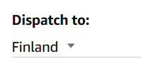

Vast'ikään huomasin, että [Saksan Amazon](https://www.amazon.de) on alkanut postittaa Echo -laitteita myös Suomeen.

\[caption id="attachment\_4187" align="alignnone" width="199"\] Amazon postitttaa Suomeen\[/caption\]

Siis eikun tilaamaan, jos kiinnostaa. [Lue aiemmasta artikkelistani, mitä laitteella voi tehdä](https://teuvovaisanen.fi/2016/12/21/amazon-echo-dot-tuli-taloon/).

Samalla myös hallintasovellus verkossa [https://alexa.amazon.com](https://alexa.amazon.com) mahdollistaa osoitteen määrittämisen Suomeen. Laite alkaa siis oikeasti toimia kunnolla Suomessa, toki suomenkieltä sille ei voi puhua ainakaan vielä.
