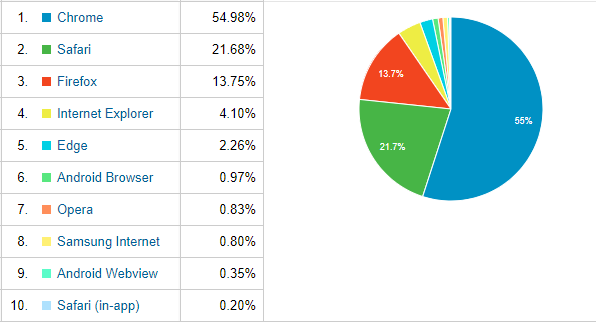
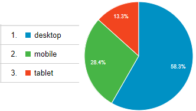
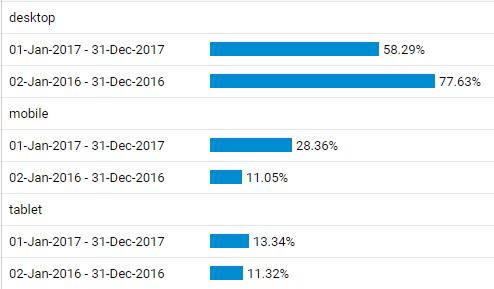
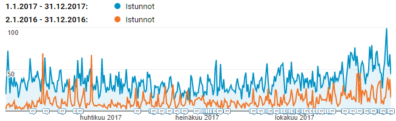

Olen pitänyt kirjaa sivustolla vierailevien käyttäjen selaimista alusta alkaen. Muutamaan vuoteen en ole siitä kirjoittanut, mutta nyt muutama käppyrä aiheesta.

<!--more-->

## Käytetyimmät selaimet - Top 10 -2017

Chrome on selkeä ykkönen, eipä yllätys, sillä se on maailmanlaajuisestikin käytetyin selain. Microsoftin selaimet ovat kuihtuneet marginaaliin ja ehkä yllättävintä on se ettei Edge ole noussut edes ikivanhan IE:n ohitse.

\[caption id="attachment\_4315" align="alignnone" width="596"\] Top 10 selaimet 2017\[/caption\]

## Desktop, tablet vai mobile?

Enemmistö vierailijoista on desktop -käyttäjiä.

\[caption id="attachment\_4313" align="alignnone" width="332"\] Desktop - tablet - mobile 2017\[/caption\]

Mobiilikäyttäjien määrä kuitenkin selvästi lisääntynyt edelliseen vuoteen verrattuna. Vuonna 2017 dekstop-käyttäjiä enää reilu puolet.

\[caption id="attachment\_4314" align="alignnone" width="494"\] Desktop vs tablet vs mobile 2017 - 2017\[/caption\]

## Mobiililaitteet Top 10 - 2017

1. Apple iPhone 23.40%
2. Apple iPad 20.01%
3. not set 3.98%
4. OnePlus A3003 3 2.51%
5. Huawei PLK-L01 Honor 7 2.18%
6. Samsung SM-G930F Galaxy S7 2.03%
7. Samsung GT-P5100 Galaxy Tab 2 10.1 1.96%
8. Samsung SM-G920F Galaxy S6 1.48%
9. Samsung SM-G935F Galaxy S7 Edge 1.48%
10. Huawei FRD-L09 Honor 8 1.47%

Oho, melkein joka toisella on i-laite. Veikkaan tämän johtuvan osittain siitä, kun [pidän säännöllisesti iPad -kurssia](https://teuvovaisanen.fi/kurssi/ipad-tabletti-haltuun/).

## Käynnit lisääntyneet

\[caption id="attachment\_4324" align="alignnone" width="654"\] Istunnot 2016 vs 2017\[/caption\]

Kävijämäärät ovat lisääntyneet roimasti. Siihen on selkeä syy, aloin pitkän tauon jälkeen kirjoittaa artikkeleita.

Katsotaan mitä vuosi 2018 tuo tullessaan. Hyvää uutta vuotta!
