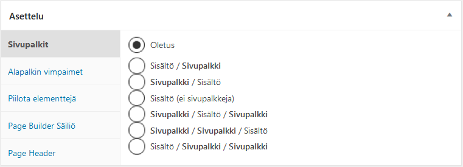
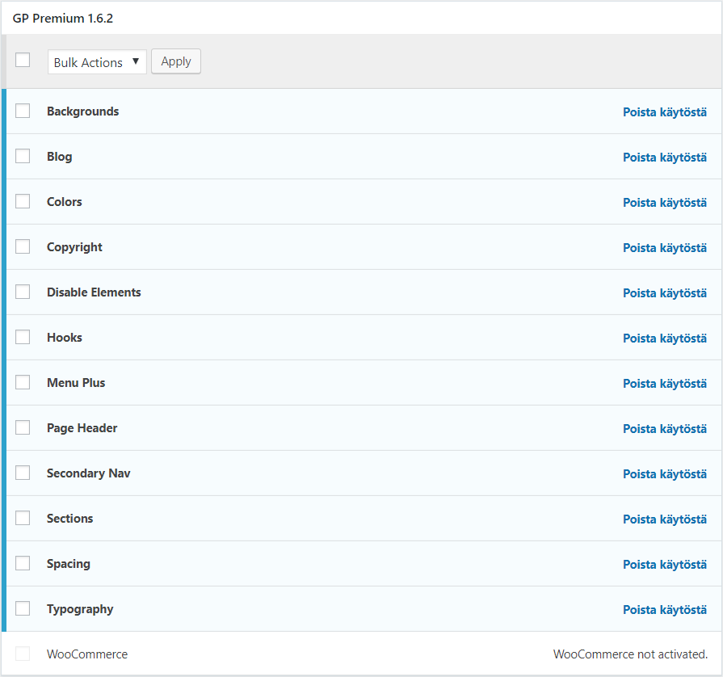

Vuosia käytin sivustollani vain maksuttomia teemoja. Vuonna 2016 kuitenkin päätin kokeilla jotain maksullista teemaa, sillä tarpeeni muuttuivat ja päädyin etsinnän ja harkinnan kautta valitsemaan [GeneratePress](https://generatepress.com/?ref=5784&utm_source=teuvovaisanen.fi&utm_medium=affiliate&utm_campaign=generatepress-praise) -nimisen teeman. Teemalla kokeilun aloitin sen maksuttomalla versiolla, mainio jo sekin sellaisenaan ja saattaa hyvinkin riittää yksinkertaisiin tarpeisiin. Maksullinen Premium -versio kuitenkin nostaa teeman ominaisuuksia hurjasti. Teema on monipuolinen, helposti räätälöitävissä ja siihen on saatavissa erinomainen tuki tekijältään kanadalaiselta pienyrittäjältä. Teemalla on hyvä asennuskanta ja sitä ylläpidetään kiitettävästi. Siinäpä tulikin tärkeimmät valintakriteerit :)

<!--more-->

## TLDR;

- GeneratePress -teema ja sen Premium versio soveltuu etenkin ei-koodaustaitoisille sivuston omistajille sillä moni ulkoasun säätö tehdään helpoilla teeman mukautin -valikon työkaluilla
- Myös edistyneemmille/koodarikäyttäjille teemasta löytyy mukavia ominaisuuksia
- Premium -versio ei ole todellakaan ole hinnalla pilattu. Himpun alle 60 kanadan dollaria ensimmäinen vuosi, seuraavista saa muistaakseni 40 % alennusta.
- Rajaton lisenssi, eli sivustoja saapi tehdä niin paljon kuin lystää, tämä sopii minulle, sillä teen jonkin verran sivustoja asiakkailleni.
- Uusimpana ominaisuutena tarjolla on runsaasti valmiita malleja, joiden avulla pääsee nopeasti liikkeelle

Ja ominaisuuksia premiumissa riittää, muutamasta niistä poimintoja seuraavaksi.

## Käyttöliittymän värit - Colors

Teema antaa hyvin laajat mahdollisuudet määrittää käyttöliittymän eri osien värit, kuten esim. runko, header, footer, sisältö, navigointi, vimpaimet, lomakkeet jne.  
Kun ensin saa suunniteltua oman hyvän väripaletin vaikkapa Adoben Color -palvelun avulla, on itse värien toteuttaminen teemassa helppoa. Et tarvitse CSS -kielen koodaustaitoja, vaan teeman mukauttimessa on helpot säätimet värin asettamiseksi.

## Sivuston typografia - Typography

GeneratePress käyttää oletusarvoisesti ns. Font Stackia eli yleisimpiä kirjasimia, joita käyttäjillä on koneillaan asennettuna. Näin sivuston käyttö hiukan nopeutuu. Toki voit helposti käyttää myös maksuttomia kirjasimia Gogle Fonts -palvelusta. Samaan tapaan kuin värien kanssa, voit mukauttimessa määrittää haluamasi kirjasimet ja niiden koon eri osiin käyttöliittymää kuten sivuston nimi, tagline, otsikot, navigointi, vimpaimet, footer jne. ilman CSS -koodausta helpoilla säätimillä.

## Käyttöliittymän osien asettelu - Layout

Teeman työkalujen avulla voi kontrolloida käyttöliittymän leveyttä ja sen sisällä olevien osien näkymistä. Samoin headerin ja footerin käyttäytymistä suhteessa sivuston sisältöosaan, sivuston nimen ja logon asetteluun on säätimet. Navigoinnin voi asettaa eri paikkoihin. Yksi näppärimmistä teeman työkaluista on sivun/artikkelin luomisen yhteydessä oleva työkalu, jolla voi yksilöllisesti määrittää ko. julkaisun ominaisuuksia, kuten sivupalkit ja tiettyjen osien piilottamisen.

<figure>

<figcaption>

 GeneratePress-Asettelutyökalu

</figcaption>

</figure>

## Käyttöliittymän osien taustakuvat - Background Images

Voit kontrolloida taustakuvia seuraaviin käyttöliitymänosiin: body, header, valikot ja niiden alavalikot, sisältöosa, sivupalkkki ja footer

## GP Hooks

Edistyneemmillekin käyttäjille teema tarjoaa jotain mukavaa. Teema tuo tullessaan GP Hooks -osion, jossa koodin kanssa työskentelemään tottuneet käyttäjät voivat lisätä omia toimintojaan kuten PHP-koodia, JavaScriptiä ja HTMLää haluamiinsa paikkoihin WordPressin suorittamaa koodia. Paikkoja ovat:

- wp\_head
- Before Header
- Before Header Content
- After Header Content
- After Header
- Inside Content Container
- Before Content
- After Entry Title
- After Content
- Before Right Sidebar Content
- After Right Sidebar Content
- Before Leftt Sidebar Content
- After Left Sidebar Content
- Before Footer
- After Footer Widgets
- Before Footer Content
- After Footer Content
- wp\_footer

GP hooks mahdollistaa osaavalle käyttäjälle todellisen räätälöijän taivaan :)

## GeneratePress Premium version hankinta

GeneratePress -teemasta on siis tarjolla maksuton versio. Premiumiksi päivittäminen tapahtuu lisäosan avulla. Ostat siis lisäosan (zip -paketti), lataat sen järjestelmään, aktivoit ja täytät saamasi lisenssikoodin ja sen jälkeen otat haluamasi ominaisuudet käyttöön.

Kunkin premium moduulin ominaisuudet on listattu teeman kotisivuilla ja useasta moduulista on myös olemassa lyhyt esittelyvideo. Jos kiinnostuit teemasta, vierailepa siis tutustumaan tarkemmin aiheeseen [GeneratePress Premium -sivuilla](https://generatepress.com/premium/?ref=5784&utm_source=teuvovaisanen.fi&utm_medium=affiliate&utm_campaign=generatepress-praise). Voit myös perehtyä [GeneratePress teeman ohjesivuille](https://docs.generatepress.com/?ref=5784&utm_source=teuvovaisanen.fi&utm_medium=affiliate&utm_campaign=generatepress-praise).

Tämä teema on sopinut itselleni mainiosti. Teen sillä jonkin verran sivustoja asiakkaille, joilla on usein on halu ja tarve myös itse päästä hieman säätämään oman sivustonsa ulkoasua. Tällä teemalla se onnistuu heiltä myös ilman HTML / CSS -koodaustaitoja käyttäen WordPressin mukautin-valikon työkaluja.

