Helpoin tapa asentaa WordPress omalle tietokoneelle on käyttää Bitnami WordPress Stack Installeria. WordPress tarvitsee alleen web-palvelimen ja tietokantapalvelimen, Bitnami tarjoaa tähän helpon kokonaispaketin yhdellä yksinkertaisella asennuksella.

<!--more-->

Siirry selaimella osoitteeseen [https://bitnami.com/stack/wordpress/installer](https://bitnami.com/stack/wordpress/installer)

Lataa sieltä Bitnami WordPress Stack Installer

<figure>

[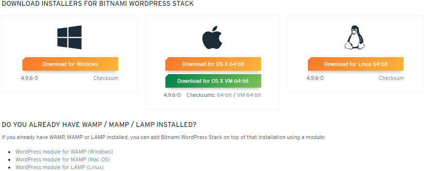](https://teuvovaisanen.fi/wp-content/uploads/2018/06/Bitnami-WordPress-Stack-Download.jpg)

<figcaption>

Bitnami WordPress Stack Download

</figcaption>

</figure>

Mikäli sinulla on jo koneellasi Web- ja tietokantapalvelin (esim. XAMPP), voit asentaa pelkän moduulin. [WordPress -moduulin asennuksesta olen kirjoittanut erikseen](https://teuvovaisanen.fi/2016/02/05/wordpress-asennus-omalle-koneelle/).

Mikäli sinulla ei ole ennestään asennettuna mitään, niin lataa koko stack. Tämä artikkeli kertoo stackin Windows -version asennuksesta.

## Bitnami WordPress Stack asennus

Asennus on todella helppoa, next next next -tyyliin. Käynnistä asennus lataamastasi installerista ja noudata ohjeita. Ohessa asennuksen vaiheet kuvagalleriassa.

- 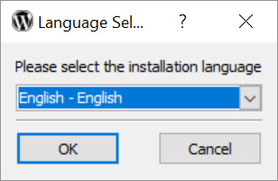
    
- 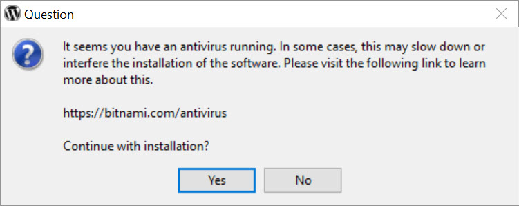
    
- 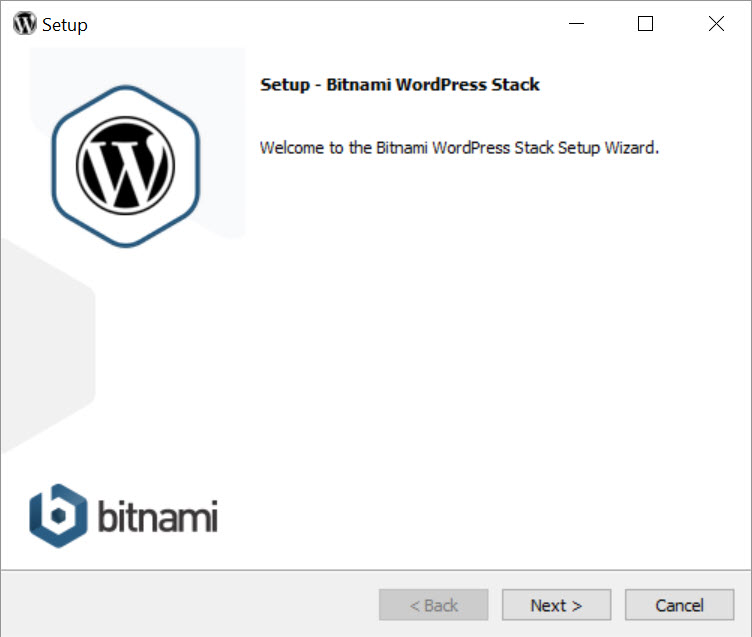
    
- 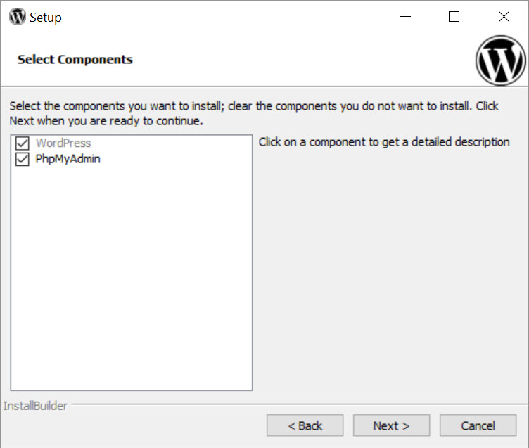
    
- 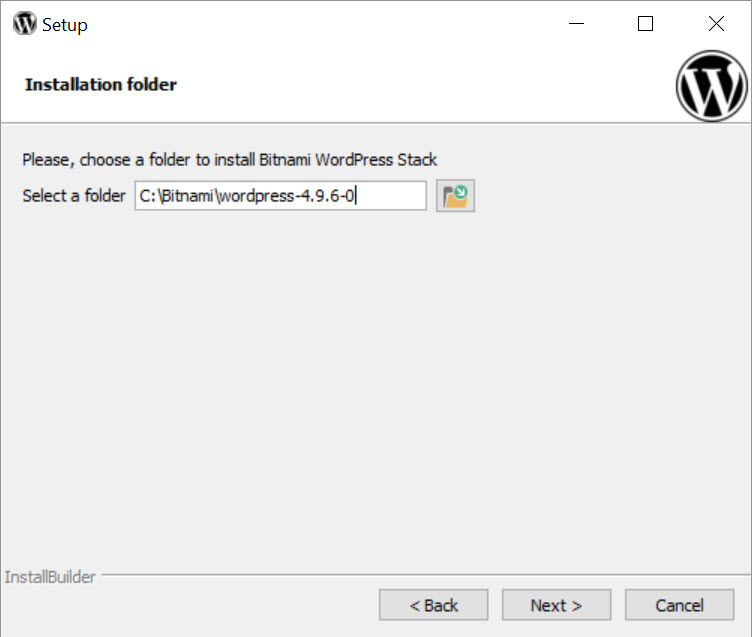
    
- 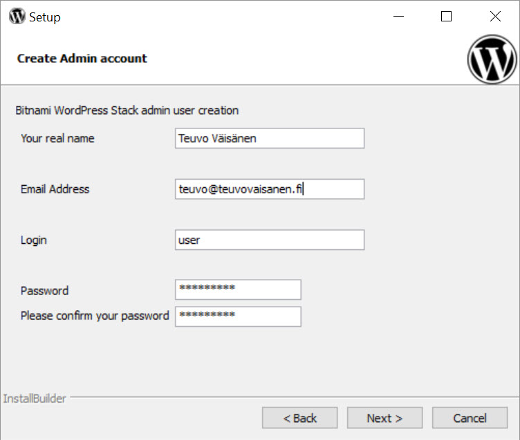
    
- 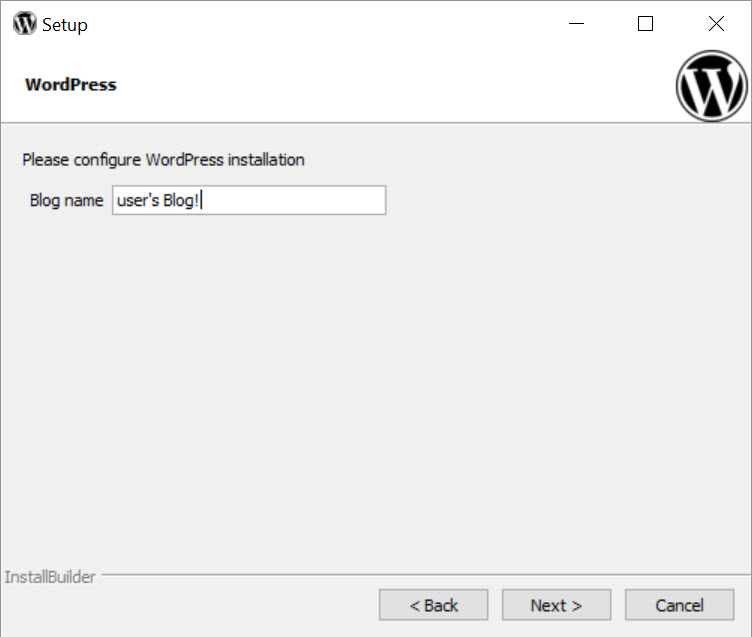
    
- 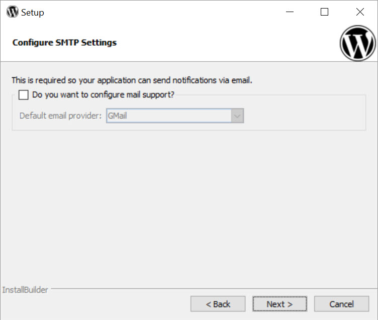
    
- 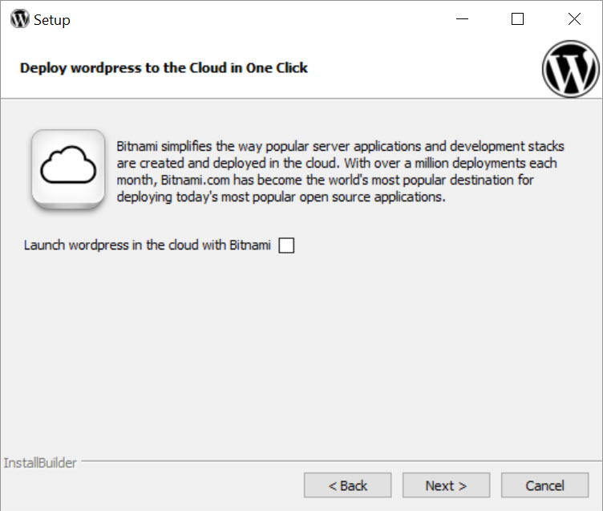
    
- 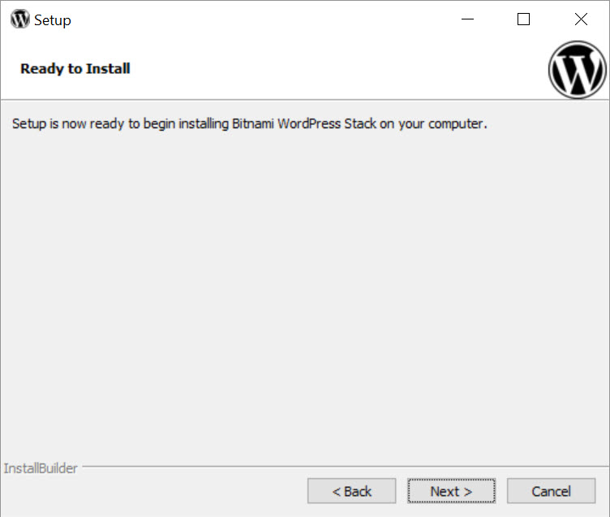
    
- 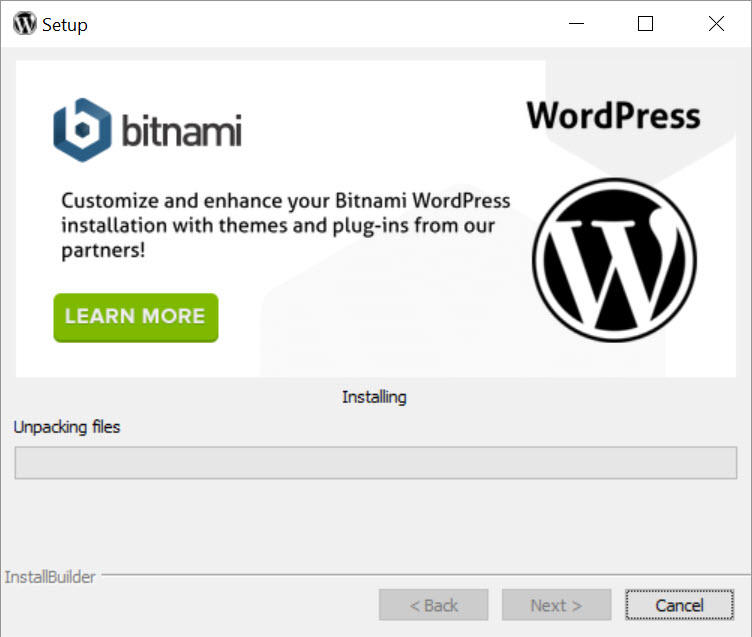
    
- 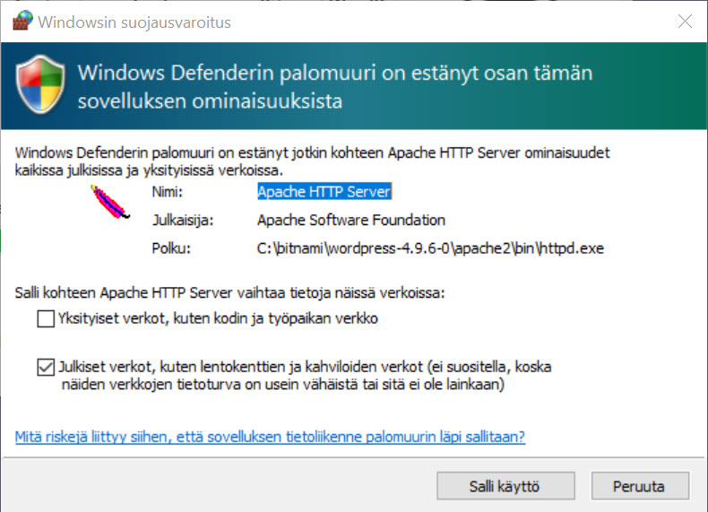
    
- 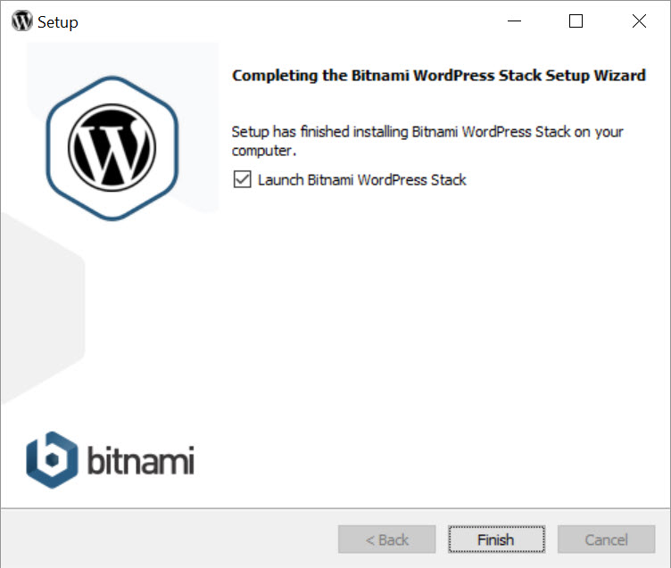
    
- 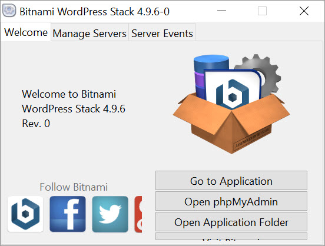
    
- 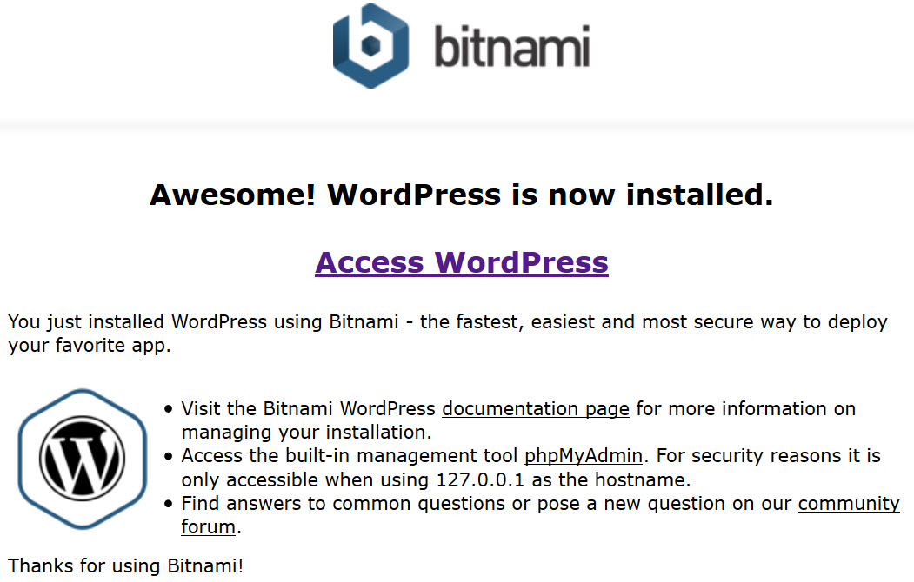
    

Asennuksen jälkeen sinulla on helppokäyttöinen oma paikallinen WordPress -asennus, jonka avulla voit huoletta kokeilla kaikkea mahdollista rikkomatta oikeaa Web -hotellissa olevaa sivustoasi. Siis helppo kehitysversio , joka ei näy avoimeen internettiin .

Käytä **windows-manager** -ohjelmaa palvelimien käynnistämiseen ja sammuttamiseen. Löydät sen asennuskansiosta C:\\bitnami\\asennuksesiversionumero  
Apache ja MySQL -palvelut käynnistyvät automaattisesti, harkitse niiden muuttamiseksi manuaaliseksi.

Voit myös ladata [Bitnami WordPress Stack asennus PDF](https://teuvovaisanen.fi/wp-content/uploads/2018/06/Bitnami-WordPress-Stack-asennus.pdf) eli asennusohjeet PDF -tiedostona, josta löytyvät yllä olevat kuvat hieman tarkemmin selitettynä.

WordPressin asentaminen omalle koneelle voidaan tehdä muullakin tapaa. Olen kirjoittanut niistä aiemmin, [lue XAMPPin asentamisesta](https://teuvovaisanen.fi/2016/02/04/wordpress-asentaminen-omalle-koneelle/) ja sen päälle [WordPress -moduulin asentamisesta](https://teuvovaisanen.fi/2016/02/05/wordpress-asennus-omalle-koneelle/).
