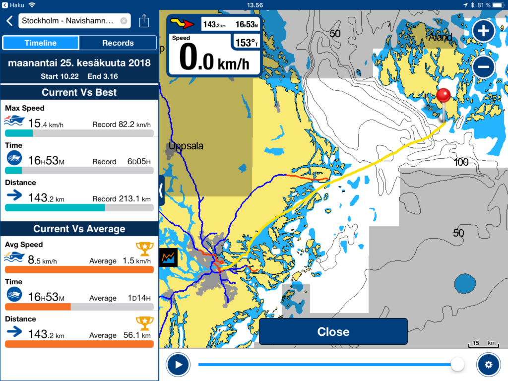
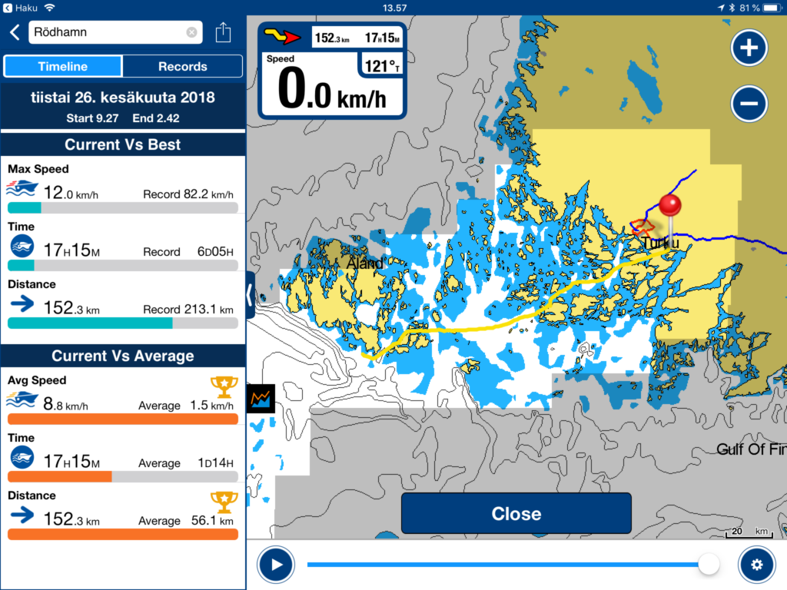

Pääsin tekemään pitkän ja mielenkiintoisen veneretken Ruotsista Suomeen. Vene oli ostettu Tukholmasta, eikä uusi omistaja voinut itse ajaa sitä Suomeen, vaan jonkun oli noudettava se sieltä. Lupauduimme kaverini kanssa ajamaan moottoriveneen Tukholmasta Suomeen Piikkiöön, josta vene sitten siirretään autokuljetuksella uudelle omistajalleen jonnekin järvi-Suomeen.<!--more-->

Matkasimme aluksi autolla Helsingistä Turkuun, josta yön yli Viking Gracella Tukholmaan.

\[gallery ids="4647,4648,4646"\]

Ruotsalainen kontaktimme oli aiemmin ajanut veneen Södertäljestä Tukholmaan, jossa se odotti meitä "lähtövalmiina" pienen kanavan rannalla aivan Viking Linen terminaalin lähistöllä.

## Veneen tiedot

- Malli: **Maxim 26**
- Materiaali: **Lujitemuovi**
- Moottori: **Volvo Penta MD 21A**
- Max. kierrokset 3400 rpm, matkanopeudella suositus 3000 rpm (ohjekirjan mukaan)

Ennakkotietoja veneestä oli niukalti, mutta niiden mukaan vene oli hyvässä kunnossa, riittävästi varustettuna matkaa varten, matkanopeutta luvattiin jopa 10-12 solmua. Matkan pitäisi siis taittua melko nopsaan, yhdellä yöpymisellä ja tarvittavilla fiilistelypysähdyksillä Ahvenanmaan ja Turun saaristossa. Noh, niukatkaan ennakkotiedot eivät aivan pitäneet paikkaansa...

\[gallery ids="4651,4652,4654,4653,4657,4656,4659,4658,4650"\]

Haasteita oli luvassa heti alkuunsa. Veneessä oli pohjassa läpivienti lokille, mutta lokia ei ollut laisinkaan asennettuna, vaan pelkkä peukalon kokoinen reikä suoraan mereen, jossa lokianturin olisi pitänyt olla. Onneksi reikä pohjassa oli pienessä suljetussa osastossa ja merivesi noussut reiästä osastoon vain n. 10 cm korkeudelle, eikä osastolta päässyt valumaan muualle veneeseen. Ensitöiksemme teimme tapin, suljimme reiän ja lappasimme muutaman litran vettä osastosta ulos.

Toinen haaste tulikin matkanopeudesta. Moottorilla ei voinutkaan ajaa ohjekirjan mukaisia ja meille luvattuja nopeuksia, vaan ainoastaan 2000 rpm kierroksilla, muuten moottori kuumeni liikaa. 2000 rpm tuottivat keskinopeudeksi vain n. 8,5 - 8.8 km tunnissa eli n. 4,7 solmua. Siis todella mateluvauhtia noin pitkälle matkalle. Moottorissa oli makeavesijäähdytys ja melko varmaan lämmönvaihtaja oli tukossa, eikä meriveden tuottama jäähdytys toiminut kunnolla. Edessä oli siis matka mateluvauhdilla, tarvittiin hyvää säätä ja lehmän hermoja, jos mieli perille Suomeen.

Pentterikään ei ollut kunnossa, joten lämmintä ruokaakaan ei ollut tiedossa, muuta kuin mahdollisissa pysähdyspaikoissa.

Puutteista huolimatta päätimme lähteä matkaan. Meillä oli onneksi pitkä alkumatka turvallisesti Ruotsin saaristossa Kapellskäriin asti, ja jos veneessä olisi ilmennyt isompia ongelmia alkumatkasta, olisimme keskeyttäneet matkan ennen Ahvenanmeren ylitystä. Lähtiessä keli oli hyvä, 4-5 metrinen vastatuuli, eikä sääennustekaan luvannut huonoa.

## Ensimmäisen päivän etappi - maanantai 25.6.2018

Ensiksi eväitä kaupasta ja sitten starttasimme Viking Linen terminaalin vierestä matkaan aamulla klo 9:20 hitaasti puksuttaen koillista kohti.  Alkumatka on pitkälti samaa reittiä kuin mitä "ruotsinlaivat" kulkevat. Tukholman saaristo suorastaan pullistelee hienoja rantahuviloita ja linnojakin nähtiin muutama. Hitaasta veneestä oli se ilo, että kerkesi katselemaan maisemia kunnolla.

Vaxholmissa tankki täyteen, olipas hauska jutella tankkausta tehneen ruotsalaispojan kanssa ruotsia pitkästä aikaa. Matka eteni hitaasti mutta ongelmitta suojaista reittiä pitkin kohti koillista ja Kapellskäriä, jossain vaiheessa piti päättää mennäänkö samantien yli vai jäämmekö yöksi Ruotsin puolelle.

Alkuillasta Kapellsärin kohdalle päästyämme, päätimme jatkaa matkaa Ahvenanmeren yli, vaikka tiesimme saapuvamme vasta yöllä Ahvenanmaalle. Sääennuste oli hyvä, 5-6 metrin pohjoisenpuoleista sivutuulta avomeriosuudelle. Taivas oli lähes pilvetön, kuukin vielä valaisi matkaa ja olihan muutenkin vuoden valoisin aika, joten yönselkään kohti Lemlandin eteläkärkeä.

Onhan se pitkä ylitys, linnuntietä n. 70 km. Alkumatkasta Kapellskäristä oli parisenkymmentä kilometria vielä rikkonaista ulkosaaristoa, ennen kuin oikea aava meri alkoi. Vastarantaa ei siellä näy. Onneksi oli kartat, kompassi ja navigaattori suuntanuolella, niiden avulla suuntima oli helppo pitää. Vain muutamia pienveneitä tuli vastaan, sen sijaan laivoja nähtiin useampia.

\[gallery ids="4690,4665,4664,4666,4663,4667,4668,4669,4662,4661"\]

Ensin tuli vastarannalta näkyviin tuulivoimala ja sitten pikkuhiljaa alkoi Ahvenanmaa hahmottua horisontissa. Olisi ollut hieno rantautua luonnonsatamaan, mutta ei kesäyössä näe rantakareja ja kun veneessä ei edes ollut kaikuluotainta, pysyimme siis GPS:n avulla kartalla "valkoisessa vedessä" ja väylillä ja suuntasimme siis turvallisesti ensimmäiseen Ahvenanmaalla vastaan tulleeseen vierasvenesatamaan.

**Yöpyminen Rödhamn -vierasvenesatamassa**

[http://segel.ax/hamnar/rodhamn/](http://segel.ax/hamnar/rodhamn/)

Vihdoin Suomessa klo 03:20, helpottunut olo ja samantien nukkumaan.

- ensimmäisen päivän etappi: 143,2 km
- ajoaika: 16 tuntia ja 53 minuuttia
- keskinopeus: 8,5 km tunnissa

\[caption id="attachment\_4671" align="alignnone" width="1024"\] Reittitiedot Tukholma-Rödhamn\[/caption\]

## Toisen päivän etappi: Rödhamn - Piikkiö

Aamuherätys kahdeksan jälkeen, viitisen tuntia unta takana. Pikainen kierros saaressa, todella hienot maisemat. Yllättävän vähän veneitä laitureissa. Pikainen aamiainen ja taas matkaan kohti Turkua klo. 9:20, edessä oli edellistä päivää pikkuisen pidempi etappi.

Dieseliä oli saatava lisää, joten kohti Degerötä ja Föglötä. Föglöstä menovettä tankkiin ja kylän kaupasta tuoretta evästä matkaan. Kyllä Ahvenanmaan saaristo on kaunis, ehkä tämän reitin hienoin osuus oli heti Degerön jälkeinen venereitti itään kohti Kihtiä. Olisipa ollut kiva pysähtyä, mutta hitaan veneen ja aikataulujen takia oli vain jatkettava matkantekoa.

Edessä oli vielä yksi iso selän ylitys, Kihti. Melko pian Kihdin selällä näytti akun varaustilanne kehnolta. Samaan aikaan aiemmin reilua puolta tankkia näyttänyt polttoainemittari oli tipahtanut alle kolmasosaan. Johtuiko kaikki akkujen varaustasosta vai oliko dieseliä oikeasti niin vähän? Otin tabletin ja puhelimen irti tupakansytyttimen kytkennästä eli veneen akuista ja liitin erillisen Anker -varavirtalähteen tietotekniikalle. Pikkuhiljaa alkoi veneen akkujen varaustilanne parantua ja samalla taas dieselmittari näytti puolta tankkia, mutta oliko niin oikeasti? Paras tankata kuitenkin uudestaan varmuuden vuoksi.  Vanhan veneen akkujen kunto alkoi nyt arveluttaa, onneksi oli yksi vara-akku, jos ongelmia tulisi. Suuntasimme Korppooseen kohti Verkania, siellä oli polttoaineen jakelupiste lähes reittimme varrella.

\[gallery ids="4679,4678,4680,4681,4674,4673,4676,4682,4675,4677"\]

Korppoon Verkanilla tankkaus ja kahvia, jota ilman olimme jo liian kauan olleet. Tästä matka jatkui hitaasti mutta ongelmitta kohti Piikkiötä, jossa meitä odotti laituri. Pääsimme perille laituriin ennen aamukolmea. Laiturin haltija kuskasi meidät Turkuun, josta jatkoimme omalla autolla Helsinkiin. Perillä kotona oltiin ennen aamukuutta.

- toisen päivän etappi: 152,3 km
- ajoaika: 17 tuntia 15 minuuttia
- keskinopeus: 8.8 km tunnissa

\[caption id="attachment\_4684" align="alignnone" width="1024"\] Reittitiedot Rödhamn-Piikkiö\[/caption\]

## Navigointi-  ja turvavarusteita

- Tukholman alueen isokokoinen **ruotsalainen merikorttisarja**, joka kattoi koko Ruotsin puoleisen alkumatkan
- **Ahvenanmaan merikorttisarja**, joka kattoi lähestulkoon koko Suomen puolen loppumatkan
- Tabletissa **Navionics Europe HD** -sovellus [https://www.navionics.com/fin/apps/navionics-boating](https://www.navionics.com/fin/apps/navionics-boating) (maksullinen versio), joka kattoi koko matkan
- Puhelimessa
    - **Sailmate** -sovellus [https://www.sailmate.fi/](https://www.sailmate.fi/) (maksuton versio), joka kattoi koko Suomen puolen matkan
    - **Maastokartat** [https://www.maastokartat.fi/](https://www.maastokartat.fi/) sekä
    - **112 Suomi** -sovellus [http://www.112.fi/hatakeskusuudistus/112suomi\_mobiilisovellus](http://www.112.fi/hatakeskusuudistus/112suomi_mobiilisovellus)
    - **Ilmatieteen laitoksen Sää** \-sovellus ja web-sivut [http://ilmatieteenlaitos.fi/](http://ilmatieteenlaitos.fi/)
- Varapuhelimessa myös Sailmate ja Maastokartat sekä 112 Suomi ja Sää -sovellukset
- Kompassi
- Kiikarit

## Lopun tunnelmat

Matkan aikana nähtiin normaaleja merilintuja kuten riskilöitä, ruokkeja, merimetsoja, merikotkia, kalasääskiä ja pari niiden pesääkin isojen merimerkkien päällä.

Matka oli hieno pienistä vastoinkäymisistä huolimatta, voisi mielellään noutaa toisenkin veneen Ruotsista ;) p.s. liveraportoin aiheesta jonkin verran matkan aikana Twitterissä [#noutoretki -tagilla](https://twitter.com/search?q=%23noutoretki&src=typd).
