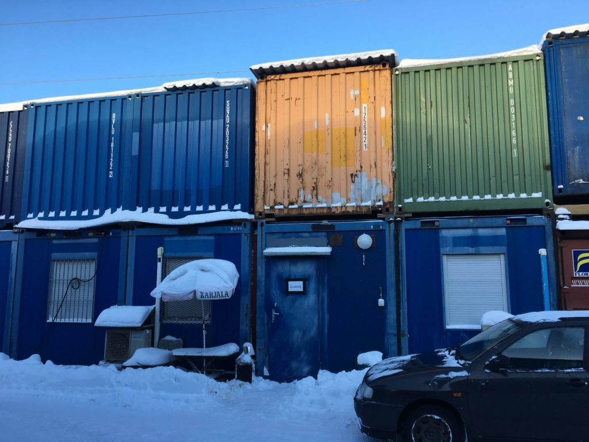
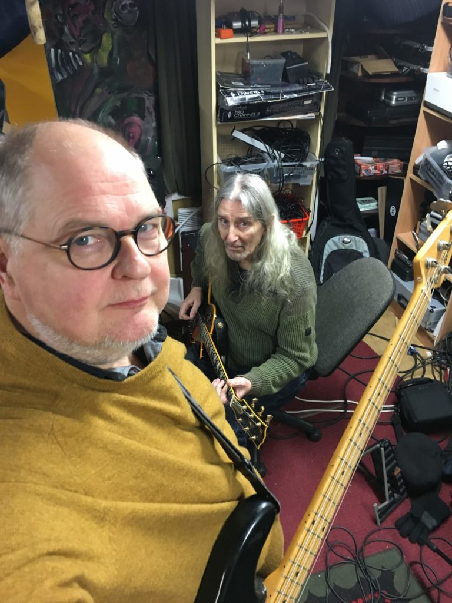
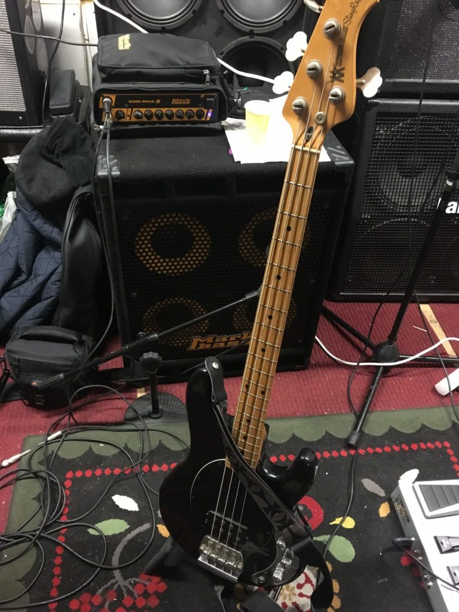
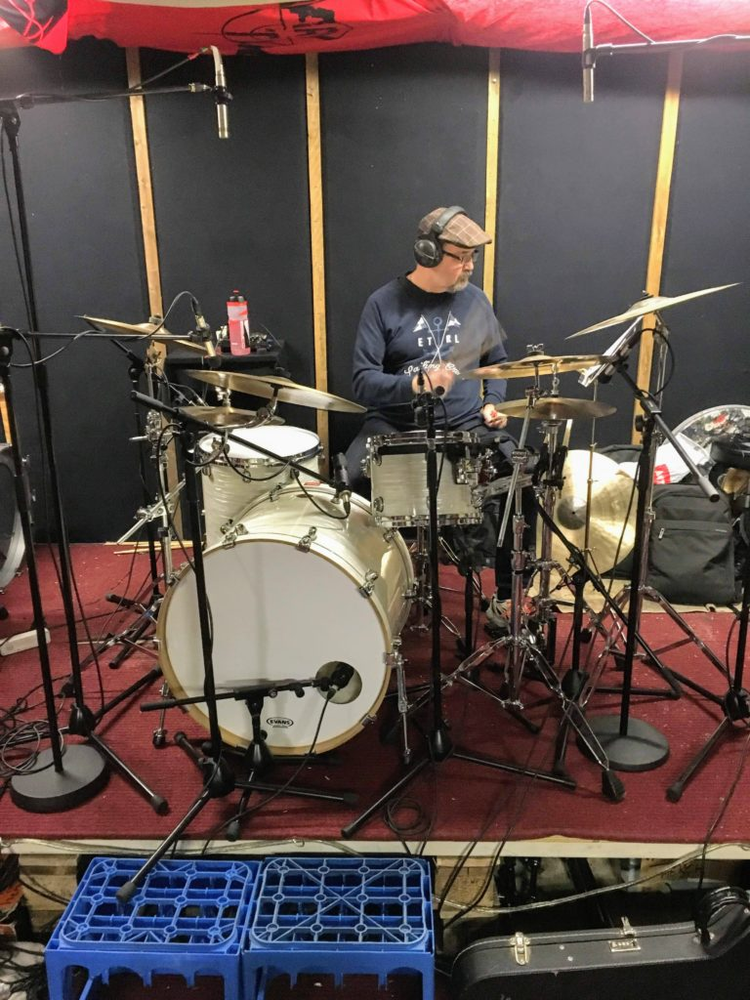
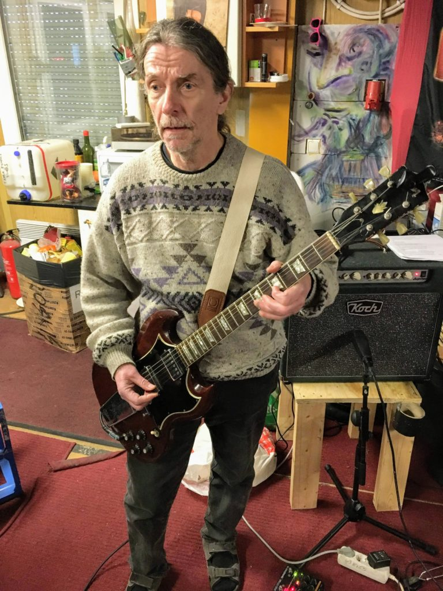
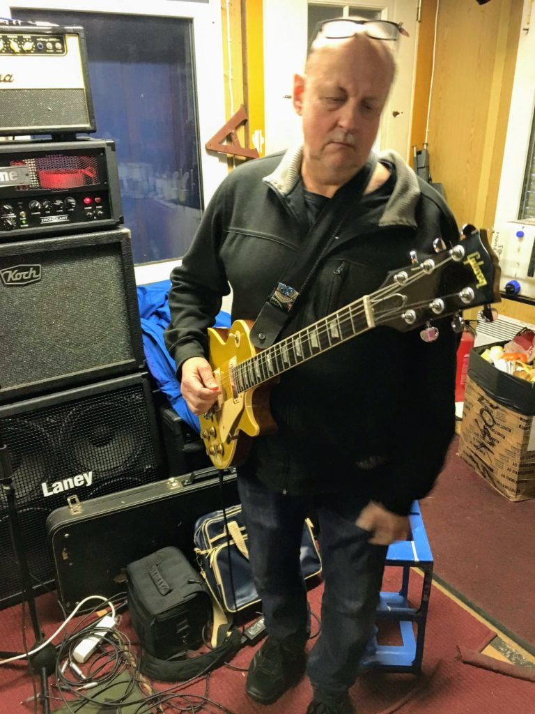
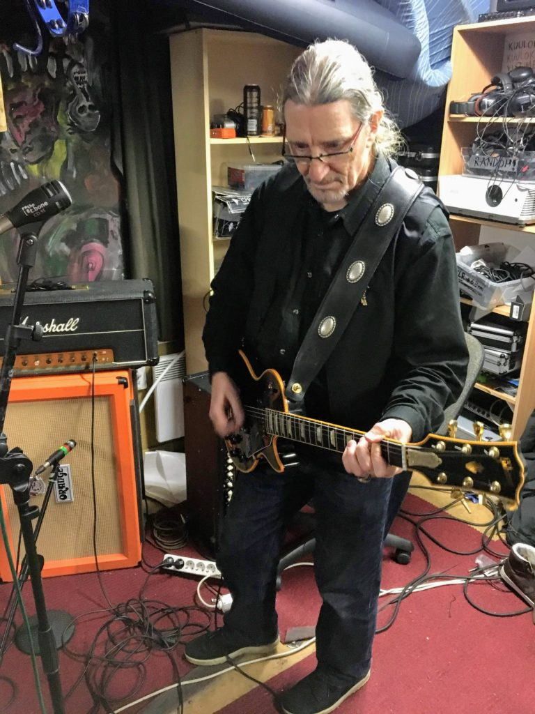
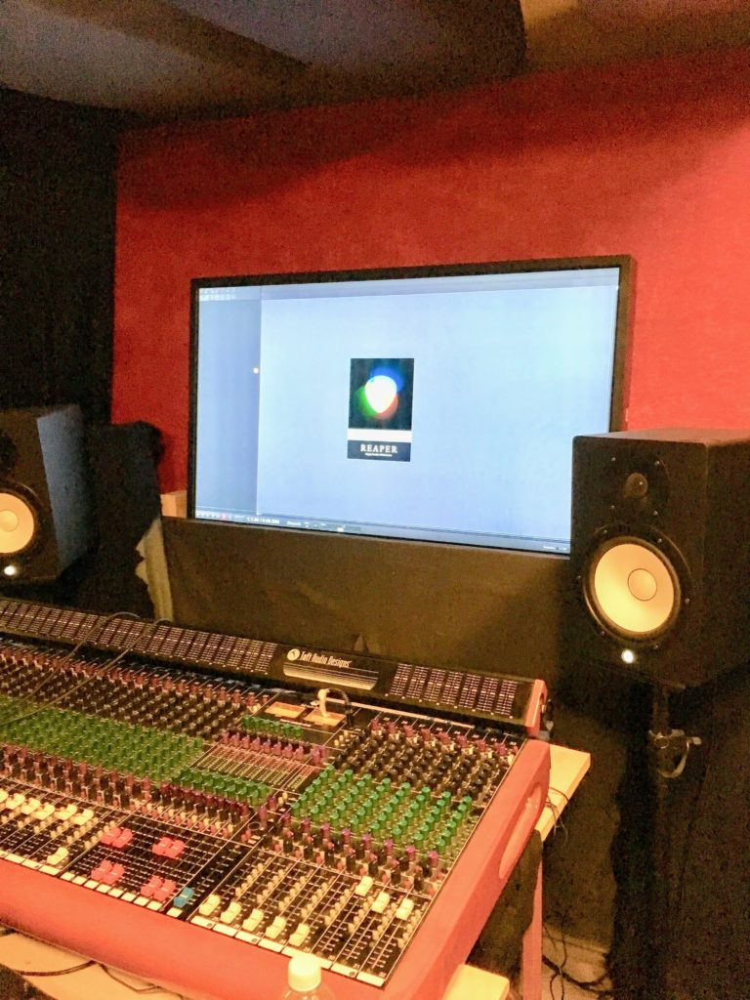

Aloitimme bändin kanssa tammikuun kolmannella viikolla levyn äänitykset [Saarni Music](https://www.saarnimusic.com/) \-studiolla. Tarkoituksena on äänittää neljä eri kappaletta ja levyksi asti tehdä.

Ensimmäinen studiopäivä meni rumpujen kasaukseen ja niiden mikitykseeen. Samoin mikitettiin muutkin soittimet/vahvistimet/kaapit äänitystä varten. Tehtiin muutamia koeottoja kaikista neljästä kappaleesta. Hauskaa.

Toinen studiopäivä sujui pohjien otoissa. Äänitettiin rummut ja basso livenä sisään. Onnistunut ja tehokas työrytmi.

Kolmas studiopäivä sujui kahden kappaleen kitaraäänitysten kanssa, hidasta hommaa. Liikaa jengiä hengailemassa ja häiritsemässä työskentelyä, eli ei niin kovin onnistunut työrytmi.

- <figure>
    
    
    
    <figcaption>
    
    Saarni Music - studio kontissa
    
    </figcaption>
    
    </figure>
    
- <figure>
    
    
    
    <figcaption>
    
    Stedi ja Stefan
    
    </figcaption>
    
    </figure>
    
- <figure>
    
    
    
    <figcaption>
    
    Stedin Musicman Stingray ja MarkBass -vahvistin sekä kaappi
    
    </figcaption>
    
    </figure>
    
- <figure>
    
    
    
    <figcaption>
    
    Juha ja studion kannut
    
    </figcaption>
    
    </figure>
    
- <figure>
    
    
    
    <figcaption>
    
    Kari ja Gibson sekä Koch kombo
    
    </figcaption>
    
    </figure>
    
- <figure>
    
    
    
    <figcaption>
    
    Keijo ja Gibson sekä Laney
    
    </figcaption>
    
    </figure>
    
- <figure>
    
    
    
    <figcaption>
    
    Stefan ja Gibson sekä Marshall -vahvistin
    
    </figcaption>
    
    </figure>
    
- <figure>
    
    
    
    <figcaption>
    
    Mikseri ja Reaper
    
    </figcaption>
    
    </figure>
    

Ennen studiosessioita näitä neljää kappaletta työstettin treenikämpillä, siellä tein itse äänitykset Zoom R24 -laitteella ja miksasin Ableton Studiolla. Nämä harjoitusotokset ovat kuultavissa bändin FB -sivuilla: [https://www.facebook.com/StefanPiesnackBand/](https://www.facebook.com/StefanPiesnackBand/)

Tammikuun viimeisenä viikonloppuna jatketaan äänityksiä.
