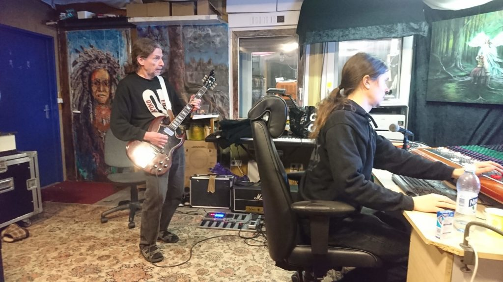
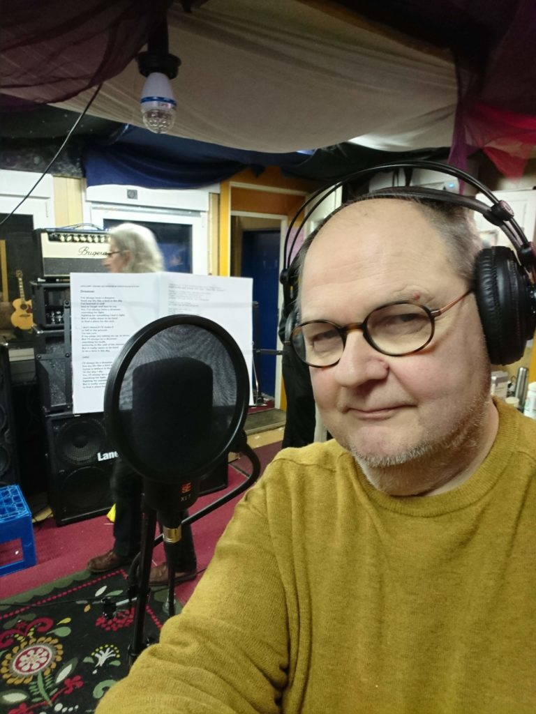
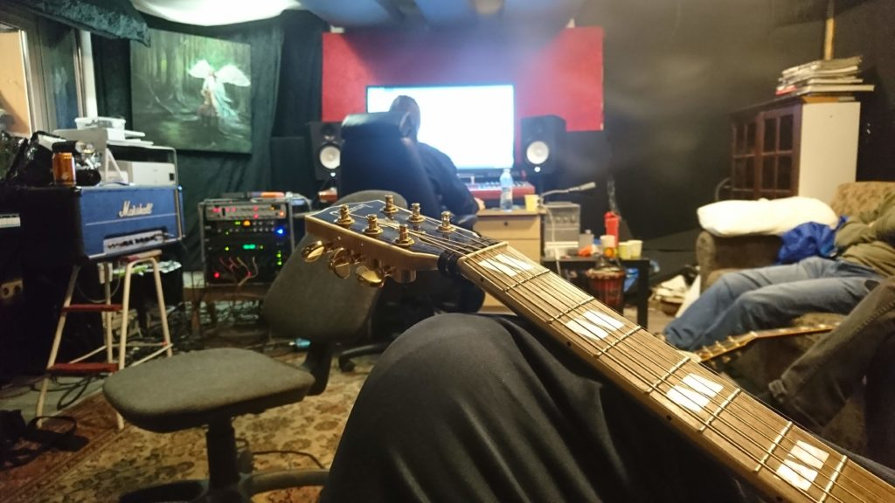
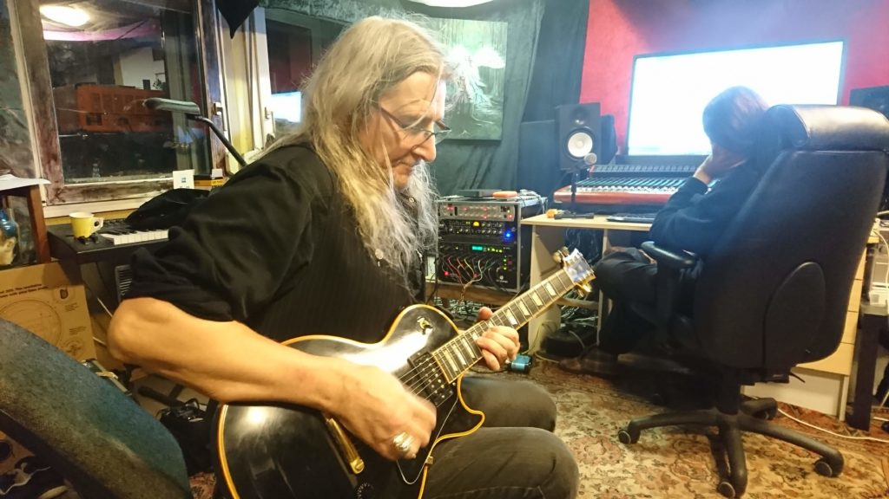
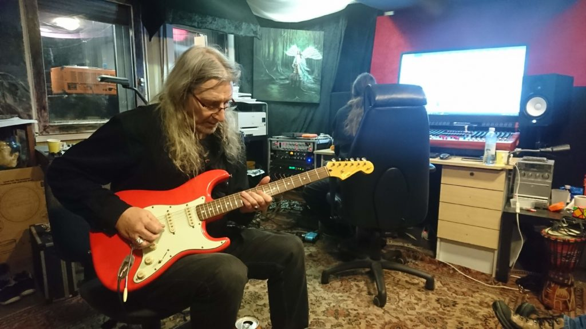
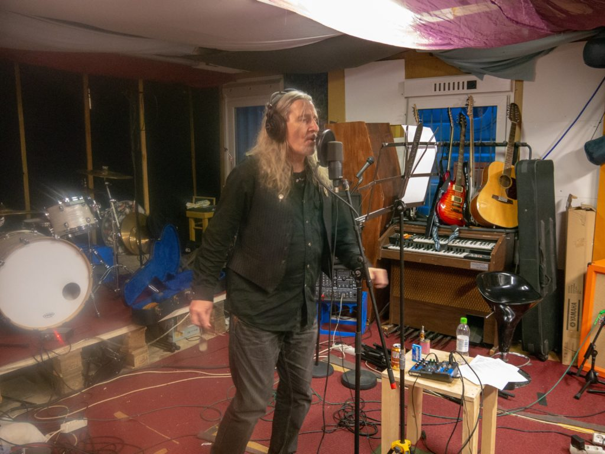

Ensimmäisen studioviikonlopun jälkeen oli arkitauko. Tähän astisista äänityksistä saatiin audiot kotiin kuunneltaviksi, jotta itse kukin voisi vielä hioa seuraavan viikonlopun koitoksiaan. Omalta osaltani soitot olivat jo sisällä, mutta lauluosuuksia oli hyvä treenailla kotistudiossa etukäteen Abletonin avulla.

Neljäs studiopäivä koostui kitaroista ja lauluista, samoin viides päivä. Kitarat pauhasivat äänitystilassa, mutta soitto soitettiin tarkkaamon puolelta. Laulut äänitystilassa. Kuudentena päivänä loput kitarat ja koskettimet.

- <figure>
    
    
    
    <figcaption>
    
    Kari ja 60-luvun Gibson sekä studion Markus
    
    </figcaption>
    
    </figure>
    
- <figure>
    
    
    
    <figcaption>
    
    Stedin laulusessiot Dreamerin parissa alkamassa
    
    </figcaption>
    
    </figure>
    
- <figure>
    
    
    
    <figcaption>
    
    Stedin akustinen Gibsonkin pääsi raidoille
    
    </figcaption>
    
    </figure>
    
- <figure>
    
    
    
    <figcaption>
    
    Stefan ja Gibson
    
    </figcaption>
    
    </figure>
    
- <figure>
    
    
    
    <figcaption>
    
    Stfan ja strato
    
    </figcaption>
    
    </figure>
    
- <figure>
    
    
    
    <figcaption>
    
    Stefan laulaa Crack Killeriä
    
    </figcaption>
    
    </figure>
    

Toisen viikonlopun jälkeen Saarni -studion Markus toimitti kuunneltavaksi raakamiksauksen, jotta saataisiin käsitys mitä ollaan saatu aikaiseksi. Toki lauluista ja kitaroista oli useita ottoja, niitä tultaisiin sitten käyttämään varsinaisessa miksauksessa, joka oli vuorossa seuraavalla viikolla.
