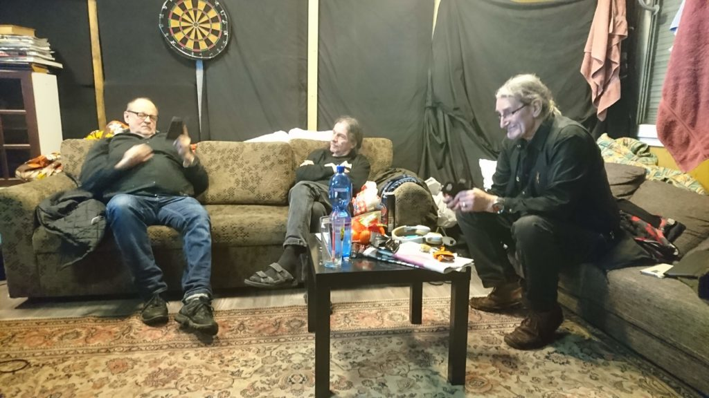
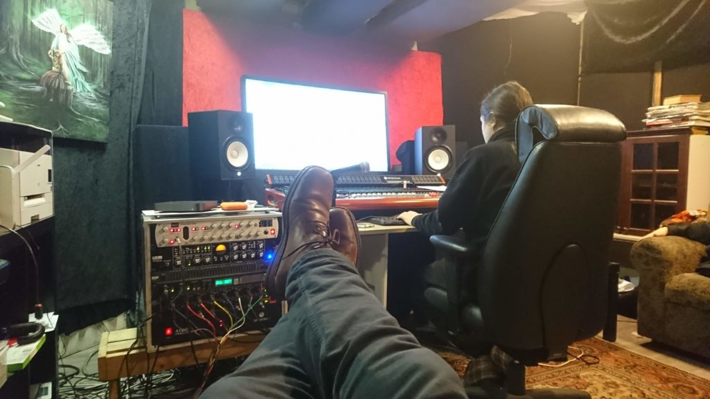
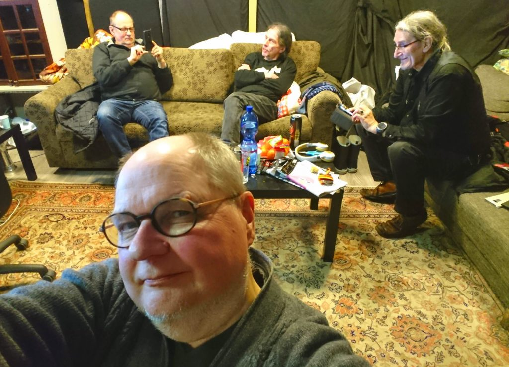

Kaksi viikonloppua (pe,la,su) takana ja äänitykset neljään biisiin tehty. Vuorossa miksauspäivä.

Ennen miksauspäivää tein kotona Ableton Studiolla erikseen muutaman lauluraidan Dreameriin, sillä en ollut tyytyväinen omaan suoritukseeni studiolla, ääni oli mm. käheänä. Taidot laulamiseen ovat muutenkin vajavaiset, huoh... Ne uudet laulujen otot onnistuivat kotona paljon paremmin ja siis ympättiinkin projektiin mukaan, nyt oikeastaan Dreamerin koko leadlaulu tulee kotona äänitettynä :)

- <figure>
    
    
    
    <figcaption>
    
    Keijo, Kretsu ja Stefu  
      
    
    
    </figcaption>
    
    </figure>
    
- <figure>
    
    
    
    <figcaption>
    
    Markus miksaa
    
    </figcaption>
    
    </figure>
    
- <figure>
    
    
    
    <figcaption>
    
    Stedi, Keijo, Kretsu ja Stefu
    
    </figcaption>
    
    </figure>
    

Aikaa miksaukselle oli siis pari tuntia per biisi. Miksauspäivä oli rento ja sujui hyvässä hengessä, biisien säveltäjät olivat tässä tärkeimmässä roolissa, heillä ehkä se paras näkemys omiin biiseihinsä tietty on.

Miksauksesta saatiin taas audiot arvioitavaksi jatkoa ajatellen.
