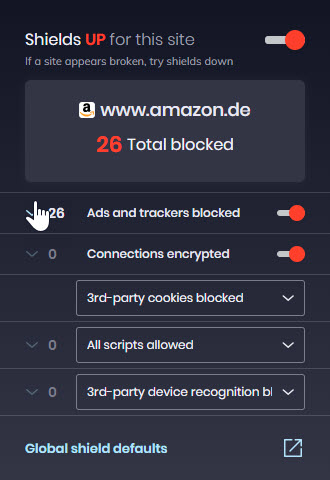
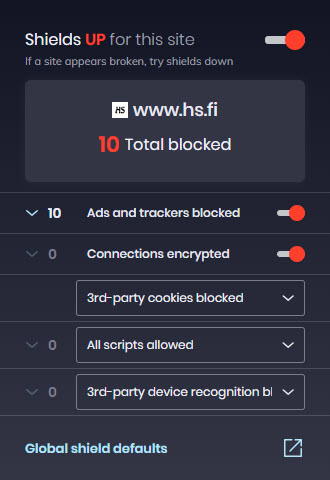
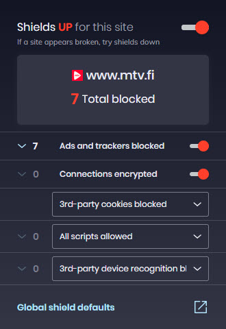
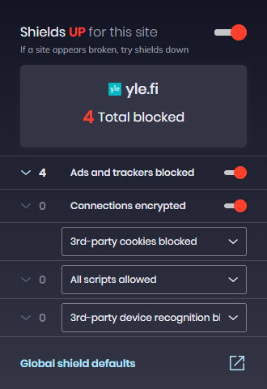
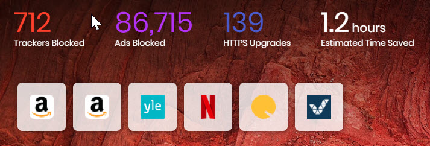
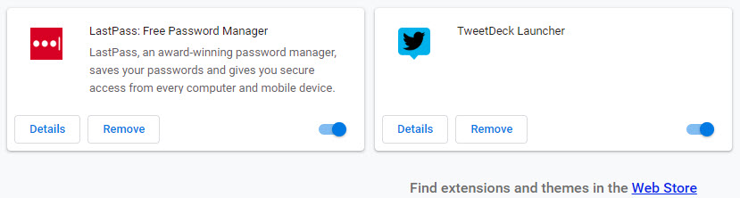

Brave -selain on kuin Chrome -selain, mutta ilman Google -kytköksiä. Brave selain estää haittakoodeja selatessasi verkkoa, pitää tietosi turvassa ja estää erilaisten seurantakoodien toiminnan. Selaimen kehittämisen takana on Mozilla -organisaatiosta tuttu Brendan Eich taustajoukkoineen.

Olen koeluontoisesti käyttänyt selainta sekä puhelimessa että desktopissa jonkin aikaa, vaikuttaa erinomaisen lupaavalta. Selain blokkaa seurantaskriptit tehokkaasti ja sivuilla hidastavat mainokset automaattisesti.

Esimerkkejä blokkauksista muutamalta sivustolta, joissa mainoksia ja seurantaa on käytössä:

- 
    
- 
    
- 
    
- 
    
- 
    

Brave kun on Chromium -pohjainen selain, niin siihen voi asentaa samoja lisäosia kuin itse Chromeenkin.

<figure>

<figcaption>

Brave lisäosat

</figcaption>

</figure>

Alla lyhyt esittelyvideo Brave -selaimesta.

https://player.vimeo.com/video/282341981

Brave -selaimen koti: [https://brave.com/](https://brave.com/)
