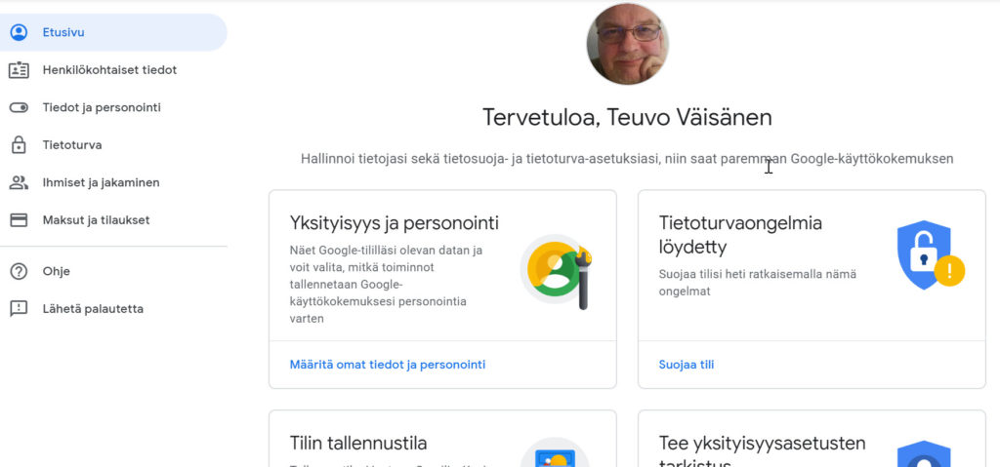
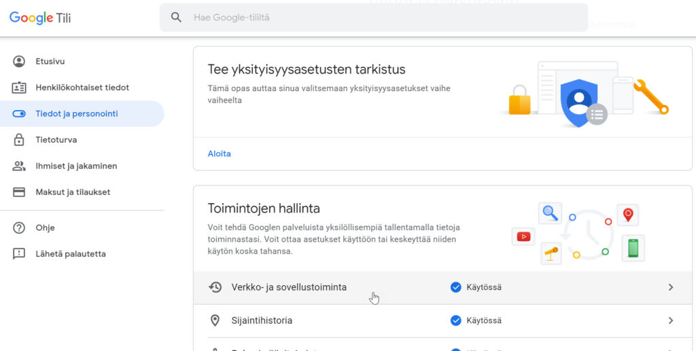
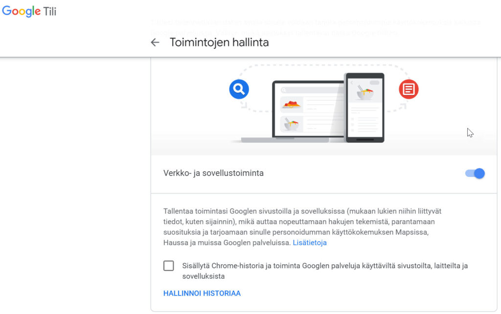
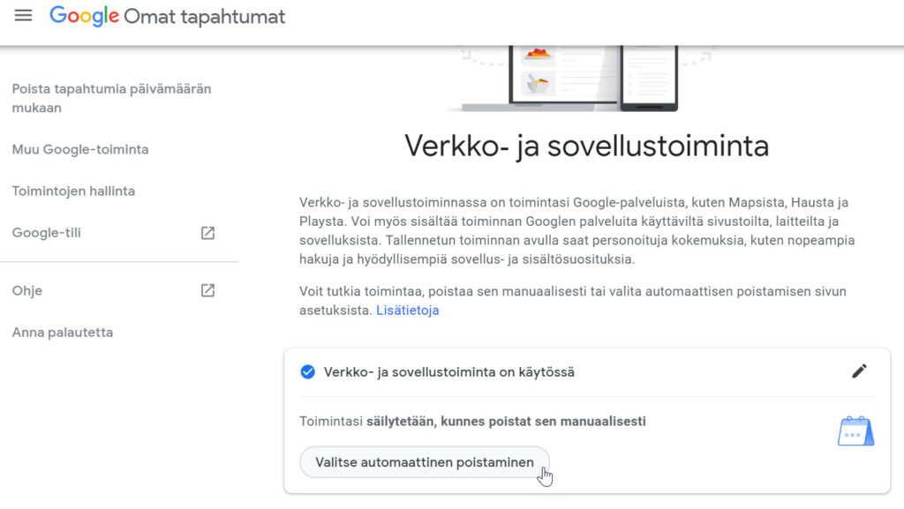
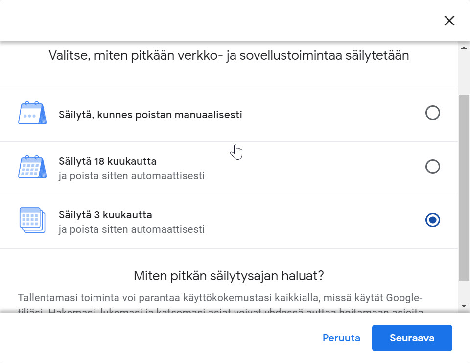
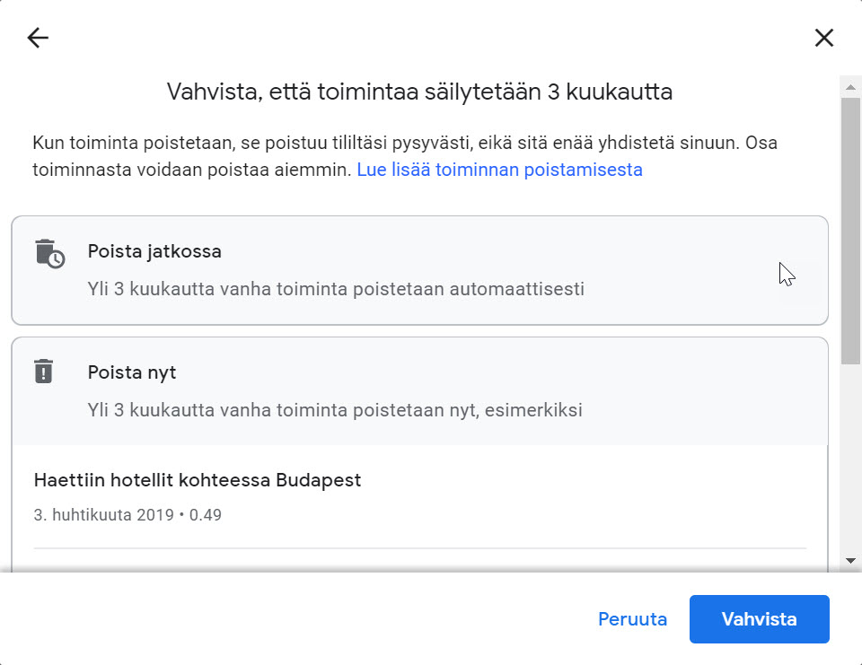
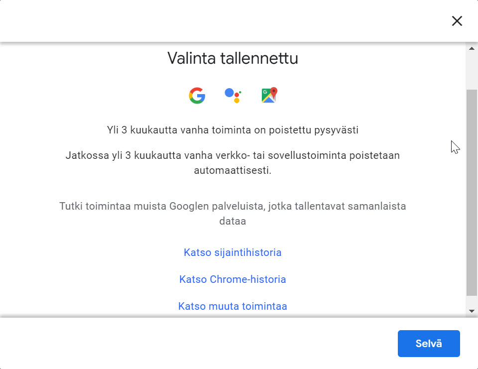

Google antaa nyt käyttäjän poistaa osan hakuhistoriastaan sekä sovellusten keräämistä tiedoista omalta tililtään. Yksityisyys ehkä hivenen petraantuu tämän muutoksen myötä.

Kun olet kirjautuneena Googleen esim. selaimellasi, on Google kerännyt esimerkiksi kaikki Googlehaut. Voit katsoa oman tilisi osalta mitä kaikkea Google muistaakaan sinun tehneen. Voit tutustua omaan haku- ja sovellushistoriaasi osoitteessa [https://myaccount.google.com](https://myaccount.google.com/)

Nyt kesästä 2019 lähtien Google antaa käyttäjän poistaa vanhimmat tiedot historiastasi ja voit antaa sen tapahtuvan automaattisestikin näin halutessasi. Voit määrittää tietojen poistumisen asetukset:

- poista 3 kuukautta vanhemmat
- poista18 kuukautta vanhemmat
- säilytä kaikki

Näin muutat omat asetuksesi:

1. Kirjaudu selaimella tilillesi osoitteessa [https://myaccount.google.com](https://myaccount.google.com/)
2. Siirry valikon kohtaan **Tiedot ja personointi**
3. Valitse **Verkko ja sovellustoiminta**
4. Valitse **Hallinnoi historiaa**
5. **Valitse automaattinen poistaminen**
6. Valitse haluamasi vaihtoehto ja siirry seuraavaan vaiheeseen
7. Vahvista valintasi ja saat ilmoituksen tehdyistä toimista

Ohessa vielä tämänhetkisen käyttöliittymän ruutukaappauksia eri vaiheista.

- 
    
- 
    
- 
    
- 
    
- 
    
- 
    
- 
    

Samalla kun vierailee tuolla oman Google-tilinsä asetussivulla, kannattaa muutenkin käydä omia tietoja läpi ja tehdä vaikka se avustettu tietosuojatarkistus.
