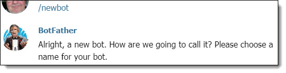
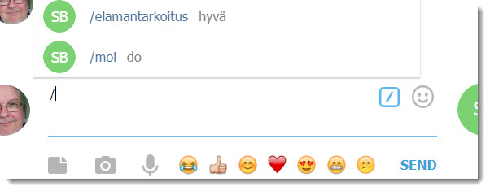
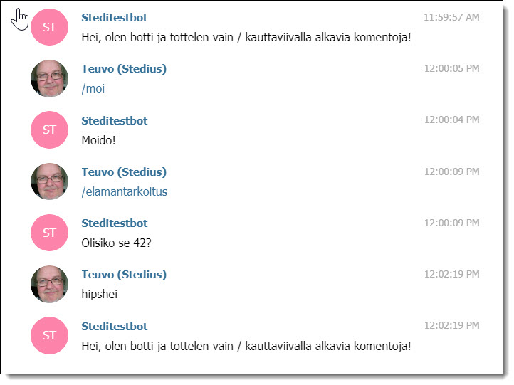

Sain ajatuksen rakentaa oma Telegram Bot PHP:lla, ihan vain oppimismielessä, kesän verryttelykoodauksena ;) . Se olikin kohtuullisen helppoa, sillä osaan jotenkin PHP:n alkeet ja internet on pullollaan esimerkkejä. Olen käyttänyt Telegram Messengeriä tähän asti pääasiassa yhteydenpitoon Ingress -peliyhteisön jäsenten kanssa. Telegramin käytön yhteydessä olen oppinut käyttämään toisten tekemiä botteja, ne ovat näppäriä ja hauskojakin apureita. Nyt opettelin tekemään oman Telegram botin.  
(Mikä on [bot eli botti](https://fi.wikipedia.org/wiki/Botti)?)

## Mikä on Telegram?

[Telegram Messenger](https://telegram.org/) eli lyhyesti TG, on Whatsappin kaltainen pikaviestinsovellus, mutta ilman Facebookin seuranta- / vakoilukytkentöjä ;) Sitä käytetään joko maksuttomilla mobiilisovelluksilla ( Android, iOS, WP), tietokonesovelluksilla (Windows, Mac, Linux) tai selaimella webissä (Chrome -sovellus), sovellukset löytyvät täältä: [https://telegram.org/apps](https://telegram.org/apps) . Sovellusta käyttöönotettaessa luodaan oma käyttäjätunnus.

## Telegram Botin luominen

Seuraavaksi botin tekemisen vaiheet.  
Omien TG -tunnuksien myötä siirrytään ko. palveluun jollain TG -sovelluksella ja etsitään palvelusta käyttäjää **@BotFather** (se on bot itsekin).  
Annetaan @BotFather'ille viestikentässä komento **/help**  
se listaa kaikki komennot, joita voi käyttää oman botin luomisessa ja interaktiossa @BotFather'in kanssa.

Oman botin luomisen aloitus komennolla **/newbot** ja seurataan @BotFather'in ohjeita.

<figure>



<figcaption>

Oma bot luodaan "keskustelussa" @BotFather'in kanssa

</figcaption>

</figure>

Telegram botin luomisen vaiheet on opastettu englanniksi selkeästi TG:n sivuilla [https://core.telegram.org/bots#6-botfather](https://core.telegram.org/bots#6-botfather) . Botin luomisen yhteydessä saadaan botille oma **token**, pieni tunnuskoodi, jota tarvitaan botin ohjelmoinnissa myöhemmin, se siis talteen!

## Omat komennot botille

Omalle botille voi määrittää @BotFather'in avulla komentoja, joihin sitten omassa PHP:ssa reagoidaan. Tässä tarvitaan apuna siis web -sivustoa, jossa PHP -koodi, tuo itse tehty botin toimintalogiikka asustaa. Sivustolla tulee olla SSL -suojaus, muuten kaikki Telegran APIn toiminnallisuudet eivät ole käytössä. Ohjelmointirajapintaan voi tutustua täällä [https://core.telegram.org/bots/api](https://core.telegram.org/bots/api)

Botin tottelemat komennot määritetään @BotFather'ille keskustellen samaan tapaan kuin itse botin luominenkin. Aloitus komennolla **/setcommands** , jonka jälkeen määritetään omat komennot. Määrittämisen jälkeen ne näkyvät oman botin kanssa keskustellessa kirjoittamalla kauttaviiva \[ / \] viestikenttään tai painamalla kauttaviivapainiketta.

<figure>



<figcaption>

Kauttaviiva viestikenttään tai kauttaviivapainike

</figcaption>

</figure>

Vielä nuo omalle botille itse tehdyt komennot eivät varsinaisesti tee mitään, sitä varten tarvitaan sitä PHP -koodia, jossa tehtyjen komentojen toiminnallisuus määritetään. Löysin Youtubesta hyvän tutoriaalin, jonka pohjalta itse valmistin oman bottini keskustelukoodin, kaikki kunnia siis Patrick Lemken v. 2015 tekemille videoille, jotka löytyvät Youtubesta [täältä](https://www.youtube.com/user/GangsterBossNuke/videos).

PHP -koodin on siis oltava palvelimella avoimessa internetissä, esim.:

```
https://munserveri.fi/kansio/munbottikoodini.php
```

Tässä minun palvelimellani asuva esimerkkibotin PHP -koodini:

```
<?php

$botToken = "SAAMASI_BOT_TOKEN_TULEE_TÄHÄN";
# tänne laitetaan siis botin luomisessa saatu token

$tgApi = "https://api.telegram.org/bot".$botToken;
# tässä osoite TG APIin ja sen perään konkatenoitu token

$update = file_get_contents('php://input');
# napataan TG:stä lähetetty viestidata, se tulee palvelusta JSON -formaatissa
# tallennetaan palautuva data muuttujaan 

$updateArray = json_decode($update, TRUE);
# muunnetaan APIlta saatu JSON -muotoinen data Arrayksi

# https://api.telegram.org/botSAAMASI_BOT_TOKEN_TULEE_TÄHÄN/getupdates
# palautuvan datan rakennetta voi tutkia yo. komennon avulla selaimessa

$chatId = $updateArray["message"]["chat"]["id"];
# tallennetaan id, jotta botti osaa vastata oikealle viestin lähettäjälle

$message = $updateArray["message"]["text"];
# napataan arraysta haluttu tieto eli komento, jonka botin käyttäjä lähetti TG:llä 

# alla komentoihin vastaaminen, komennot määritetään siis TG:ssä @BotFather'in kanssa
switch($message)  {
    case "/elamantarkoitus":
        sendMessage($chatId, "Olisiko se 42?");
    break;
    case "/moi":
        sendMessage($chatId, "Moido!");
    break;
    default:
        # kaikki muut tilanteet paitsi nuo caset
        sendMessage($chatId, "Hei, olen botti ja tottelen vain / kauttaviivalla alkavia komentoja!");
}

function sendMessage ($chatId, $message) {
	$url = $GLOBALS['tgApi']."/sendmessage?chat_id=".$chatId."&text=".urlencode($message);
    file_get_contents($url);
    # tämä on viestin lähettämisen funktio
}

#  webhook pitää laittaa päälle osoittamaan tämän PHP:n sijaintiin palvelimella

?>
```

Jotta botti "toimisi" eli jatkuvasti kuuntelisi sille mahdollisesti syötettyjä komentoja, on vielä asetettava ns. Webhook. Webhookin avulla Telegram -palvelu osaa välittää käytetyt komennot itse tehtyyn PHP -koodiin palvelimella. Webhookin asettaminen tapahtuu selaimen avulla kirjoitettamalla alla oleva komento selaimen osoitekenttään ja siirtymällä osoitteeseen, muistetaan tietty laittaa se oma token ja oman PHP:n sijainti tuohon ao. ritirampsuun.

```
https://api.telegram.org/botSAAMASI_BOT_TOKEN_TULEE_TÄHÄN/setwebhook?url=https://munserveri.fi/kansio/munbottikoodini.php
```

Palvelun asettamisesta saa selainikkunassa hyväksynnän, botti on toiminnassa.

```
{"ok":true,"result":true,"description":"Webhook was set"}
```

Bottia vaan testaamaan seuraavaksi.

<figure>



<figcaption>

Oma Telegram Bot

</figcaption>

</figure>

## Jatkokehittelyä

Mitä botin voi laittaa tekemään / vastaamaan tehtyihin komentoihin? Periaatteessa vaikka mitä, kannattaa tutustua aiemmin mainittuun [TG:n ohjelmointirajapintaan](https://core.telegram.org/bots/api).

Itselläni on ajatuksena etälukea kotona olevia Ruuvitag -antureita, olenkin kirjoittanut siitä eri tarinan: [Ruuvitag, Raspberry Pi ja Telegram Bot](https://teuvovaisanen.fi/2019/09/09/ruuvitag-raspberry-pi-ja-telegram-bot/)

Botin rakentelussa voi käyttää myös valmiita kirjastoja kuten esimerkiksi Githubista löytyvä **PHP Telegram Bot**, [https://github.com/php-telegram-bot](https://github.com/php-telegram-bot). Ehkä tutustun tuohonkin jossain vaiheessa.
