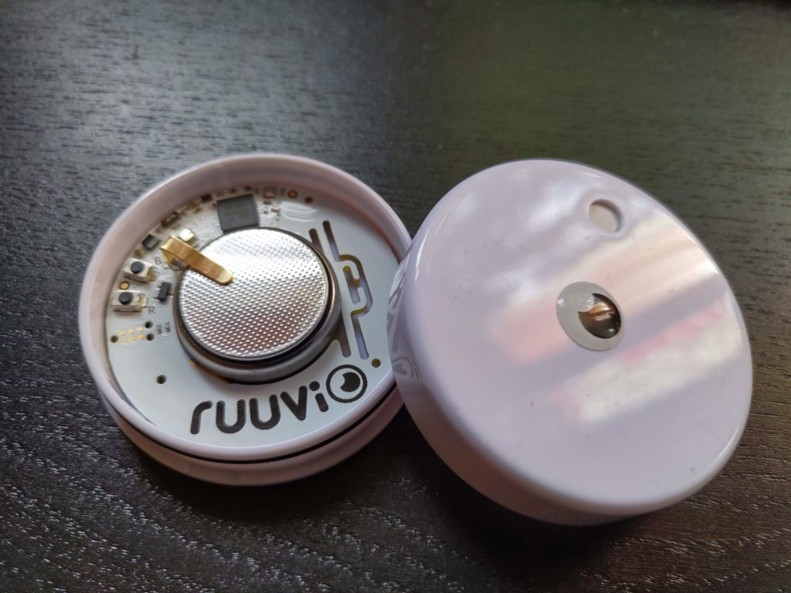
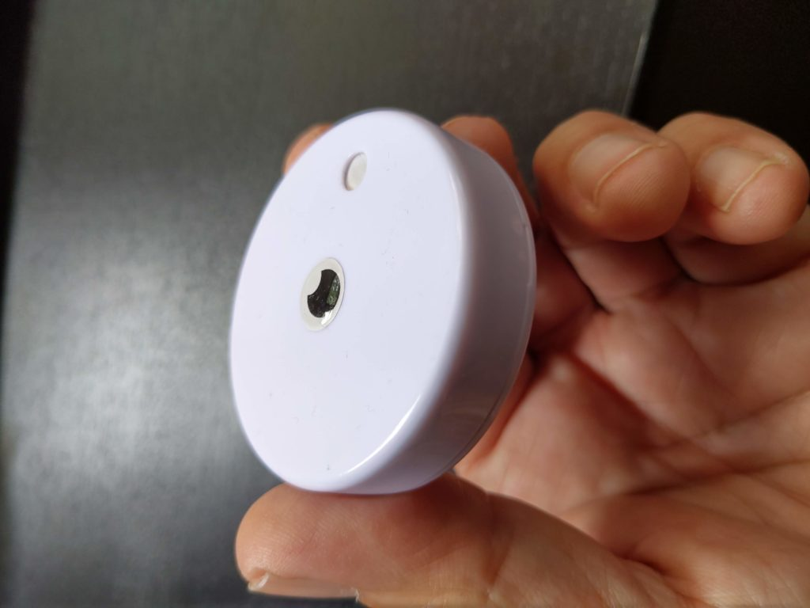
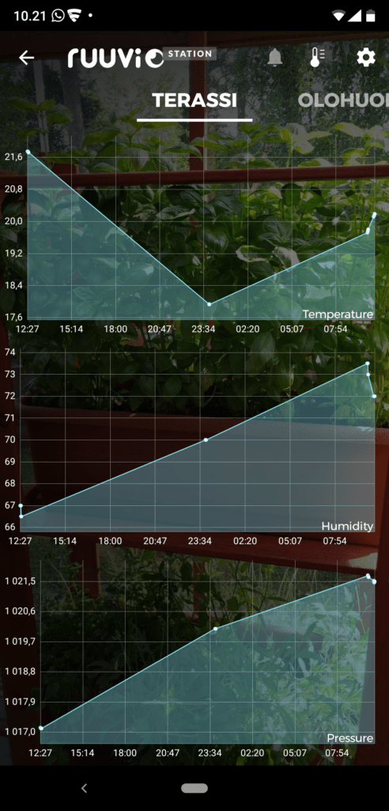
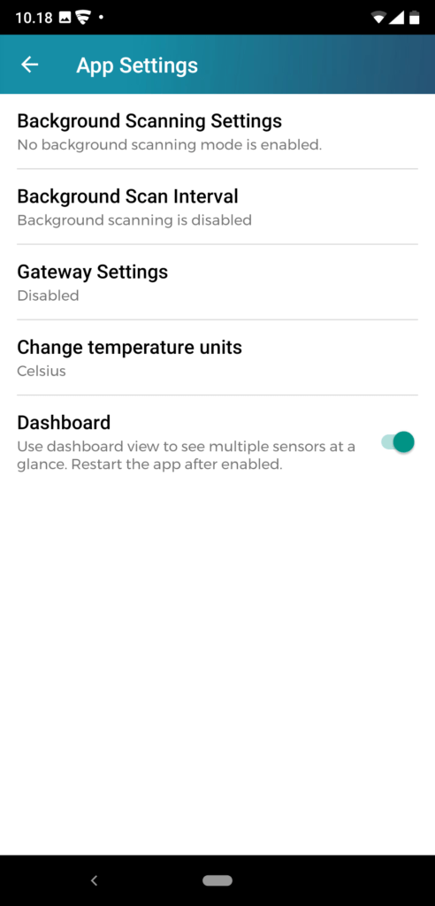
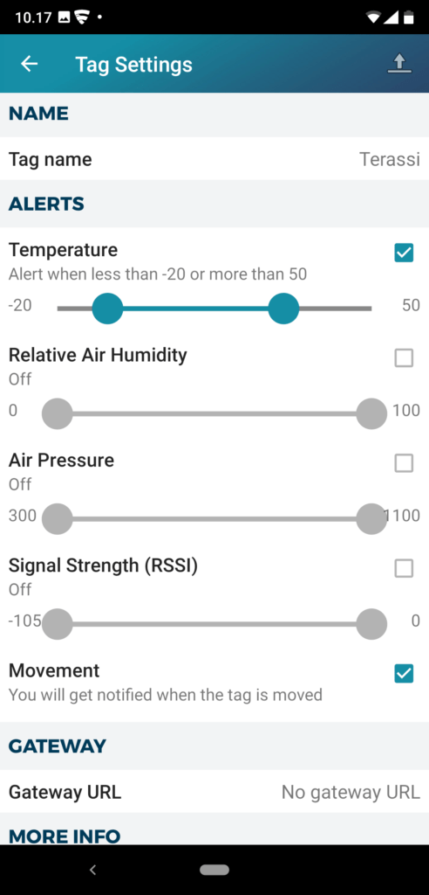
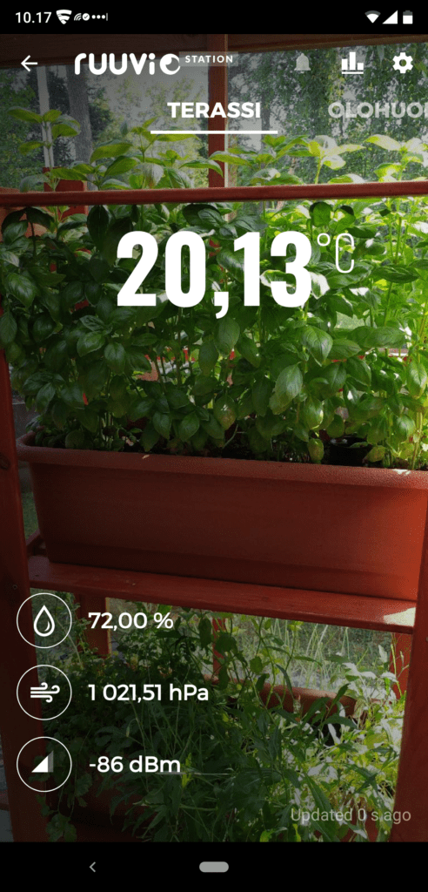
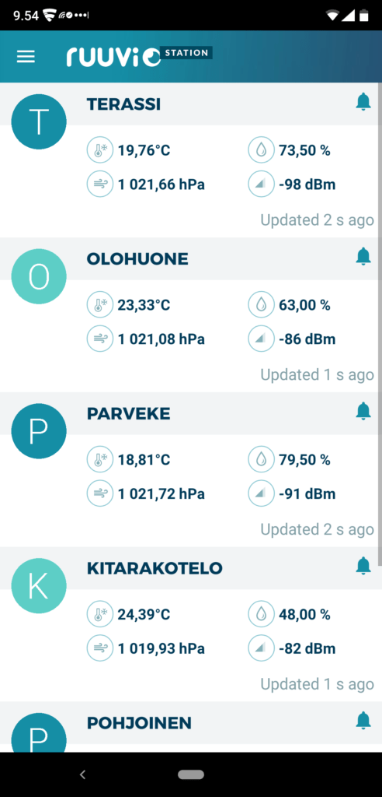

Hommasin kesällä aluksi kolme Ruuvitag -sensoria, sillä olen aina haaveillut omasta sääasemasta sekä ollut kiinnostunut antureista. Ruuvitag on kotimainen avoimen lähdekoodin sensorilaite, johon on saatavana maksuton mobiilisovellus (Android ja iOS). Sovelluksella voi lukea bluetoothin avulla sensorien jatkuvasti lähettämää dataa, kuten lämpötilaa, ilmankosteutta, ilmanpainetta sekä liikettä. Ruuvitag toimii käyttöönotettaessa sellaisenaan yksinkertaisena sääasemana.

- <figure>
    
    
    
    <figcaption>
    
    Ruuvitag sensori
    
    </figcaption>
    
    </figure>
    
- <figure>
    
    
    
    <figcaption>
    
    Ruuvitag on tikkuaskia pienempi
    
    </figcaption>
    
    </figure>
    

Ruuvitagit tulivat tilauksen jälkeen nopeasti postin avustuksella. [https://ruuvi.com/](https://ruuvi.com/)

Kännykkäsovellus **Ruuvi Station** sitten seuraavaksi lataukseen [https://play.google.com/store/apps/details?id=com.ruuvi.station&hl=fi](https://play.google.com/store/apps/details?id=com.ruuvi.station&hl=fi)

Sovellus löytää "kuuloetäisyydellä" olevat anturit ja ne lisätään sovellukseen. Anturit voi nimetä haluamallaan nimellä. Androidin Ruuvi Station -sovellus on merkittävästi monipuolisempi kuin iOS -versio (kuvakaappaukset Androidista).

- <figure>
    
    
    
    <figcaption>
    
    Ruuvi Station datan historianäyttö
    
    </figcaption>
    
    </figure>
    
- <figure>
    
    
    
    <figcaption>
    
    Ruuvi Station voi skannata antureita taustalla
    
    </figcaption>
    
    </figure>
    
- <figure>
    
    
    
    <figcaption>
    
    Ruuvi Station voi hälyttää kun anturien lukemissa tapahtuu jotain merkittävää
    
    </figcaption>
    
    </figure>
    
- <figure>
    
    
    
    <figcaption>
    
    Saat asetettua taustakuvan
    
    </figcaption>
    
    </figure>
    
- <figure>
    
    
    
    <figcaption>
    
    Monta anturia samalla näytöllä
    
    </figcaption>
    
    </figure>
    

Kännykkäsovellus toimii vain lähietäisyydellä, mutta yllättävän hyvin sovellus pystyy lukemaan eri anturien dataa, vaikka ne ovat betoniseinien takanakin. Avoimessa maastossa signaali kantaa satoja metrejä, hyvissä olosuhteissa jopa yli kilometrin, ei siis mikään ihan pilipali bluetooth. [Katso video kuuluvuustestistä](https://www.youtube.com/watch?v=wRpW2KIPfVo). Sensorin pariston luvataan kestävän pitkään, jopa toista vuotta.

Jos haluaa kauempaa, oikeasti etänä lukea antureiden lukemia, täytyy hieman koodailla. Alkuun pääsee helposti kännykän avulla, sillä jokainen anturi on mahdollista asettaa puskemaan dataa suoraan nettiin käyttämällä asetuksista löytyvää **Gateway** -asetusta sekä ajastusta. Puhelin puskee gateway -osoitteeseen anturin datan JSON -muodossa. Se täytyy sitten itse osata Webissä ottaa talteen ja manipuloida haluamallaan tavalla.

Kaiken kaikkiaan anturit toimivat moitteetta, ostinkin kolme lisää, yksi sujahti kitarakoteloon tarkkailemaan kosteutta. Jouduinkin hankkimaan kitaralle kosteuttimen, jotta optimisäilytysolosuhteet olisivat säilytyksessä kunnossa.

Tein kokeeksi Telegram Botin, jonka avulla pystyn etänä lukemaan gatewayn välittämää anturien dataa. Siinä ongelmana on vain se, että pitää olla yksi "ylimääräinen" kännykkä kokona koko ajan skannaamassa antureita. Alkukokeilujen jälkeen korvasinkin sitten kännykän myöhemmin Raspberry Pi -korttitietokoneella, siitä kirjoitinkin myöhemmin: [Ruuvitag, Raspberry Pi ja Telegram Bot](https://teuvovaisanen.fi/2019/09/09/ruuvitag-raspberry-pi-ja-telegram-bot/).
