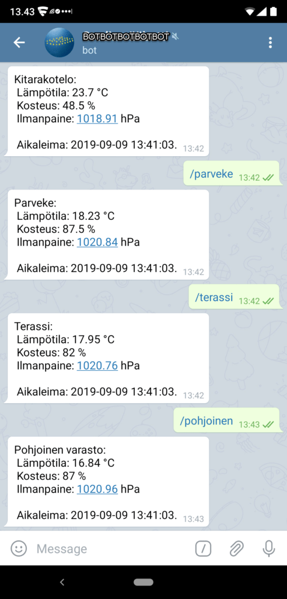

Kesän koodausprojekti sai jatkoa ja käyttämättömänä lojunut Raspberry Pi pääsi vihdoin oikeisiin töihin. Nyt Raspi skannaa Ruuvitageja ja minä voin etänä lukea anturien lukemia Telegramin avustuksella. Kuinkas tähän päädyttiin? Siitä seuraavaksi.

## Raspberry Pi käyttöönotto

Raspberry Pi (RPi) tarvitsee sisälleen käyttöjärjestelmän ja se asennetaan microSD -kortille. Käytössäni on RPi 3 Model B+. Sen käyttöönotto lyhykäisyydessään seuraavasti:

- muistikortin alustus SD Card Formatter -ohjelmalla  
    [https://www.sdcard.org/downloads/formatter/](https://www.sdcard.org/downloads/formatter/)
- Raspbian käyttöjärjestelmän imagen lataus  
    [https://www.raspberrypi.org/downloads/raspbian/](https://www.raspberrypi.org/downloads/raspbian/)
- Raspbian imagen laitto formatoidulle muistikortille Balena Etcherillä  
    [https://www.balena.io/etcher/](https://www.balena.io/etcher/)
- Muistikortti kiinni RPi:hin ja bootti sekä normaalit käyttöönottorutiinit
- SSH:n aktivointi ja laitteen uudelleennimeäminen

## Ruuvitag-sensor - Python -kirjasto

Githubista löytyy Pythonilla tehty kirjasto Ruuvitagien kanssa tehtävään tietoliikenteeseen.  
[https://github.com/ttu/ruuvitag-sensor](https://github.com/ttu/ruuvitag-sensor)  
Siellä on myös [kirjaston asennusohje RPi:lle](https://github.com/ttu/ruuvitag-sensor/blob/master/install_guide_pi.md).

Sain opetella hiukan Pythonin alkeita, jotta pärjäsin minulle vieraan ohjelmointikielen kanssa. Hidasta, mutta ei ylivoimaista ;)

Ko. kirjaston [examples -kansion esimerkeistä](https://github.com/ttu/ruuvitag-sensor/tree/master/examples) löysin itselleni sopivan skriptin, **post\_to\_server.py**, jota hieman muokkaamalla sain toteutettua sensorien datan skannauksen ja sen lähettämisen eteenpäin internettiin. Jonkin verran meni aikaa etsiessä RPi:lle sopivaa fyysistä paikkaa, josta se pystyy onnistuneesti skannaamaan eri puolilla asuntoa olevat Ruuvitagit.

```
#!/usr/bin/env python3
"""
Get data from sensors and post it to specified url in json-format

Requires:
    Requests - pip install requests
"""

import requests
from ruuvitag_sensor.ruuvi import RuuviTagSensor

macs = [
    'pilkulla',
    'erotettu',
    'lista',
    'sensorien',
    'MAC-osoitteita',
    'ZZ:XX:YY:11:AA:BB'
]

# This should be enough that we find at least one result for each
timeout_in_sec = 60

url = 'https://munserveri/data/ruuvitag-data-receiver.php'

datas = RuuviTagSensor.get_data_for_sensors(macs, timeout_in_sec)

# Use Requests to POST datas in json-format
requests.post(url,json=datas)
#print (datas)
exit()
```

Web -sivustolla on simppeli PHP -skripti odottamassa Python -skriptin lähettämää dataa. Se tallentaa pythonin lähettämän JSON -datan tekstitiedostoon palvelimelle.

```
<?php

file_put_contents('dataa-ruuvitageista.txt', file_get_contents('php://input'));

?>
```

Testauksen jälkeen Python -skriptin ajastus RPi:hin 10 minuutin välein. Ajastus Cronilla. Apua Cronin asettamiseksi sain täältä [https://crontab.guru/](https://crontab.guru/)  
Nyt RPi puskee 10 minuutin välein uusimmat sensorilukemat PHP -skriptille, joka taas tallettaa datan tekstitiedostoon sivustolleni jatkokäsittelyä varten.

## Telegram Bot

Koekäytettyäni muutaman päivän RPi:tä ja sen python -skriptiä, toteutin vielä tekstitiedoston datan lukemisen etänä TG botin ja PHP:n avulla. [TG Botin tekemisestä kirjoitinkin aikaisemmin](https://teuvovaisanen.fi/2019/07/19/oma-telegram-bot-php-kielella/). Ohessa pala koodia, jolla toteutin datan ujuttamisen botin vastaukseen. MAC -osoite esimerkkikoodissa on keksitty.

```
switch($message) {
	case "/terassi":
		//  JSON -tiedoston käsittely 
		$strJsonFileContents = file_get_contents("dataa-ruuvitageista.txt");
		$arrayKaikki= json_decode($strJsonFileContents, true);
		#var_dump($array); // print array
		if (preg_match("/EE:BB:99:BD:22:A1/", $strJsonFileContents)) 
		{
			$msgT = $msgT."Terassi: \r\n".
			" Lämpötila: ".$arrayKaikki["EE:BB:99:BD:22:A1"]["temperature"]." °C\r\n".
			" Kosteus: ".$arrayKaikki["EE:BB:99:BD:22:A1"]["humidity"]." %\r\n".
			" Ilmanpaine: ".$arrayKaikki["EE:BB:99:BD:22:A1"]["pressure"]." hPa\r\n\r\n".
			" Aikaleima: ".date("Y-m-d H:i:s.",filemtime("dataa-ruuvitageista.txt"));
		} else 
		{
			$msgT = "Terassille ei ole yhteyttä.";
		}

		#echo $terassimsg;
		sendMessage($chatId, $msgT);
		break;

	case "/olohuone":
ja niin edelleen
```

Ja tältä se näyttää puhelimen TG:ssä



Hyvin toimii, nyt jo muutaman viikon data rullannut itsekseen ja botilla voin etänä tarkistaa tilanteen.

## Jatkokehittelyä

Botti on nyt julkinen, joten kuka vaan voi lukea sensorilukemia omalla TG:llään, jos tietää bottini nimen. Tämä täytyy jatkossa suojata, tulen jossain vaiheessa siirtämään botin toimimaan vain TG -ryhmässä, jotta voin valvoa pääsyn sensorien dataan.

Samalla aioin toteuttaa hälytykset eli esim. jos kitarakotelossa tulee liian kuivaa, botti lähettää siitä minulle erikseen viestin.
