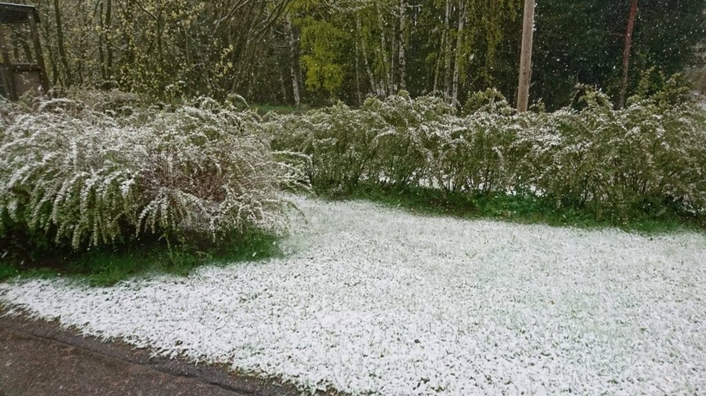
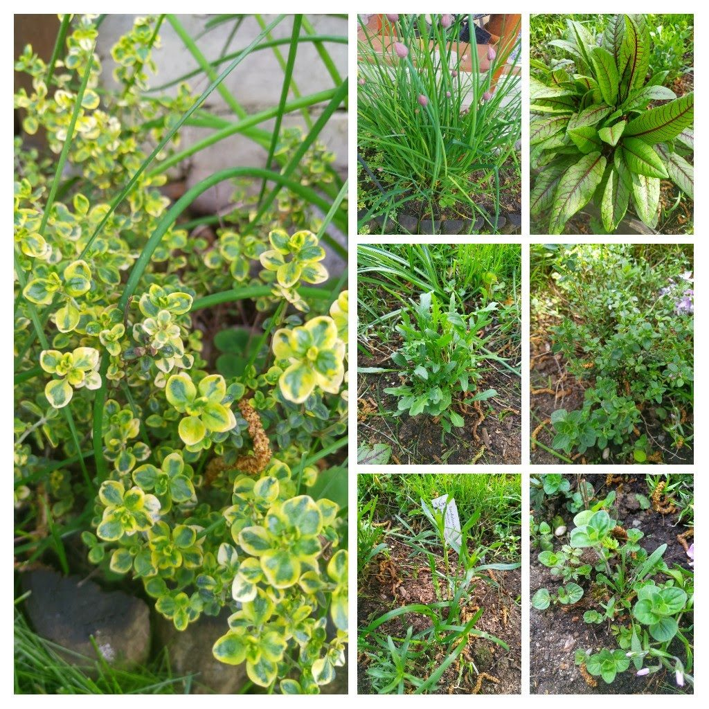
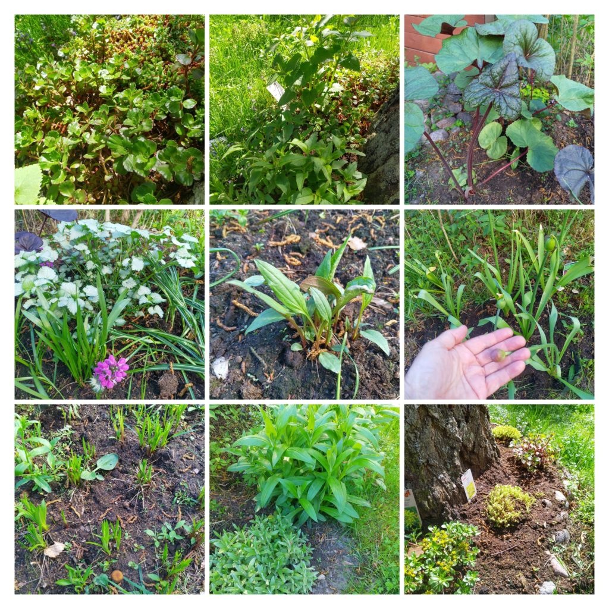

Kesä tuli hissukseen aika viileän toukokuun alun jälkeen. Toukokuussa saatiin kai talven lumiennätyskin aikaiseksi.

<figure>

<figcaption>

Takatalvi

</figcaption>

</figure>

Maassa onnistuneesti talvehtineita yrttejä olivat kaupan ruukuista maahan tökätyt **korianteri**, **rakuuna**, **sitruunatimjami**, **timjami**, **oregano**, **viinisuolaheinä** ja tietysti jo monen vuoden takaa rehottava **ruohosipuli**.

**Basilika**t ovat jo altakasteluruukussa sisäterassilla, mutta pihalle on menossa vielä ainakin **rosmariini**, joka ei tästä lumettomasta talvesta säilynyt hengissä.

<figure>

<figcaption>

talvehtineet yrtit

</figcaption>

</figure>

Perhos- ja pörriäiskasveista talvehtivat mm. **valkotäpläimikkä**, **kallionauhus, täpläpeippi,** neljä viidestä **punahatusta**, syksyllä istutetut **laukat** eli **alliumit, punatähkät**, **helminukkajäkkärät, vuorikaunokit,** **yrtti-iiso**, **tarhaväriminttu** ja erilaiset **maksaruohot**.

Pihan ulkopuolelle siirretyt preeriavärimintut, harjaneilikat ja pieni sammalleimurypäs näyttävät myös olevan elossa.

<figure>

<figcaption>

talvehtineet pörriäiskasvit

</figcaption>

</figure>

Jotain uuttakin on laitettu kevään mittaan kasvamaan. **Vaarinlaukka, kirjokuulijoja, iisoppeja**. **helmihyasintteja**, sekä lisää **sedumeja** eli **maksaruohoja.** Kesän pörriäisiä odotellessa. Nurmikkoa ei leikata ennen kuin on pakko, noudatetaan pitkälti [Pelasta pörriäinen](https://yle.fi/aihe/artikkeli/2020/04/01/viisi-tapaa-pelastaa-porriainen-valitse-omasi-ja-merkkaa-tekosi) -kampanjan periaatteita.
