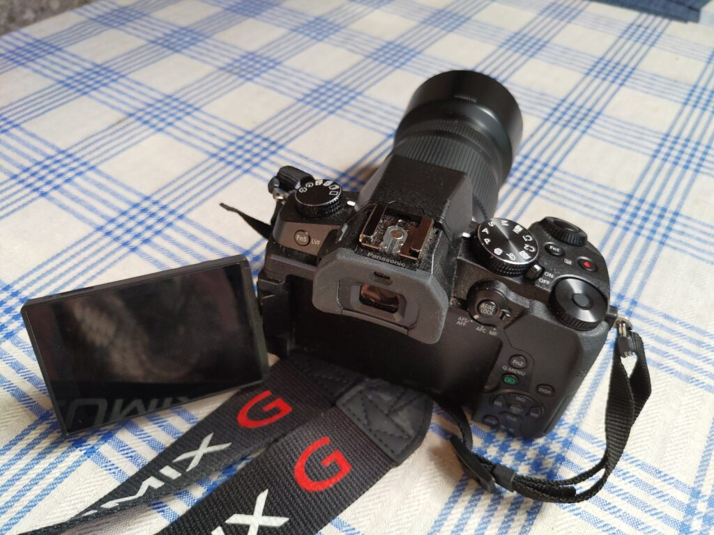
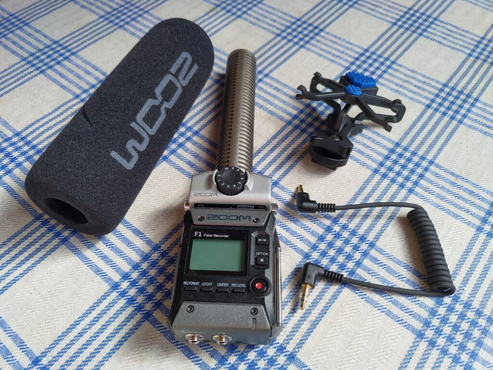
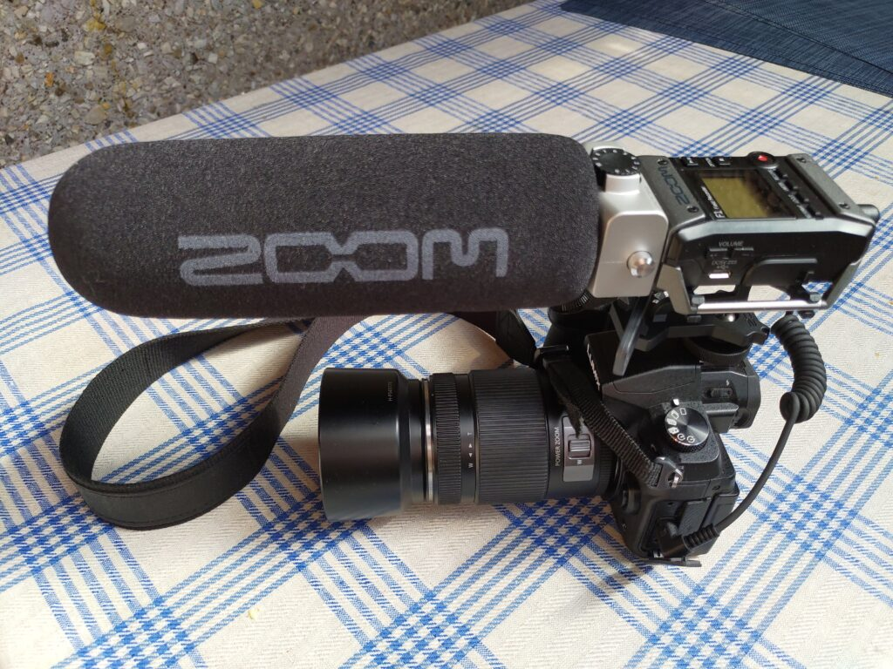
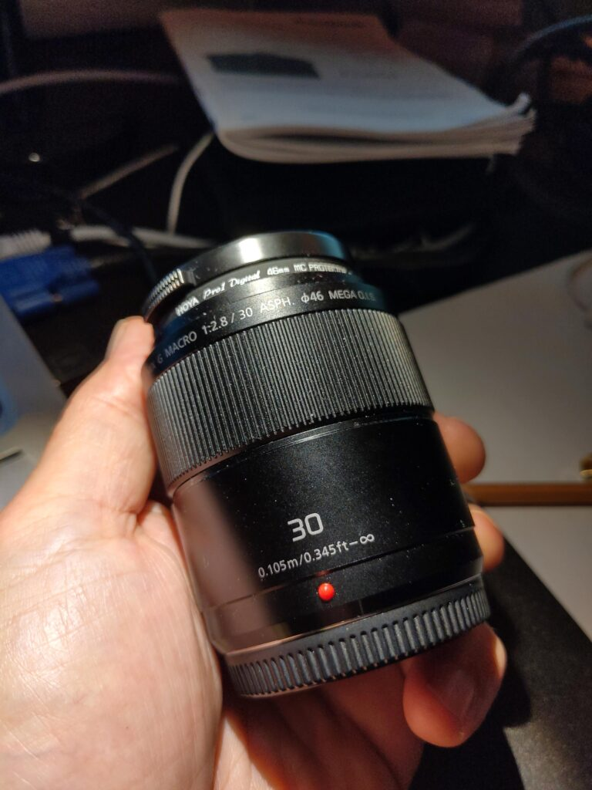

Olen alkanut valokuvata enemmän, ehkäpä lisääntyneen vapaa-ajan myötä. Kalustoa on päivitetty ja jonkin verran uuttakin hankittu. Edelleen pysyn tyytyväisenä MFT -järjestelmän parissa sen keveyden takia.

## Uusi runko - Panasonic Lumix DMC-G80

Keväällä päivitin vanhan DMC-G5 rungon uudempaan. Olisin pärjännyt vanhalla muuten vielä hyvin, mutta olin suunnitellut ruveta ottamaan videota laadukkaalla äänellä ja vanhaan G5 -runkoon ei voinut liittää ulkoista mikrofonia. Siispä hankin rungon, jossa on liitäntä mikrofonille. Varmaan siinä on paljon muutakin uutta, mutta tuo äänitysominaisuus oli avainasemassa. Vanha runko ei kelvannut enää vaihdossa valokuvausliikkeelle, mutta sain sen helposti kaupaksi yksityiselle.

<figure>

<figcaption>

Panasonic Lumix DMC-G80

</figcaption>

</figure>

[Lisätietoa Lumix G80 -kamerarungosta](https://www.panasonic.com/fi/consumer/kamerat-videokamerat/lumix-g-jarjestelmakamera/dmc-g80.html)

## Uusi äänityslaitteisto - Zoom F1-SP

Tutkailin pitkään erilaisia haulikkomikrofoneja, mutta päädyinkin sitten ostamaan kenttätallentimen haulikkomikrofonilla. Sen saa Lumixiin kiinni piuhalla, mutta se toimii myös sellaisenaan ilman kameraa. Voisin alkaa käyttää sitä siis myös yölaulajien kuunteluretkilläni kamerakäytön lisäksi. Hankinta meni tämän vuoden yölaulajien äänittämiseksi hieman myöhäiseksi, mutta ensi keväänä sitten siihen käyttöön. Saattaa toimia musajutuissanikin.

<figure>

<figcaption>

Zoom F1-SP

</figcaption>

</figure>

<figure>

<figcaption>

Zoom kiinni rungossa

</figcaption>

</figure>

[Lisätietoa Zoom F1-SP kenttätallentimesta](https://www.soundtools.fi/verkkokauppa/studiolaitteet/tallennuslaitteet/audiotallentimet/zoom-f1-sp-kenttatallennin-haulikkomikilla-info)

## Uusi makro-objektiivi - Lumix G 30mm

Lähikuvaukseen olin pitkään hankkimassa Olympuksen 60mm makroa, mutta saatavuusongelmat sekä muutaman tuotevertailuartikkelin ja [YouTube -arvostelun](https://youtu.be/LSb9oSeEGII) läpikäyminen saivat minut lopulta päätymään Panasonicin omaan Lumix G 30mm makroon (käytetty). Muutaman päivän sitä nyt käytettyäni olen tosi tyytyväinen. Mainio kuvan laatu ja se toimii myös ikäänkuin normaaliobjektiivina makron lisäksi (MFT 30mm on 60mm kinovastaavuus).

<figure>

<figcaption>

Lumix G 30mm makro

</figcaption>

</figure>

[Lisätietoja Lumix G 30mm -objektiivista](https://www.panasonic.com/fi/consumer/kamerat-videokamerat/objektiivit/h-hs030.html)
