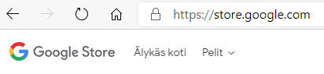
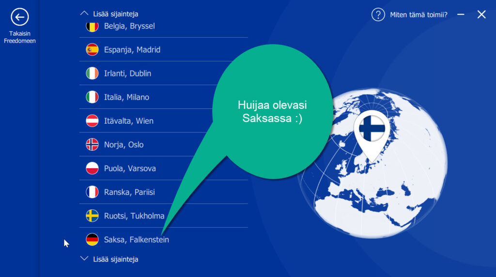
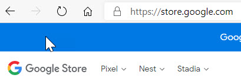

Oli aika hankkia uusi puhelin, kun vanhalla alkoi olla ikää kolmisen vuotta. Nokia 8.1 palveli aikansa tosi hyvin, mutta iän myötä lopulta sen näytön jatkuva hyytyminen alkoi olla liikaa sietokyvylle. Pitkään vertailin eri malleja, ja lopulta päädyin Google -puhelimeen, Pixel 4a. Siinä tuntui olevan kaikki kohdallaan, fyysinen koko, puhdas Android, [yleiset ominaisuudet](https://www.gsmarena.com/google_pixel_4a-10123.php) ja hinta. Vaan mistä sen saisi ostettua?

## Google Store

Suomessa näkyvässä Googlen kaupassa [https://store.google.com/](https://store.google.com/) ei puhelimia ole tarjolla.

Ulkomailla näkyvistä Google -kaupoista taasen ei postiteta Suomeen. En tiedä syytä, miksi eri maissa on eri tuotevalikoimat tarjolla, harmittava seikka näin kuluttajan kannalta.

Suomessa Pixel -puhelimia myy tietääkseni ainoastaan Verkkokauppa.com, ja sekään ei ostohetkellä edes tarjonnut valikoimissaan 4a:ta vaan sitä vanhempaa 3a:ta, hintaan 499€ , köh köh, se uudempi malli kun on Googlen omassa kaupassa hinnaltaan vain 340€. Kohtuullisen suolainen lisähinta, etten sanoisi. En halunnut vanhempaa mallia, enkä halunnut maksaa siitä aivan liikaa, joten oli keksittävä kiertotie.

## VPN avuksi - F-Secure Freedome

Jotta näkisi ulkomaisen Google Storen tuotevalikoiman, on tultava kauppaan ko. maan IP-osoitteella. Näin esimerkiksi Saksan Google Storeen on surffattava Saksasta, tai siis ainakin saksalaisesta IP-osoitteesta. Siinä auttaa tietenkin VPN -yhteys. Itselläni on F-Securen Freedome ollut vuosia käytössä, ja ei muuta kuin asetuksista Saksan Falkenstein päälle.

Näin VPN-ohjelmiston avulla surffaaminen onnistuu kuin olisi ko. maassa. Tämähän on siis aivan luvallista.

Ja kas, Google Storen tuotevalikoimakin muuttuu :)  
Sieltähän se Pixel 4a löytyy hintaan 340€ , vaan tosiaan, Google EI POSTITA SUUOMEEN!  
Tarvitaan apuja Saksasta.

## Postituspalvelu MyGermany.com

Saksasta löytyy erinäisiä palveluita, jotka ovat erikoistuneet postittamaan ostokset Suomeen niissä tilanteissa, jossa verkkokauppa itsessään ei postituspalvelua jostain syystä tarjoa. Yksi niistä on käyttämäni [https://mygermany.com/](https://mygermany.com/)  
Palvelun käyttöönotto oli helppoa ja sen idea on selostettu hyvin ko. palvelun sivustolla [https://mygermany.com/how-our-forwarding-process-works/](https://mygermany.com/how-our-forwarding-process-works/)  
Rekisteröityminen maksoi yhden euron, joka hyvitettiin ensimmäisen ostoksen postituksen yhteydessä. Rekisteröitymisen jälkeen saa "oman saksalaisen osoitteen", jonne verkkokaupan ostokset voi ohjata. Postituspalvelu lähettää ostokset sitten maksusta Suomeen.

Rekisteröitymisen jälkeen sitten vaan Google -kauppaan ja ostoksille.  
Kaikki sujui mainiosti ja alkuun ainakin osto ja sen postitus omaan saksalaiseen osoitteeseen näyttäisi onnistuvan.  
Odottavan aika on kuitenkin pitkä ja välillä meinasi usko loppua. Tätä odotusta voi vaikka seurata aiheen twiiteistäni täällä [https://twitter.com/stedi/status/1316069241641107456](https://twitter.com/stedi/status/1316069241641107456)

## Mitä tämä lysti maksaa?

Postituspalvelun hinta riippuu tietty lähetettävän paketin koosta ja mahdollisista lisäpalveluista. Oman tilaukseni loppuhinnaksi tuli:

Puhelin Pixel 4a **340,00 €**  
MyGermany postitus **40,50 €**  
Yhteensä **380,50 €**

Säästöä tuli n. 120 € esim. tuohon Verkkokauppa.com -hintaan 499 € verrattuna, ja vieläpä uudempi mallikin. Kokemuksesta tyytyväisenä ei varmaankaan jää viimeiseksi kerraksi tämän postituspalvelun käyttö.
