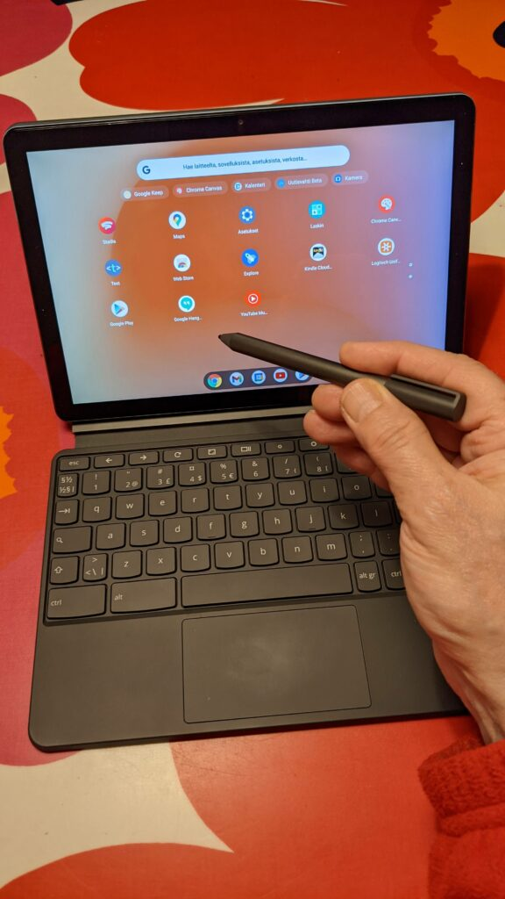

Hankin Toshiba Chromebook 2 -läppärin vuonna 2015 ja olen säännöllisesti käyttänyt sitä Windows läppärin rinnalla. Niillä molemmilla on useampi koulutus vuosien saatossa pidetty, hyvin ovat toimineet molemmat. Kurssimateriaalini ovat pääosin Google Driven tiedostoformaateissa, joten Chromebook on ollut niitä työstäessä luonteva peli. Nyt seitsemän vuoden jälkeen Toshibani käyttöjärjestelmän tuki päättyy syksyllä 2021, joten tuli aika pohtia jatkoa. Millä koneilla jatko?

## Lisää Chrome -laitteita

HP Probook -Windows koneeni on kolmisen vuotta vanha ja sillä pärjään edelleen hyvin kaikki työasiat. Rinnalle kaipasin kuitenkin uudempaa Chrome-laitetta, joten innostuin hankkimaan kokeeksi 2-in-1 -laitteen, 10.1 tuumaisen miniläppäri/tabletti [Lenovo IdeaPad Duet Chromebookin](https://www.lenovo.com/fi/fi/laptops/lenovo/student-chromebooks/Lenovo-CT-X636/p/ZZICZCTCT1X). Se on siis tabletti, johon kiinnittyy näppäimistö, jolla se muuttuu Chromebookiksi. Vanhaan Toshibaan ei koskaan tullut Google Play Storea, mutta tässä uudemmassa se on. Siihen siis saa asennettua Android -ohjelmia, joka monipuolistaa laitetta huomattavasti. Kosketusnäyttölaite kun se myös on, niin hommasin sille kaveriksi kynän [Lenovo USI Pen](https://www.lenovo.com/us/en/accessories-and-monitors/pens-and-supplies/pens/TAB-ACC-BO-Lenovo-USI-Pen/p/4X80Z49662). Alkukokemukset ovat positiivisia. Tämä on tietty kakkoslaite vapaa-aikaan, eikä korvaa Windows -läppäriä työasioissa pääosin kokonsa puolesta.

Tilauksessa on myös [Asus Chromebox 4](https://www.asus.com/Displays-Desktops/Mini-PCs/Chrome-OS-devices/ASUS-Chromebox-4/) -tietokone, josta on tarkoitus tulla pääasiallinen kotikoneeni. Tämän avulla aion hoitaa kotitoimistolta kaikki Google Meet -yhteyttä käyttävät koulutukset. Mielenkiintoinen lisäpiirre uudemmissa chrome -koneissa on mahdollisuus käyttää linuxia ja sen sovelluksia.

Uuden Chromebookin ostajan kannattaa tarkistaa hankittavan koneen päivitysasiat, etenkin tarjouksissa olevien vanhempien mallien päivitysstatus voi olla melko lyhyt, kun taas uusimmille luvataan **jopa 8+ vuoden käyttöjärjestelmäpäivitykset**. Googlekin itse kehottaa tukisivuillaan näin:

> Jokaiselle laitteella on automaattisten päivitysten päättymispäivä. Suosittelemme tarkistamaan laitteen automaattisten päivitysten päättymispäivän ennen ostamista.

[Lista eri valmistajien tuen päättymisestä tässä.](https://support.google.com/chrome/a/answer/6220366?p=auto-update-policy&visit_id=637579754135762700-2213931308&rd=1)

Windows -läppäri olkoon sitten matkatyökoneeni, sekakäyttäjänä siis jatketaan.

Vielä on edessä Ableton (Windows) -musiikkityöaseman uusiminen, se onkin sitten kokonaan toinen juttu.
