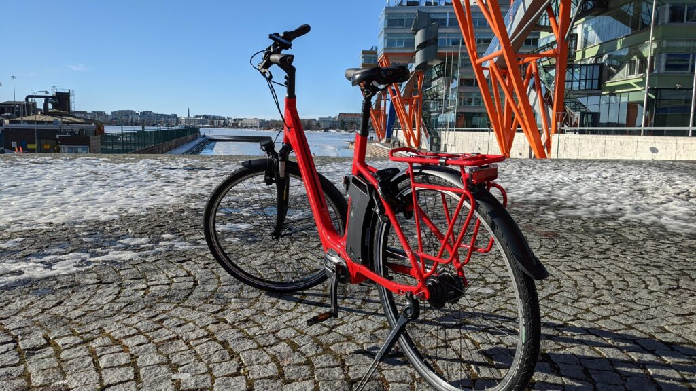
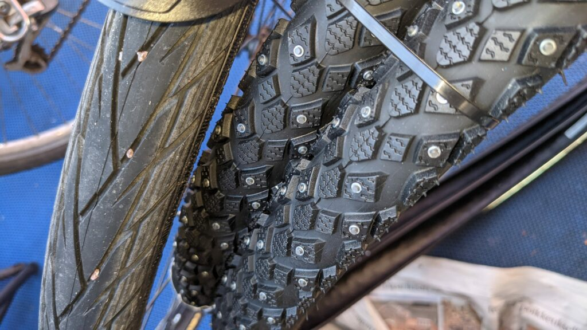

Olen siirtynyt sähköavusteisen polkupyöräilyn maailmaan. Hankin nyt kevättalvella 2021 saksalaisen Kalkhoff -merkkisen pyörän [Larunpyora.com](https://larunpyora.com/) -liikkeestä.

Hyvin on toki tavallinen polkupyöräkin minua palvellut, viimeisin Helkama Hybrid jo noin 30 vuotta. Pääosin itse huollettuna, isompia huoltoja on tehnyt paikallinen [Vuosaaren pyörähuolto](https://www.vuosaarenpyorahuolto.fi/).  
Pitkiä reissuja on sillä vuosien saatossa tullut tehtyä tavallisella vaihdepyörällä.

Sähköavusteinen polkupyörä tuo kuitenkin helppoutta ja mukavuutta ja ennen kaikkea mahdollistaa pidempien päiväretkien tekemisen. Ikäkin tuo omat mausteensa pyöräilyyn, sähköpyörällä varmistelen pyöräilyni jatkumisen eläkkeellä toivottavasti vielä pitkälle eteenpäin.

## Kalkhoff Agattu 1.S Advance

<figure>

<figcaption>

Kalkhoff Agattu 1.S Advance

</figcaption>

</figure>

Ostokriteereinä minulla oli muutama välttämätön ominaisuus: **iso akku** ja **rento ajoasento**.  
Ne tässä mallissa toteutuvat. Nyt 100 km koeajettuani, voi myös todeta, että tuo helppo pyörän selkään kipuaminenkin ja pysähtyminen mm. liikennevaloissa on mukavaa. Ei tässä iässä enää vetreydy, pikemminkin taantuu.

Kova innostus on myös kokeilla talvipyöräilyä. Hankinkin myös nastarenkaat ja selvä turvallisuusparannushan ne olivat.

<figure>

<figcaption>

Nastarenkaat

</figcaption>

</figure>

Helsingissä on muutama hyvin hoidettu, ns. harjasuolattu väylä. Niitä pitkin pärjää kyllä ilman nastojakin, mutta muualla on paljon jäisiä väyliä ja tavallinen rengas on liian haasteellinen.  
[Priorisoidun talvihoidon reitistö talvella 2020-2021](https://kartta.hel.fi/?link=83LGr6)

Lämpimiä kevätkelejä odotellessa :)
