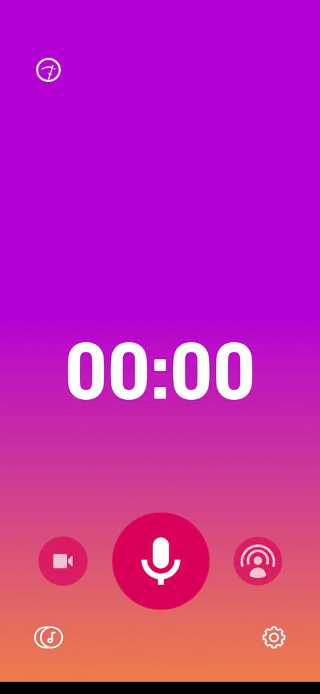

[Hankin aiemmin äänityslaitteen Zoom F1-SP](https://teuvovaisanen.fi/2020/08/09/paivityksia-valokuvausvalineistoon/) ja siihen pari mikrofonia, jotta retkeillessä saisi tallennettua laadukasta ääntä piuhan välityksellä järjestelmäkameran videoon. Aina ei tarvitse videota, niin Zoomia voi tietty käyttää itsenäisesti hyvälaatuisena äänityslaitteena.

Silloin tällöin on myös mukava livenä retkeltä saman tien julkaista ääninäytteitä esim. Twitteriin. Some-kanaviin julkaisu onnistuu tietty helpoiten retkellä puhelimesta, joten puhelimessa tulisi olla äänitysohjelma.

## Dolby On -sovellus

Viimeisin l[öytöni sovelluskaupasta](https://play.google.com/store/apps/details?id=com.dolby.dolby234) oli maksuton [**Dolby On** -äänitysohjelma](https://www.dolby.com/apps/dolby-on/). Se on yksinkertainen puhelimen sovellus, jolla äänitys ja äänen jälkikäsittely onnistuu todella helposti. Dolby On -ohjelmalla äänittäessä voi käyttää puhelimen omaa mikrofonia, tai sitten ulkoista mikrofonia, eli omassa tapauksessani liitän Zoomin piuhalla puhelimeen. Näin voin käyttää esim. haulikkomikrofonia puhelimella äänittäessä ja Zoom toimii ikään kuin esivahvistimena.

Sovellus on todella simppeli käyttää, mikä onkin maastossa tärkeää. Lähes kaikki on automatisoitu, äänentasosta lähtien.

Ja voi sillä ottaa äänen sijasta videotakin.

Tallennettaessa Dolby On tekee "kaiken" mahdollisen puolestasi. Normalisointi, de-esser, kohinanpoisto, fade-in, fade-out ym.

Ohjelmalla voi julkaista äänen/videon samantien mm. SoundCloudiin, Twitchiin, Youtubeen, Instagramiin ja Facebookiin tai tallentaa vain laitteen muistiin ja julkaista muuten. Twitteriin ei vielä tätä kirjoittaessani ole Androidilla mahdollista julkaista ääntä (iOS on), vaan äänestä täytyy ensin tehdä video ja sen voi sitten Androidillakin julkaista Twitterissä. Onneksi Dolby On tarjoaa simppelin visualisoinnin pelkälle äänelle kuten alla olevasta esimerkistä näkyy.

https://twitter.com/stedi/status/1392562755262197761

Kaiken kaikkiaan erinomainen pikku sovellus, suosittelen.
